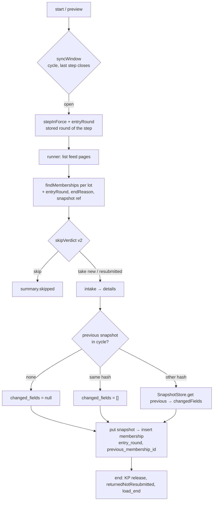

# Timeline sync at any step — Design

## 1. Document Control

| | |
|---|---|
| Spec path | `docs/specs/ingestion/timeline-sync` |
| Requirements | `requirements.md` (FR-1…FR-13, NFR-1…NFR-5), approved by the back lead on 2026-11-06 ("Continue") |
| Status | Approved by the back lead, 2026-11-06 (gated: requirements, design and tasks gates each answered "Continue") |
| Depth | Full |
| Verified at | `feat/ingestion-timeline-sync` @ `01a5404` (QA); `onecgiar_pr` @ `3f88c9c2b` (Reporting); read-only query on `qadb` (qatest), 2026-11-06 |
| Builds on | step-1 design `docs/specs/archive/2026-11-04-ingestion--step-1-loads/design.md` ("step-1 DD-n" below) |
| Last updated | 2026-11-06 |

## 2. Executive Summary

No new module, route or port. The change stays inside `ingestion` plus one rule in `admin-config/timelines`. It is driven by four things:

1. **Pure rules** in `load-rules.ts`:
   - `syncWindow` replaces `loadWindow`;
   - `stepInForce` and `entryRound`;
   - `skipVerdict` gains the round, the return rule and S-6;
   - `changedFields`;
   - the extended `LoadSummary`.
2. **Migration `0008`:**
   - the per-timeline unique key becomes per round;
   - `returned` joins `end_reason`;
   - loads get `round` and `step_position`;
   - memberships get `entry_round`, `previous_membership_id` and `changed_fields`.
3. **One new snapshot read** (`SnapshotStore.get`), only for a result whose hash changed since its previous snapshot in the cycle.
4. **One new store write**, `endAsReturned`, with no caller outside tests.

The database still carries the invariants:
- one running sync per cycle;
- one active membership per `(cycle, result_code)`;
- now one membership per `(timeline, result_code, entry_round)`.

## 3. Architecture Overview

Unchanged from step-1 § 3. The flow inside the existing boxes:



## 4. Extended Directory Structure

```text
server/
  drizzle/0008_timeline_sync_rounds.sql             new (generated)
  drizzle/rollback/0008_timeline_sync_rounds.down.sql  new (manual)
  src/database/drizzle/schema/timeline-results.ts   changed: entry_round, previous_membership_id, changed_fields, end_reason + returned, unique key
  src/database/drizzle/schema/timeline-loads.ts     changed: round, step_position
  src/database/drizzle/schema/schema.spec.ts        changed: pins of both tables
  src/admin-config/timelines/timeline-rules.ts      changed: round ≤ 2 (ROUND_ABOVE_MAX)
  src/common/error-codes.ts                         changed: FIELD_ERRORS.ROUND_ABOVE_MAX
  src/ingestion/load-rules.ts                       changed (see § 7.4)
  src/ingestion/loads.store.ts                      changed: findSteps (replaces findStepOne), findMemberships fields, insertMembership key, endAsReturned, countReturnedNotResubmitted
  src/ingestion/loads.unit-of-work.ts               changed: start (window, round), recordLot (counts, key)
  src/ingestion/load-runner.ts                      changed: verdict v2, previous snapshot, changed fields
  src/ingestion/loads.service.ts                    changed: preview (round, counts), reads
  src/ingestion/snapshot-store.port.ts, dynamo-snapshot-store.ts  changed: get(resultCode, sk)
  src/ingestion/models/load.model.ts, dto/          changed: round, stepPosition, summary keys
  test/support/in-memory-loads.ts                   changed: same keys and methods
docs/specs/ingestion/timeline-sync/front-contract.md  new (supersedes the step-1 copy)
server/src/ingestion/AGENTS.md, server/src/database/AGENTS.md, docs/prd.md  changed
```

## 5. Data Model

### 5.1 `timeline_results` (migration `0008`)

| Change | Column / key | Rule |
|---|---|---|
| Add | `entry_round` tinyint unsigned NOT NULL DEFAULT 1, CHECK `entry_round IN (1, 2)` | The sync's round (FR-2). Existing rows get 1 |
| Drop | unique `uq_timeline_results_timeline_code (timeline_id, result_code)` | Step-1 DD-3, superseded by DD-2 here |
| Add | unique `uq_timeline_results_timeline_code_round (timeline_id, result_code, entry_round)` | FR-5, AC12. It also serves the `(timeline_id, …)` lookups the dropped key served |
| Modify | `end_reason` enum + `returned` | FR-6. `released_not_qaed` stays, reserved (S-7). Additive `MODIFY`, so existing values keep |
| Add | `previous_membership_id` bigint unsigned NULL, FK → `timeline_results.id` | The membership whose snapshot this one was compared with. NULL = no earlier snapshot in the cycle |
| Add | `changed_fields` json NULL, CHECK `changed_fields IS NULL OR JSON_LENGTH(changed_fields) <= 256` | FR-8. NULL ⇔ `previous_membership_id` NULL. `[]` = same values. A JSON array of catalog keys (≤ 64 chars each) |
| Keep | `active_key` and its unique index; `idx_timeline_results_result_code` | Unchanged |

Bound of `changed_fields` (NFR-3): at most 256 keys × 66 bytes ≈ 17 KB per row. **The 256 is a ceiling, not the measured count:** T-1 measures the largest top-level key count of any catalog type (P-9) and lowers the CHECK to it plus a margin, recorded in `execution.md`.

Only one update is allowed on a row: ending it (`ended_at`, `end_reason`). `endAsReturned` is that update, restricted to `entry_round = 1 AND ended_at IS NULL`.

### 5.2 `timeline_loads` (migration `0008`)

| Change | Column | Rule |
|---|---|---|
| Add | `round` tinyint unsigned NOT NULL DEFAULT 1, CHECK `round IN (1, 2)` | FR-2, read at start |
| Add | `step_position` tinyint unsigned NOT NULL DEFAULT 1, CHECK `step_position BETWEEN 1 AND 5` | FR-2 |
| Meaning change | `timeline_step_id` | The step in force at start (was step 1). Existing rows already point to step 1, which matches `step_position = 1` |

### 5.3 `LoadSummary` (JSON in `timeline_loads.summary`)

| Key | Status | Merge |
|---|---|---|
| `loaded`, `byProgram`, `byType`, `kpGroups`, `skipped`, `otherTimelines` | Kept | As today |
| `loadedNew`, `loadedResubmitted` | New, numbers | Sum. `loaded = loadedNew + loadedResubmitted` holds per lot, so it holds after any merge order |
| `round` | New, `1 \| 2` | Equal on both sides by construction (one load = one round). The merge keeps the left value. A mismatch is a programming error: it throws, and a test pins it |
| `returnedNotResubmitted` | New, `{total, byProgram, byType}` | **Not merged per lot.** Written once at the end of the run from one query (§ 7.3), because a returned result the feed no longer lists is in no lot. Lots carry `{0, {}, {}}` |

A stored summary from before `0008` lacks the new keys. The existing `storedSummary` reader fills them: `loadedNew = loaded`, `loadedResubmitted = 0`, `round = 1`, `returnedNotResubmitted = {0, {}, {}}`.

### 5.4 DynamoDB `ResultSnapshot`

The key and the attributes are unchanged. A round-2 entry is a new item, because the sk carries `load_id` (step-1 § 5.4). The port gains `get(resultCode, sk) → record | null`, which is one GetItem.

### 5.5 `timeline_audit_events`

No schema change. `load_start.changes.load.after` gains `round` and `stepPosition`. `load_end.changes.load.after` gains `round`, `loadedNew` and `loadedResubmitted`. This is additive inside the JSON (FR-11).

## 6. API Design

The same 4 routes, `ADMIN_ACCESS`. Additive fields only:

| Route | Adds |
|---|---|
| `GET /timelines/:id/loads/preview` | `round`, `stepPosition`. `toLoad.new`, `toLoad.resubmitted`. `returnedNotResubmitted {total, byProgram[{programId, code?, count}], byResultType[{key, count}]}`. `window` follows FR-1 |
| `POST /timelines/:id/loads` | Unchanged (202 `{id, status}`). The 409s are unchanged: `CYCLES_CLOSED`, `LOADS_WINDOW_CLOSED`, `LOADS_ALREADY_RUNNING`, `LOADS_CATALOG_MISSING` |
| `GET /timelines/:id/loads` | Each item gets `round` and `stepPosition` |
| `GET /timelines/:id/loads/:loadId` | The item fields plus the summary's new keys |
| Skip reasons (preview and summary) | + `RETURNED_NOT_RESUBMITTED` |
| Timeline create (admin-config) | A new field issue code `ROUND_ABOVE_MAX` on `steps[n].round` (400 `VALIDATION`, all errors at once). The edit is unchanged: `round` is not editable (400 `UNKNOWN_FIELD`; amended 2026-11-06) |

Changed fields are **not** exposed by any route in this spec. They are stored for the results list of the worklist / assessment spec. The front contract documents the column, so Yeck can plan the "Updated" tag.

## 7. Backend Module Design

### 7.1 Window and round at start (`LoadsUnitOfWork.start`)

1. Lock order is unchanged: the cycle `FOR SHARE`, then the timeline `FOR UPDATE`.
2. `findSteps(timelineId)` replaces `findStepOne` and returns every step (`id`, `position`, `opensAt`, `closesAt`, `round`), ordered by position. These are read **under the timeline lock**, so a concurrent edit cannot change them between the judgment and the insert (the edit takes the same lock; step-1 DD-7).
3. `syncWindow(cycle.status, lastStep.closesAt, now)` gives `open`, `CYCLES_CLOSED` or `LOADS_WINDOW_CLOSED`. The closed cycle is checked first.
4. `stepInForce(steps, now)`: the last step whose `opensAt ≤ now`, or step 1 when none has opened. `entryRound` is that step's stored `round`. The load is inserted with `timeline_step_id`, `round` and `step_position`.
5. The rest is unchanged: abandoning a stale load, the `running_key`, the version bump, `load_start` (now with `round`), and idempotency.

The preview runs the same three functions without a lock (it writes nothing).

### 7.2 Membership read (`LoadsStore.findMemberships`)

The same query, plus these columns on each row:
- `entryRound`, `endReason`;
- `programClarisaId`, `resultTypeKey`, `kpGroup`;
- `snapshotSk`, `snapshotHash`.

The step query is unchanged (the last step per timeline). This is still one query plus one step query per lot, chunked by 500 (NFR-2).

### 7.3 Run (`LoadRunner`), per lot

1. **End expired** (step-1 DD-5): unchanged. It only ends **active** rows; `returned` rows are already ended.
2. **Verdict**: `skipVerdict` v2 (§ 7.4) for each listed item, with the load's `round`, the feed's `submittedAt`, and the code's memberships. The output is a skip `{reason, timelineId?}`, or a take `{kind: 'new' | 'resubmitted', previous: row | null}`:
   - `previous` is the cycle's latest membership of the code (highest `id`, any timeline, any state);
   - for `resubmitted`, it is the returned round-1 row here.
3. **Intake → details**: unchanged, for takes only.
4. **Classify**:
   - `new` → the KP classifier, as in step 1;
   - `resubmitted`, type unchanged → `{status: 'pending', kpGroup: previous.kpGroup}`, with no classifier (S-9 a). Never released by the KP release, because its status is `pending`;
   - `resubmitted`, type changed from KP → `{status: 'pending', kpGroup: null}` (S-9 b);
   - `resubmitted`, type changed to KP → the KP classifier, as for `new` (S-9 c); released like a new KP.
   The type change is `previous.resultTypeKey !== result.resultTypeKey` (amended 2026-11-09, back lead).
5. **Changed fields**:
   - `previous` is null → `previousMembershipId = null`, `changedFields = null`;
   - same hash → `[]`, no read;
   - type changed (`previous.resultTypeKey !== result.resultTypeKey`) → `['result_type_key']`, no read: two types' keys would overflow the `0008` CHECK (≤ 96), and the round-1 row keeps the old type (amended 2026-11-09, back lead);
   - otherwise → `SnapshotStore.get(code, previous.snapshotSk)`, then `changedFields(previousValues, values)`. A missing previous item, which is an orphan case that should not happen, is `INTERNAL` for the lot; there is no silent null.

   The get calls share the existing snapshot parallelism (10) and retries (step-1 DD-8).
6. **Snapshots → memberships**: the order is unchanged (step-1 DD-4). Each membership carries `entryRound = load.round`, `previousMembershipId` and `changedFields`. A duplicate on either unique key (`uq_timeline_results_timeline_code_round` or `active_key`; MySQL may name either one) is classified by reading the code's memberships: one in this timeline, active or entered in this sync's round → the skip `ALREADY_IN_THIS_TIMELINE`; otherwise `ACTIVE_IN_OTHER_TIMELINE` (amended 2026-11-09, back lead, T-4 gate). The key names live in `loads.store.ts`. The lot summary counts `loadedNew` / `loadedResubmitted` from each take's kind.
7. **End of run** (completed or failed alike, before `load_end`): one `countReturnedNotResubmitted(timelineId)` query. It counts round-1 rows here with `end_reason = 'returned'` and no round-2 row for the same code here, grouped by program and type. The result is written into the summary.

### 7.4 Pure rules (`load-rules.ts`)

| Rule | Input → output | Replaces |
|---|---|---|
| `syncWindow` | `(cycleStatus, lastStepClosesAt, now)` → `open \| CYCLES_CLOSED \| LOADS_WINDOW_CLOSED`; the closing minute is open | `loadWindow` (removed, see § 10 reversion challenge) |
| `stepInForce` | `(steps, now)` → the step; step 1 before any opens | — |
| `entryRound` | `(steps, now)` → `1 \| 2` = `stepInForce(...).round`; throws on a stored round outside 1–2 (impossible after T-2's edit rule and P-7) | — |
| `skipVerdict` v2 | `(round, timelineId, now, submittedAt, memberships, duplicated)` → skip or take, in FR-4 order | `skipVerdict` |
| `isResubmitted` | `(submittedAt ISO \| null, endedAt Date)` → `submittedAt !== null && floorSeconds(submittedAt) > floorSeconds(endedAt)` | — |
| `changedFields` | `(previous values, current values)` → sorted keys whose canonical JSON differs, over the union of keys (a key only on one side counts) | — |
| `mergeSummary` | Associative merge per § 5.3 | extended |

`canonicalJson` moves from `load-runner.ts` to `load-rules.ts`, so the hash and `changedFields` share one canonical form (FR-8 "AND IT MUST").

### 7.5 `endAsReturned` (`LoadsStore`)

The conditional update is `SET ended_at = :at, end_reason = 'returned' WHERE id = :id AND entry_round = 1 AND ended_at IS NULL`. It returns `{ended: true}` or `{ended: false, reason: 'not_found' | 'already_ended' | 'not_round_1'}`, the reason coming from a read after a zero-row update. It is exported on the port only. No controller, no job, and no unit-of-work command call it. The in-memory store implements it the same way, for the runner suites.

### 7.6 Round limit (`timeline-rules.ts`)

The new check sits beside `ROUND_SEQUENCE`: `step.round > MAX_ROUND (2)` → issue `{field: 'steps[n].round', code: 'ROUND_ABOVE_MAX'}`. Both checks can fire on the same step; each is reported. `MAX_ROUND` is exported from `timeline-rules.ts`, the admin-config side, and `load-rules.ts` imports it. That keeps the dependency direction of step-1 DD-9 (ingestion may import admin-config, never the reverse).

### 7.7 Logs

The runner's existing lines (`lot`, `completed`, `failed`) gain `round` (a number). The service lines (`preview`, `start`, `list`, `get`) stay as they are: the privacy suite pins them (FR-12) (amended 2026-11-09, back lead). There are no new fields with content. Changed fields are never logged (NFR-4).

## 8. Frontend / UX Component Architecture

None in this spec. `front-contract.md` (new, in this folder) supersedes the step-1 copy. It gives Yeck:
- the round fields and the new summary keys;
- `RETURNED_NOT_RESUBMITTED` and `returned`;
- `ROUND_ABOVE_MAX`;
- the window rule;
- the stored-but-not-exposed changed fields.

The front consumers that must follow are `client/src/app/core/api/loads.models.ts`, `load-drawer.ts`, `load-summary-drawer.ts`, `load.copy.ts`, `cycle.logic.ts` and `core/http/api-envelope.ts` (P-12, P-13). They are Yeck's.

## 9. Shared Contracts or Package Extensions

- **Reporting**: no contract change. The rules read `submitted_at` as Reporting computes it (P-1).
- **Env vars**: none.
- **TRD**: no ADR change beyond the step-1 pending P9 (`trd-adr`). That pending item already describes the MySQL run record. This spec adds nothing to it.

## 10. Design Decisions

| ID | Decision | Alternatives rejected | Consequence | Requirements |
|---|---|---|---|---|
| DD-1 | The round is the stored `round` of the step in force, read under the timeline lock at start (Q-1 = B) | Position rule (step ≥ 3); capped stored round | The sync agrees with the editor's "QA round N". Same result on every timeline today (P-7) | FR-2 |
| DD-2 | Unique `(timeline_id, result_code, entry_round)` replaces `(timeline_id, result_code)`; `active_key` kept | Active-only uniqueness (step-1 DD-3's fallback) | AC12 lives in the database. At most 2 rows per result per timeline | FR-5, NFR-1 |
| DD-3 | A `returned` row in another timeline blocks while that timeline's last step has not closed (Q-2) | Only active rows block | The result can come back only where it was returned, until that timeline ends. Reuses `ACTIVE_IN_OTHER_TIMELINE` and `otherTimelines`, so no new front copy is needed | FR-4 |
| DD-4 | A re-submitted result of the same type skips the KP classifier and keeps its round-1 `kp_group`; a type change away from KP clears the group; a type change to KP is classified as new (S-9, accepted by the back lead 2026-11-09; Angel to ratify) | Re-classify | A KP returned for review is never auto-released in round 2. If Angel says re-classify, only step 4 of § 7.3 changes | FR-7 |
| DD-5 | Changed fields are stored in MySQL (`changed_fields`, `previous_membership_id`); the hash short-cut avoids most reads | A DynamoDB attribute; recomputing on read | The "Updated" tag needs no DynamoDB read. One GetItem per changed re-entry (NFR-2) | FR-8, NFR-2, NFR-3 |
| DD-6 | `previous` = the cycle's latest membership of the code, any timeline | Only this timeline | A result that moved from a closed timeline A to B also shows what changed. FR-8 says "in the same cycle" | FR-8 |
| DD-7 | `returnedNotResubmitted` is computed once at the end from QA's own rows, not merged per lot | Count in lots | A result the program unsubmitted is not in any lot, but is still counted. One query per sync | FR-9 |
| DD-8 | The time comparison floors both sides to whole seconds, strict `>` | Millisecond compare; a tolerance window | Reporting's epoch is whole seconds (P-1). A tie counts as not resubmitted. Skew is an accepted risk (requirements § 7) | FR-4 |
| DD-9 | `MAX_ROUND` lives in admin-config; ingestion imports it | Ingestion owns it | Keeps step-1 DD-9's dependency direction | FR-3 |
| DD-10 | `endAsReturned` is a store method only, conditional and idempotent | A route; a unit-of-work command | The future assessment flow wraps it in its own transaction with the Reporting release | FR-6 |

**Reversion challenge (Step 2.3), run inline by the Leader; Lite skip does not apply.**
- **DD-2 removes step-1 DD-3's key.** *What does removing it break?*
  1. The race mapping in `recordLot` names the key `timeline_code`. It is renamed with the key (T-3), or a duplicate becomes a 500. Covered by the `loads.unit-of-work.spec.ts` duplicate cases (P-11).
  2. G-2, a lost commit acknowledgement retried in the same round, still hits the new key, because a retry is the same load and so the same round. The skip mapping still holds; G-2's effect is unchanged, not worse.
  3. "Has a load" (`DrizzleTimelineLoads`) counts rows. More rows change nothing (P-10).
  4. A rollback after two rounds cannot recreate the old key. The down script refuses (NFR-5).

  No unaddressed breakage.
- **`loadWindow` → `syncWindow` widens the window.** *What breaks?*
  - The tests that pin "closed after step 1" (P-12) change on purpose (T-4).
  - The front reads only `window` and `LOADS_WINDOW_CLOSED`. It keeps working, and the drawer simply enables the button longer.
  - **One gap:** `cycle.logic.ts` may disable the load action after step 1 on its own (P-13, `UNVERIFIED`). If so, the server allows a sync the front hides. That is not a server breakage; it goes to Yeck through the contract.

### Budget (Step 2.4)

| Measure | Estimate |
|---|---|
| Tasks | 8 (+ 1 HITL) |
| Production LOC | ≈ 1,000 (rules 180, migration and schema 120, store 180, unit of work 120, runner 220, service and models 120, admin-config rule 30, snapshot port 30). Step-1 ran × 1.9 on its first estimate; this one is sized from the code paths already read |
| Test LOC | ≈ 3,500. Boundary table of `entryRound` × 3 timeline shapes; verdict table (6 FR-4 cases × rounds × S-6); summary property test; unit-of-work key cases; runner re-entry flows; e2e. Sized from the gates, per KZ-auth--user-management--core-2 (P4, High) |
| Review rounds | ≈ 12 (1 per task, + 1 for the runner, the migration and the e2e) |

This fits Full depth. It is above 900 LOC, so: **one spec, 3 PRs** (proposal § 11).

## 11. Premise Ledger

Count: 11 verified, 3 `UNVERIFIED` (High 1: P-8; Low 2: P-9, P-13).

Blast-radius triggers:
- `live-path`: the ADMIN sync reaches `LoadsUnitOfWork.start` and the runner (P-14).
- `shared-state`: `timeline_steps.round` is read by the edit, the front editor and now the sync (P-6, P-7).
- `consumer`: the summary JSON, the skip-reason set, the `end_reason` enum, `FIELD_ERRORS` and the unique key's name all change (P-11, P-12, P-13).

| # | Claim | Class | Citation (as run) | Verified at | If false | Settled by |
|---|---|---|---|---|---|---|
| P-1 | Reporting's `submitted_at` is the latest active submit, in whole seconds | data-env | `onecgiar_pr` `onecgiar-pr-server/src/api/qa-catalog/qa-results.repository.ts:122-125` (`UNIX_TIMESTAMP(MAX(s.created_date)) … is_active = 1 AND s.status = 1`), `:141-144` (epoch × 1000 → ISO) | `3f88c9c2b` | Re-entry never fires (DD-8, FR-4). High → verified | — |
| P-2 | The feed lists only Submitted results, whatever their `in_qa` | data-env | same file `:293` (`r.status_id = ${SUBMITTED_STATUS_ID}`); `buildEligibility` has no `in_qa` clause (`:280-300`) | `3f88c9c2b` | `RETURNED_NOT_RESUBMITTED` as a skip would never appear (FR-9). Low | — |
| P-3 | A `not_qaed` release writes only `in_qa`; `qaed` moves the result to Quality Assessed | data-env | `onecgiar_pr` `qa-intake.service.ts:63` ("Writes only `result.in_qa`"); `qa-intake.repository.ts:8` | `3f88c9c2b` | "QAed never re-enters" (FR-4: a QAed result is not listed) would need a QA-side rule. Low | — |
| P-4 | Today a membership is unique per `(timeline, result_code)` and the race maps that key by name | location | `server/src/database/drizzle/schema/timeline-results.ts:99`; `loads.store.ts:41` (`RESULTS_TIMELINE_CODE_KEY`); `loads.unit-of-work.ts:480-486` | `01a5404` | DD-2 shape. High → verified | — |
| P-5 | The start reads only step 1 for the window, under the timeline lock | location | `loads.unit-of-work.ts:300-312` (`findStepOne` after `findTimelineForUpdate`) | `01a5404` | § 7.1. Low | — |
| P-6 | Steps store `round` (≥ 1, contiguous), and the edit checks only the sequence | location | `schema/timeline-steps.ts:60,73`; `admin-config/timelines/timeline-rules.ts:137-141` | `01a5404` | DD-1, DD-9. Low | — |
| P-7 | Every stored step round on qatest is 1 or 2; round 2 starts at step 3 everywhere | data-env | Read-only `mysql2` query on `qadb`, 2026-11-06: `SELECT MAX(round), COUNT(*) FROM timeline_steps` → `2, 144`; per-timeline `position:round:requires_load` → `1:1:1,2:1:0,3:2:1,…` on every 5-step timeline (30 timelines) | qatest data | `entryRound` would throw for a stored 3 (§ 7.4). Low | — (PROD has no timelines yet: same check before the PROD deploy, T-HITL) |
| P-8 | `ended_at` written by QA and read back as a `Date` is the true instant: the pool sets no `timezone`, so mysql2 uses the process's local zone for both directions, and every QA process runs in the same zone | data-env | `server/src/database/drizzle/drizzle.module.ts:18-21` (`createPool({uri, connectionLimit})`, no `timezone`). Same-zone hosts: `UNVERIFIED — confirm at source before relying on it` | `01a5404` | A host in another zone shifts `ended_at` by hours, and the re-entry rule misjudges every return. **High** | Infrastructure (Cris), at the T-HITL: `TZ` of every QA server process; the T-5 test pins a non-UTC process zone |
| P-9 | The largest catalog type has well under 256 top-level keys | data-env | Verified in T-1 (2026-11-06): `server/src/admin-config/field-config/fixtures/reporting-qa-catalog-2026.json` (catalog 2026.30, a snapshot of the Reporting catalog), applicable `fields[]` per type → max 70 (`innovation_use`, `innovation_development`) → CHECK `JSON_LENGTH(changed_fields) <= 96` | 2026.30 | The CHECK on `changed_fields` (§ 5.1) is set too low and a lot fails. Low | T-1, first step: count keys per type from the field-config catalog |
| P-10 | "Has a load" counts rows and completed or running loads, not one row per result | location | `load-rules.ts:152-162` (`timelineHasLoad`); step-1 design § 7.6 | `01a5404` | Reversion challenge item 3. Low | — |
| P-11 | `consumer`: readers of the unique key name and `end_reason` values | consumer | `git grep -l "uq_timeline_results_timeline_code\|RESULTS_TIMELINE_CODE_KEY\|'timeline_code'" -- server/src server/test client/src` → `schema.spec.ts` (`:1888`, `:1907`, `:2001`), `timeline-results.ts`, `loads.store.ts`, `loads.unit-of-work.ts`, `loads.unit-of-work.spec.ts`, `test/support/in-memory-loads.ts`. `git grep -l "timelineResultEndReasons\|released_not_qaed" -- server/src server/test client/src` → `schema.spec.ts`, `timeline-results.ts`. No client hit | `01a5404` | T-1, T-3 Consumers | — |
| P-12 | `consumer`: readers of the window, the skip reasons and the summary | consumer | `git grep -l "loadWindow\|LOADS_WINDOW_CLOSED" -- server/src server/test client/src` → server: `error-codes.ts`, `error-codes.spec.ts`, `load-rules.ts`, `load-rules.spec.ts`, `loads.controller.ts`, `loads.errors.ts`, `loads.service.ts`, `loads.service.spec.ts`, `loads.unit-of-work.ts`, `loads.unit-of-work.spec.ts`, `test/ingestion-loads.e2e-spec.ts`, `test/ingestion-loads-privacy.e2e-spec.ts`; client: `core/api/loads-api.spec.ts`, `core/api/loads.models.ts`, `pages/workspace/cycle/cycle.logic.ts`. `git grep -l "skipVerdict\|SkipReason\|ALREADY_IN_THIS_TIMELINE" …` and `"LoadSummary\|mergeSummary\|otherTimelines"` → server `load-rules*`, `load-runner*`, `loads.service*`, `loads.unit-of-work*`, `loads.store.ts`, `models/load.model.ts`, `test/ingestion-loads.e2e-spec.ts`; client `loads.models.ts`, `load.copy.ts`, `cycle-view.ts`, `load-drawer.ts`, `load-summary-drawer.ts` | `01a5404` | T-3…T-6 Consumers; the client files go to Yeck through the contract | — |
| P-13 | `consumer`: the front decides "can load" from the server's `window` only, not from step 1's dates | consumer | `client/src/app/pages/workspace/cycle/cycle.logic.ts` names `LOADS_WINDOW_CLOSED` (P-12); whether it also gates on step 1 is `UNVERIFIED — confirm at source before relying on it` | — | The front hides a sync the server allows. Low (server unaffected) | T-7: read `cycle.logic.ts` and state the finding in the front contract for Yeck |
| P-14 | `live-path`: the ADMIN's sync reaches the changed code: `POST /timelines/:id/loads` → `LoadsController` (`ADMIN_ACCESS`) → `LoadsService.start` → `LoadsUnitOfWork.start` → after commit `LoadRunner.run` | live-path | `server/src/ingestion/AGENTS.md` (Files: controller → service → runner); `loads.service.ts` start → unit of work (`:376-…`); the runner fired after commit (step-1 § 7.2.3) | `01a5404` | — | — |

Notes:
- **P-7 was a read-only `SELECT`** run from a scratchpad script outside the repo. No write, no credentials printed.
- **P-11 and P-12 were searched with `git grep`** over `server/src server/test client/src`.
