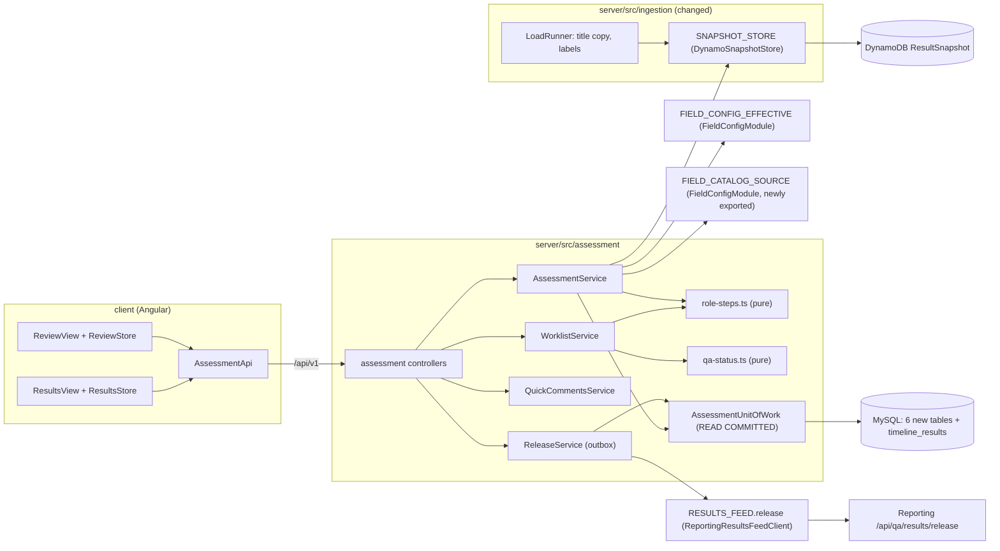

# Step 1 assessment: worklist and field-by-field review — Design

## 1. Document Control

| Spec path | Requirements | Status | Last updated |
|---|---|---|---|
| docs/specs/assessment/step-1-assessment | `requirements.md` (FR-1…FR-25, NFR-1…NFR-8) | Draft (Phase 2) | 2026-11-10 |

| | |
|---|---|
| Depth | Full |
| Verified at | `20696f9` (`staging-center`, branch `feat/assessment-step-1`) |
| Exploration | Two read-only scouts (server, client). Their citations were spot-checked inline (`load-runner.ts:606-615`, `loads.store.ts:708-722`, `load-runner.ts:114-119`) |
| Skills | `nestjs-expert`, `nestjs-best-practices`, `api-design-principles`, `error-handling-patterns`, `aws-serverless`, `angular-developer`, `tailwind-design-system`, `software-architect` (this design), `diagram-design` (§ 3) |
| Kaizen lessons applied | KZ-ingestion--step-1-loads-1 (OQ defaults block their tasks, DD-15) · KZ-ingestion--timeline-sync-1 (keys from the real writer, DD-7) · KZ-ingestion--timeline-sync-2 (a task that changes behavior owns the tests pinning it, DD-12) · KZ-admin-config--cycle-timelines-3 (no credentials through chat at the live checks, DD-16) |

## 2. Executive Summary

A new NestJS module `server/src/assessment/` owns six new tables, created by migration `0009_assessment`, and twelve routes. The module reads the existing data directly instead of importing other modules: memberships, timelines, steps and assignments from MySQL, snapshots from DynamoDB, the effective field configuration through `FIELD_CONFIG_EFFECTIVE`, and the catalog through `FIELD_CATALOG_SOURCE`. This is the same pattern `DrizzleTimelineLoads` uses (P-13), and ingestion already binds its own copies of what it needs in the same way (P-24).

- **Data as configuration.** A pure **role-step table** decides who sees what, and a pure **status table** decides the QA status. Both can be tested in isolation.
- **Writes.** Each write runs in one READ COMMITTED transaction. It takes the timeline row `FOR SHARE`, then the assessment row `FOR UPDATE`. An end and its release row commit together.
- **Release to Reporting.** A small outbox (`assessment_releases`) sends it after commit. It retries with leases and counts Reporting's `not_in_qa` answer as "already released" (P-4).
- **Ingestion changes.** Ingestion gains optional `labels` (stored outside the hash), a `title` copy, and the end-of-load count inside its transaction.
- **Client.** The client keeps Juanpa's components and view models. It replaces only the data source (mock → API) behind new stores and mappers, and hides the AI parts.

## 3. Architecture Overview



Legend: boxes are classes or modules, cylinders are stores, and the arrows show call direction. No module imports `IngestionModule` (DD-1).

## 4. Extended Directory Structure

```text
server/
  drizzle/0009_assessment.sql (+ meta/0009_snapshot.json, _journal.json)   new
  drizzle/rollback/0009_assessment.down.sql                                 new
  src/database/drizzle/schema/
    result-assessments.ts · assessment-field-validations.ts · assessment-comments.ts
    comment-events.ts · quick-comments.ts · assessment-audit-events.ts · assessment-releases.ts   new
    timeline-results.ts       changed: + title (DD-9)
    index.ts, schema.spec.ts  changed
  src/database/dynamodb/entities/result-snapshot.entity.ts   changed: + labels, labelsGz
  src/assessment/                                             new module
    AGENTS.md · assessment.module.ts · assessment.clock.ts (re-binds ADMIN_CONFIG_CLOCK)
    role-steps.ts · qa-status.ts · comment-transitions.ts · assessment-rules.ts   (pure)
    scope.ts                      (pure: the user's reviewer rows → SQL-ready scope)
    worklist.controller.ts · worklist.service.ts · worklist.store.ts · worklist-cursor.ts
    assessment.controller.ts · assessment.service.ts · assessment-view.ts (pure: catalog + config + snapshot → sections)
    assessment.store.ts · assessment.unit-of-work.ts
    quick-comments.controller.ts · quick-comments.service.ts
    releases.controller.ts · release.service.ts · release.store.ts
    title-backfill.ts
    assessment.errors.ts · dto/ · models/
  src/ingestion/
    results-feed.port.ts, reporting-results-feed.client.ts   changed: optional labels (DD-6)
    snapshot-store.port.ts, dynamo-snapshot-store.ts          changed: labels outside hash
    load-runner.ts                                             changed: title copy, labels, count in end tx
    loads.unit-of-work.ts, loads.store.ts                      changed: end() counts inside its tx; + endAsReleasedQaed
    fixtures/results-details.json                              changed: synthetic labels
  src/admin-config/field-config/field-config.module.ts         changed: also exports FIELD_CATALOG_SOURCE
  src/common/error-codes.ts                                    changed: 8 ASSESSMENT_* codes
  test/assessment-*.e2e-spec.ts, test/support/in-memory-assessment.ts   new
client/src/app/
  core/api/assessment-api.ts · assessment.models.ts             new
  shell/workspace-layout.ts                                     new (DD-14)
  shell/qa-shell.ts                                             changed: reads WorkspaceLayout (DD-14)
  pages/workspace/results/results-store.ts · results.mapper.ts · results-view.* · results-table.ts   new / changed
  pages/workspace/review/review-store.ts · review.mapper.ts · review-view.* · review-comments-drawer.ts · review-aside.*   new / changed
  (results.mock.ts and review.mock.ts stay: Overview and Notifications read results.mock.ts, P-26)
```

## 5. Data Model

Migration `0009_assessment` (generated by `pnpm db:generate`; a human applies it, P-19). Its down script is `rollback/0009_assessment.down.sql`. Every table is InnoDB, and the foreign keys are `ON DELETE no action`.

| Table | Columns (key ones) | Keys and checks | Carries |
|---|---|---|---|
| `result_assessments` | `id`; `timeline_result_id` → `timeline_results`; `step_position` tinyint; `role_code` varchar(32); `status` enum(`pending`,`quality_assessed`,`returned`); `field_config_version` int; `created_at`, `created_by`; `finished_at`, `finished_by` (both null or both set) | **unique (`timeline_result_id`, `step_position`)**; `chk_result_assessments_finished` (finished ⇔ status ≠ pending) | FR-17: one assessment per membership and step |
| `assessment_field_validations` | `assessment_id`, `field_key` varchar(200), `validated` bool, `updated_at`, `updated_by` | PK (`assessment_id`, `field_key`) | FR-10. Last write wins, every change is audited |
| `assessment_comments` | `id`; `assessment_id`; `field_key`; `author_id` → users; `step_position`; `round`; `body` varchar(2000); `value_copy` JSON; `value_truncated` bool; `state` enum (DD-10); `visible_to_program_at` datetime null; `withdrawn_at` null; `created_at` | idx (`assessment_id`, `field_key`); `chk_comment_withdrawn` (`withdrawn_at` set ⇔ state = `withdrawn`); `chk_value_copy_size` (`JSON_LENGTH`-independent: `LENGTH(value_copy) <= 65536`) | FR-11, FR-13, FR-19, NFR-7 |
| `comment_events` | `id`, `comment_id`, `actor_id`, `actor_role`, `from_state` null, `to_state`, `created_at` | Append-only | ADR-006 |
| `quick_comments` | `id`, `role_code`, `body` varchar(2000), `body_hash` char(64) (sha-256 of the trimmed body), `created_by`, `created_at` | **unique (`role_code`, `body_hash`)** | FR-12 |
| `assessment_audit_events` | `id`, `assessment_id` null, `actor_id`, `action` enum(`validate`,`unvalidate`,`check_all`,`uncheck_all`,`comment_add`,`comment_withdraw`,`quick_comment_save`,`end_quality_assessed`,`end_returned`,`release_sent`,`release_refused`), `field_keys` JSON null, `comment_id` null, `request_id`, `created_at` | Append-only, no body or value | FR-21 |
| `assessment_releases` | `id`; `assessment_id` → `result_assessments`; `timeline_result_id`; `result_id`; `phase_year`; `outcome` enum(`qaed`,`not_qaed`); `status` enum(`pending`,`sent`,`refused`); `attempts` tinyint; `lease_until` datetime null; `reason` varchar(32) null; `created_at`, `sent_at` null | **unique (`assessment_id`)** | FR-18, NFR-3: one release per end |
| `timeline_results` (changed) | + `title` varchar(1000) `COLLATE utf8mb4_0900_ai_ci` NULL (as `timelines.name`, `0003_cycle_timelines.sql:22`) | none (the LIKE scan is over one timeline, NFR-1) | FR-4, FR-24 |

**DynamoDB `ResultSnapshot`:** two new optional attributes, `labels` (string JSON) and `labelsGz` (gzip when the JSON exceeds 256 KiB, the same threshold as `values`, P-6). The `hash` stays the hash of `values` only.

**Lock order (new, extends admin-config DD-9):** timeline row `FOR SHARE` → `result_assessments` row `FOR UPDATE` → validations, comments, releases. A timeline edit takes the cycle `FOR SHARE` and then the timeline `FOR UPDATE`, so it waits for an assessment write in flight, and the reverse. A load takes the timeline `FOR UPDATE` and never touches assessment rows. Nothing takes an assessment row first and then a timeline, so there is no cycle.

## 6. API Design

Prefix `/api/v1` (P-20). Every route is authenticated and wrapped in the standard envelope. Every write is checked with the caller's role row (FR-1) **and** the timeline assignment. `canReview` alone is never enough for a write, because ADMIN is granted every permission (P-35).

| Method | Path | Roles (scope) | Request | Response | Errors |
|---|---|---|---|---|---|
| GET | `/worklist/timelines` | any authenticated | — | `{ timelines: [{ id, name, kind, roles: ['ASSESSOR'], step: { position, name, opensAt, closesAt, state } }], defaultTimelineId, timeZone }` | — |
| GET | `/timelines/:timelineId/worklist` | role row on the timeline, or ADMIN | `status` (csv), `programId` (csv), `resultTypeKey` (csv), `q`, `sort` (`code`·`title`·`program`·`resultType`·`comments`·`answered`·`assessedBy`·`status`), `dir`, `limit` (1–100, default 25), `cursor` | `{ rows: [{ membershipId, resultCode, title, updated, program: { id, code, name }, resultType: { key, label }, comments, answeredBySp: 0, assessedBy: { id, nickname } \| null, status, canOpen, readOnlyReason }], counters: { pending, finished }, writable }` + `meta.page.nextCursor` | 404 `TIMELINES_NOT_FOUND` (not offered to the caller), 400 `VALIDATION_FAILED` |
| GET | `/timelines/:timelineId/worklist/options` | as above | — | `{ programs: [...], resultTypes: [...], statuses: [...] }` within scope | as above |
| GET | `/timelines/:timelineId/results/:resultCode/assessment` | as above | `round?` (ADMIN only; default: the role's round, or the latest round for ADMIN) | `{ header, sections: [{ key, label, fields: [{ key, label, type, mode: 'view'\|'assessed', core, value, labels, validated, comments: [...] }] }], other: [...], writable, readOnlyReason, assessment: { status, assessedBy, finishedAt } \| null }` | 404 `ASSESSMENT_NOT_FOUND`, 409 `ASSESSMENT_NO_FIELD_CONFIG`, 503 `SERVICE_UNAVAILABLE` |
| PUT | `…/assessment/validations` | writer | `{ validated: boolean, fieldKeys?: string[1..200], all?: true }` (exactly one of `fieldKeys`, `all`) | the assessment summary (status, validations, the end if it happened) | 400, 403 `ASSESSMENT_READ_ONLY`, 404, 409 `ASSESSMENT_STEP_CLOSED` / `ASSESSMENT_FINISHED` / `ASSESSMENT_NO_FIELD_CONFIG` |
| POST | `…/assessment/comments` `@Idempotent()` | writer | `{ fieldKey, body }` | 201 the comment | 400, 403, 404, 409 as above |
| POST | `/assessment-comments/:commentId/withdraw` | the author | — | 200 the comment | 403 `ASSESSMENT_NOT_COMMENT_AUTHOR`, 404, 409 `ASSESSMENT_COMMENT_NOT_OPEN` / `ASSESSMENT_STEP_CLOSED` |
| POST | `…/assessment/finish` | writer | — | 200 the summary with the end | 409 `ASSESSMENT_CORE_UNCOMMENTED` (`fields` = keys), `ASSESSMENT_FINISHED`, `ASSESSMENT_STEP_CLOSED` |
| GET | `/quick-comments?role=ASSESSOR` | a live grant of that role | — | `[{ id, body, createdAt }]` newest first | 403 |
| POST | `/quick-comments` | a live grant of `role` | `{ role, body }` | 201 new, or 200 existing | 400, 403 |
| GET | `/assessment-releases?status=pending\|refused` | ADMIN | — | list with timeline, result code, outcome, attempts, reason | 403 |
| POST | `/assessment-releases/retry` | ADMIN | — | `{ attempted, sent, refused, stillPending }` | 403 |

`…` stands for `/timelines/:timelineId/results/:resultCode`. The writer's membership is resolved as (timeline, result code, the role row's round). An ended membership is still addressable for reads.

New error codes in `common/error-codes.ts`:

| Code | Status |
|---|---|
| `ASSESSMENT_NOT_FOUND` | 404 |
| `ASSESSMENT_READ_ONLY` | 403 |
| `ASSESSMENT_STEP_CLOSED` | 409 |
| `ASSESSMENT_FINISHED` | 409 |
| `ASSESSMENT_NO_FIELD_CONFIG` | 409 |
| `ASSESSMENT_CORE_UNCOMMENTED` | 409 |
| `ASSESSMENT_NOT_COMMENT_AUTHOR` | 403 |
| `ASSESSMENT_COMMENT_NOT_OPEN` | 409 |

`TIMELINES_NOT_FOUND` is reused.

## 7. Backend Module Design

### 7.1 Role-step table (`role-steps.ts`, pure; FR-1, FR-2)

| Role | Permission | Audience (step) | Round of memberships | Enabled |
|---|---|---|---|---|
| ASSESSOR | `ASSESSOR_ACCESS` | `assessors` | 1 | yes |
| LEAD_ASSESSOR | `LEAD_ACCESS` | `lead_assessors` | 2 | no |
| TPB | `TPB_ACCESS` | `tpb` | 2 | no |
| PPU | `PPU_ACCESS` | `ppu` | 2 | no |
| ADMIN (read) | `ADMIN_ACCESS` | — | any | yes, read-only |

A row lists **the user's rows** for a timeline: an active `timeline_users` row for that role, plus a live grant of that role (`isLiveAssignment`, P-10). `scope.ts` turns the rows into SQL-ready sets. Result types are the covered keys, or "all" for `'*'`. Programs are the program scope (empty = all) minus active exclusions (P-9, P-10). The timeline's own scope is already implied by its memberships. The step the role writes in is found by `audience`, unique per timeline (P-12). "Open" means `viewTimeline(...).stepStates` for that position is `in_progress` at `nowInRome(clock())`, which is inclusive to the minute (P-8). A timeline with no step for the audience is never writable.

### 7.2 Status (`qa-status.ts`, pure; FR-5)

The table of FR-5 is one exported constant. It has two consumers: `statusOf(inputs)`, used by the in-memory fake and the view, and `statusSqlCase()`, which builds the SQL `CASE` for filtering, counting and sorting. Both are derived from the same constant, so they cannot drift (DD-4). The worklist lists memberships where `ended_at IS NULL OR end_reason IN ('released_qaed','returned')` and `status <> 'not_in_qa'`.

### 7.3 Worklist (FR-1, FR-3, FR-4, FR-6, FR-7; NFR-1)

The worklist answers in a fixed number of statements:

1. The user's rows and the timeline with its steps (one join).
2. The page of rows. One statement joins `timeline_results`, the role's `result_assessments`, a grouped count of non-withdrawn comments, and `users` for `finished_by` (nickname only). It has the scope predicates, the status `CASE`, the filters and the keyset cursor.
3. The counters: one grouped statement over the same scope and Auto-validated hiding.

Catalog labels (program name, type label) come from `CatalogService` / `FIELD_CATALOG_SOURCE`, both cached. Sorting by program name or type label is an `ORDER BY FIELD(column, <ids in label order>)` built from the cached catalog. The cursor is base64url JSON `{ s: sortKey, d: dir, v: lastSortValue, c: lastResultCode }`, validated as in `users-query.repository.ts:149-177`. A cursor for another sort is 400. "Updated" is `entry_round = 2 AND JSON_LENGTH(changed_fields) > 0`, returned as a boolean only (DD-11). Total: 4 statements, under NFR-1's 8.

### 7.4 Assessment view (`assessment-view.ts`, pure; FR-8, FR-9)

Inputs:
- the shaped catalog for the cycle year (P-14);
- the effective configuration (P-16): the version pinned on the assessment, or `effectiveFor` when no assessment row exists yet;
- the snapshot's `values` and `labels`, read with `snapshotKeyOf(snapshot_sk)` (P-7, DD-7).

Output:
- sections in catalog order, keeping only `applicableFields` for the type;
- Hidden fields dropped;
- the ToC group (`toc.*` and `contributors.science_programs`) forced to at least `view` and grouped as a virtual section named "Theory of Change", at the order of its first field (OQ-7 default);
- `other` for snapshot keys missing from the catalog;
- "Not applicable" for catalog keys missing from the snapshot.

### 7.5 Writes (`AssessmentService` + `AssessmentUnitOfWork`; FR-10…FR-17)

Every write follows the same steps. The clock is read once.

1. Resolve the membership: 404 if missing or outside the caller's rows.
2. Check the step is open (409 `ASSESSMENT_STEP_CLOSED`). An admin without a writer row gets 403 `ASSESSMENT_READ_ONLY`.
3. In one READ COMMITTED transaction:
   - take the timeline `FOR SHARE` and re-judge the step with the same `now`;
   - `INSERT … ON DUPLICATE KEY UPDATE id = id` the assessment row (pinning `field_config_version` from `effectiveFor` on creation), then `SELECT … FOR UPDATE` it;
   - if its `status ≠ pending`, refuse with 409 `ASSESSMENT_FINISHED`;
   - apply the change and its audit row;
   - **end rule (`assessment-rules.ts`)**: with at least one core field and every core field validated → set status `quality_assessed`. On finish: with no core field, or no grey core → `quality_assessed`; any grey core without a non-withdrawn comment → 409 `ASSESSMENT_CORE_UNCOMMENTED`; otherwise `returned`. The status update is conditional (`WHERE id = ? AND status = 'pending'`; 0 rows is `ASSESSMENT_FINISHED`);
   - on an end: stamp `visible_to_program_at` on every non-withdrawn comment, insert the `assessment_releases` row, insert the end audit row;
   - mark idempotency where keyed (P-17).
4. After commit, `ReleaseService.dispatch()` runs (not awaited by the response, NFR-6).

The order of a validation request: validate `fieldKeys` against the Assessed fields of the pinned version (400 naming each wrong key) → upsert only the changed rows → if nothing changed, no audit row and no end check beyond the current state.

### 7.6 Release outbox (`ReleaseService`; FR-18; NFR-3, NFR-6)

`dispatch()` handles at most 50 due rows: `status = 'pending'` and (`lease_until` is null or in the past).

1. **Claim.** One conditional `UPDATE … SET lease_until = now + 60 s, attempts = attempts + 1 WHERE id IN (…) AND status = 'pending' AND (lease_until IS NULL OR lease_until < now)`. The rows it updated are then re-read, so two dispatchers never send the same row.
2. **Send.** One `RESULTS_FEED.release` per phase year, batches of 50 or fewer (P-4), with the runner's retry for 5xx, timeout and network (3 attempts).
3. **Ack**, in one transaction per batch:
   - each `released` row → `sent` and the membership is ended;
   - each `not_released` row with reason `not_in_qa` → `sent` with reason `not_in_qa` and the membership is ended (a repeated release answers this, P-4);
   - each `not_found`, `other_phase` or `not_submitted` → `refused` with its reason, and the membership is left active.
   - Membership ends: `qaed` uses `endAsReleasedQaed` (new, the same conditional shape as `endAsReturned`, P-1); `not_qaed` uses `endAsReturned` (round 1 only, P-1).
   - The audit row is `release_sent` or `release_refused`.
4. **Failures.** A 401 or 400, or exhausted attempts: the row stays `pending`, the lease expires, and the attempt count is kept. A fixed `assessment` log line carries ids and the reason word only.

Triggers: after every end commit; `POST /assessment-releases/retry` (ADMIN); and every dispatch also sweeps the due rows. No scheduler is added (accepted gap, R-2 in the proposal). The admin worklist header shows the pending count.

### 7.7 Comments, transitions, quick comments (FR-11…FR-13, FR-19)

`comment-transitions.ts` is a pure table (ADR-006):

| From | To | By |
|---|---|---|
| ∅ | `open` | author (this spec) |
| `open` | `withdrawn` | author (this spec) |
| `open` | `clarification_requested` | program (P2-3911) |
| `clarification_requested` | `open` | the assessor who wrote it (P2-3911) |
| `open` | `accepted` · `accepted_with_comment` · `disagreed` | program (P2-3911) |

The last three rows are declared and not reachable over HTTP in this spec. Every applied transition writes a `comment_events` row.

- **Value copy.** `{ value, labels }` of the field from the membership's snapshot, where `labels` is filtered to the lists the field's catalog `control_list` and subfields name. If the copy is over 64 KiB it is cut with `value_truncated = true` (NFR-7).
- **Withdraw.** Allowed for the author when the state is `open` and the `assessors` or `programs` step is open (OQ-8 default). It does not lock the assessment row as finished: a withdraw after the end is allowed.
- **Quick comments.** Saving computes the trimmed body's sha-256 and does `INSERT`. A 1062 on `uq_quick_comments_role_hash` returns the existing row with 200.

### 7.8 Ingestion changes (FR-20, FR-24)

| Change | Where | Rule |
|---|---|---|
| `labels` optional | `results-feed.port.ts` (`FeedDetailsResult.labels?`), `reporting-results-feed.client.ts` `parseDetails` | A separate lenient parse: an object of objects whose values are strings or null is kept; anything else is dropped, with the fixed log reason `labels_malformed`. It never throws, unlike `BadShape` (P-5) |
| Snapshot | `snapshot-store.port.ts`, `dynamo-snapshot-store.ts`, entity | `labels` is written beside `values`. The hash and the conflict check still compare `values` only, so a retry with other labels is the same-hash no-op and the first labels win (P-6) |
| Title | `load-runner.ts` (membership insert), `timeline_results.title` | A string `values['general.title']`, cut to 1,000 characters, otherwise null |
| Backfill | `assessment/title-backfill.ts` | On application bootstrap, not awaited, in pages of 50: rows with `title IS NULL` → snapshot get → `UPDATE … WHERE id = ? AND title IS NULL`. Idempotent, needs no manual SQL, and logs counts only |
| Count in the end transaction | `loads.unit-of-work.ts` `end()`, `load-runner.ts:267`, `:668` | `countReturnedNotResubmitted` runs on the transaction handle inside `end()`. The runner stops passing a precomputed value. The preview keeps its pool read (P-2) |
| `endAsReleasedQaed` | `loads.store.ts` | New, the same conditional shape as `endAsReturned` but with no round condition. Used only by the release ack |

### 7.9 Logging and privacy (FR-22, NFR-5)

There is one `event: 'assessment'` line per write request, with these fields only: `action`, `timelineId`, `membershipId`, `outcome`, `reason?`, `requestId`, `actorId`. The release dispatcher logs `event: 'assessment_release'` with counts and ids. Never a title, value, label, body or nickname.

## 8. Frontend / UX Component Architecture

The components and view-model types of the mockup are kept. Only the data source changes, and the AI parts are hidden.

| Piece | Change | Requirement |
|---|---|---|
| `core/api/assessment-api.ts` + `assessment.models.ts` | New transport, following `users-api.ts` (`unwrap` / `unwrapPage`, P-28) | FR-25 contract |
| `results/results-store.ts` (new) | Signals: `timelines`, `timelineId`, `filters`, `sort`, `rows`, `counters`, `nextCursor`, `state` (`loading`·`ready`·`empty`·`error`). It refetches on filter, sort or page change. Sorting is done on the server (the `TableSort` key/dir signals stay, but `apply` is not used, P-25) | FR-3, FR-4, FR-7, FR-23 |
| `results/results.mapper.ts` (new) | API row → table row. QA status labels from the FR-5 vocabulary | FR-5, FR-6 |
| `results-view.*`, `results-table.ts` | Data from the store. The Assessor filter, "reassign" and the export column are removed (OQ-4). The status multi-select uses the 8 values. URL params `timeline`, `status`, `program`, `type`, `q`; an unknown value is dropped (existing behavior, `results-view.ts:52-63`). Counters go above the table, and the read-only banner shows when `writable` is false | FR-3…FR-7, FR-23 |
| `review/review-store.ts` + `review.mapper.ts` (new) | API assessment → the existing `ResultHeaderVm`, `SectionNavVm`, `FieldVm`, `TocGroupVm` (with `ai` null). Actions call the API. On 409 `ASSESSMENT_FINISHED` it reloads and shows "Finished by <nickname>" | FR-8…FR-17 |
| `review-view.*` | The AI signals and the `ai-*` actions are disconnected, `aiCount` is 0, and `review-ai-note` is not rendered. The footer's finish flow calls `finish`. Check all / Uncheck all are in the header actions | FR-9, FR-10, FR-15 |
| `review-comments-drawer.ts` | Quick comments come from an input fed by the store (`GET /quick-comments`) instead of `QUICK_COMMENTS`. "Save as quick comment" calls `POST /quick-comments`. Withdraw is shown on own `open` comments | FR-11…FR-13 |
| `shell/workspace-layout.ts` (new) + `qa-shell.ts` | A root `WorkspaceLayout` service owns `menuCollapsed`. `qa-shell` reads it instead of its local `linkedSignal` (it keeps the same default: collapsed on `/results/:code`). The review page's "Focus" control sets `menuCollapsed` and the navigator's `rail` together | FR-8 (AC2) |
| UI states | Per-page skeleton, as the existing `*-skeleton.ts` files; empty and error states with retry; `qa-pagination` stays | FR-23 |
| Tokens | Existing tokens only. The green/grey mark uses the existing success and muted tokens plus a check icon, and an accessible name ("Validated" / "Not validated") | FR-23, NFR-8 |

Deep links that Overview and Notifications build (`?stage=…`) are unknown values to the new filter. They are dropped and the list opens unfiltered. Those two screens stay on mock data until P2-3913 (DD-13).

## 9. Shared Contracts or Package Extensions

- **`front-contract.md`** (new, in this folder) is the front's source: routes, request and response shapes, status words, error codes, and the read-only reasons.
- **Reporting.** `results[].labels` is read when present (Reporting commit `448debd0f`, not pushed). No new endpoint. `release` is used as documented, with batches of 50 or fewer.
- **Environment.** No new variable. The release uses the existing Reporting key binding of `ReportingResultsFeedClient`.
- **Module export.** `FieldConfigModule` also exports `FIELD_CATALOG_SOURCE`, so assessment shares admin-config's catalog cache instead of adding a third one.

## 10. Design Decisions

| ID | Decision | Alternatives rejected | Consequence | Requirements |
|---|---|---|---|---|
| DD-1 | `AssessmentModule` imports `UsersModule` and `FieldConfigModule` only. It binds its own `DrizzleLoadsStore` (constructed on its transaction handle), `DynamoSnapshotStore`, `ReportingResultsFeedClient` and `ADMIN_CONFIG_CLOCK`, the way `IngestionModule` binds its own copies (P-24) | Importing `IngestionModule`: it exports nothing (P-24) and would couple module lifecycles. Moving the feed into a shared module: a bigger refactor than this spec | A second binding of the feed client and the snapshot store. A change to their credentials or table must be mirrored (recorded in the new `AGENTS.md`, as ingestion already does for the catalog) | FR-18, FR-20 |
| DD-2 | Role-step table as data, with the timeline assignment required to write | Checking `canReview` only: ADMIN holds every permission (P-35), so admins could write | Later stories enable a row. Admin is read-only unless also assigned | FR-1, FR-2 |
| DD-3 | One assessment row per (membership, step), created lazily on the first write and pinning the field-config version | Creating rows at load time: it couples ingestion to assessment. A row per assessor: it contradicts AC21 | A read never writes. The configuration cannot shift under a running assessment | FR-10, FR-17 |
| DD-4 | Status computed on read, with one TS table feeding both the TS evaluator and the SQL `CASE` | A stored status column: it drifts from comments and releases | Filter, sort and count stay in SQL with server paging | FR-5, FR-7 |
| DD-5 | End and release row in the same transaction; the send happens after commit | Calling Reporting inside the transaction: it holds locks across HTTP. Sending in the request: the user would wait on Reporting | NFR-6 holds. A crash after commit leaves a pending row that the next dispatch sends | FR-18, NFR-3, NFR-6 |
| DD-6 | `labels` is optional, parsed leniently and stored outside the hash | Strict parse: a Reporting format slip would fail every load. Hashing labels: a CLARISA rename would mark results "Updated" | Ids are shown when labels are missing | FR-20 |
| DD-7 | Snapshots are read through `snapshotKeyOf(snapshot_sk)`, which moves to `ingestion/load-rules.ts` as a pure export, and are tested with keys written by the real `LoadRunner` path (KZ-ingestion--timeline-sync-1) | A local copy of the strip | One definition for both readers | FR-8, FR-11 |
| DD-8 | A comment stores a JSON copy of the value and its labels | A reference to `snapshot_sk` + key: exact (immutable snapshots) but unreadable for export (P2-3914) | Comments stay meaningful after re-syncs. The size is capped (NFR-7) | FR-11 |
| DD-9 | `title` column on `timeline_results` plus a bootstrap backfill | A separate index table: one more join. Sorting in memory: breaks server paging | Ingestion writes one more column. The backfill reads at most one snapshot per untitled row once | FR-4, FR-7, FR-24 |
| DD-10 | Comment state machine with all TRD § 7.3 states declared; only `open` and `withdrawn` are reachable | Waiting for P2-3911 to add the column: a migration in the middle of the flow | P2-3911 adds transitions, not schema | FR-19 |
| DD-11 | "Updated" is exposed as a boolean. `changed_fields` keys stay unreturned | Returning the keys: not needed by AC10, and it widens the ingestion rule | The `ingestion/AGENTS.md` rule is amended to "only its emptiness" (pending item) | FR-6 |
| DD-12 | Tasks that change pinned ingestion behavior (`end()` count, snapshot labels, parse) own the tests that pin the old behavior (KZ-ingestion--timeline-sync-2) | — | Those test files are listed in the owning task's `Consumers` | FR-20, FR-24 |
| DD-13 | **Reversion:** Results drops the mock-only vocabulary, the Assessor filter, the export and reassign actions, and the AI notes in Review | Keeping both vocabularies | The Overview and Notifications deep links (`?stage=`) open Results unfiltered until P2-3913 (challenge below) | FR-5, FR-6, FR-23 |
| DD-14 | A shared `WorkspaceLayout` service for the menu collapse | A DOM query from the review page into the shell | A small logic change in Yeck's `qa-shell.ts` | FR-8 |
| DD-15 | Tasks resting on OQ-1, OQ-2, OQ-5, OQ-7, OQ-8 and OQ-9 defaults start with a gate: Angel's answer, or the back lead's named acceptance (KZ-ingestion--step-1-loads-1) | Building first, asking later | A possible wait, but no rework built on a guess | all `[OQ-n default]` rows |
| DD-16 | Live checks on dev read the admin and assessor tokens from a git-ignored file, never from chat (KZ-admin-config--cycle-timelines-3) | — | The HITL steps name the file | NFR-3 HITL |

**Reversion challenge (DD-13).** One question, run inline by the architect over the client scout's consumer list (P-26): *what does removing the mock-driven Results behavior break?*

- **Answer 1.** `overview-view.ts:6`, `ov-cycle-hero.ts:4`, `notifications.mock.ts:1` and `notifications-view.ts:4` import `results.mock.ts`. They keep working, because the file stays.
- **Answer 2.** Their numbers and deep links describe the mock, not the API. A link like `?stage=r1-two` now opens Results unfiltered (unknown values are dropped, `results-view.ts:52-63`), and the counts on those screens will not match Results.
- **Mitigation.** The mock file stays. The links still navigate, unfiltered. The mismatch is recorded in `front-contract.md` as a known gap until P2-3913. `results-view.spec.ts` (which asserts mock rows) is rewritten by the owning task.
- Nothing else breaks: `review-view.ts:17` reads `results.mock` for stage labels only, and the review task replaces that read.

### Budget (tripwire for `/akili-execute`)

| Measure | Estimate |
|---|---|
| Tasks | 21 (18 build tasks plus 3 gates: T-1, T-16, T-21; re-measured at tasks.md) |
| Production LOC | ≈ 4,800 (server ≈ 3,100, client ≈ 1,700) |
| Test LOC | ≈ 7,500 |
| Review rounds | ≈ 26 (18 tasks; ≈ 1.4 per task, per the step-1-loads and timeline-sync history) |

## 11. Premise Ledger

**Count line:** 41 rows: 40 verified, 1 `UNVERIFIED` (Low: P-31; High: none).
**Trigger line:** `live-path` fired (user actions open, validate, comment and finish; branch points: role row, step open, assessment status) → P-37. `shared-state` fired (snapshot keys, `timeline_results` end columns, the shell collapse signal) → P-7, P-29, P-39. `consumer` fired (`FeedDetailsResult`, `ResultSnapshotRecord`, `timeline_results` columns, `results.mock.ts`, `review.mock.ts`, `FieldConfigModule` exports) → P-23, P-26, P-27, P-40, P-41.

| # | Claim | Class | Citation (as run) | Verified at | If false | Settled by |
|---|---|---|---|---|---|---|
| P-1 | `endAsReturned(id, at)` is one conditional UPDATE (`id`, `entry_round = 1`, `ended_at IS NULL`), opens no transaction and has no caller | existence | `server/src/ingestion/loads.store.ts:300`, `:708-736` | 20696f9 | DD-1 ack design changes (High) | — |
| P-2 | `countReturnedNotResubmitted` is called on the pool at `load-runner.ts:267`, `:668` and `loads.service.ts:443`. `end()` has its own READ COMMITTED transaction at `loads.unit-of-work.ts:627-660` | location | as cited | 20696f9 | § 7.8 count task changes (Low) | — |
| P-3 | The KP release discards Reporting's answer, and nothing writes `released_qaed` | existence | `load-runner.ts:606-615`; `grep -rn "released_qaed\|releasedQaed" server/src \| grep -v .spec.ts` → 1 (enum, `timeline-results.ts:41`) | 20696f9 | `endAsReleasedQaed` may already exist (Low) | — |
| P-4 | Release: 1–50 items, unique `result_id`; a repeat answers `not_in_qa`; atomic (a 500 changes nothing); reasons `not_found`, `other_phase`, `not_in_qa`, `not_submitted` | data-env | `onecgiar_pr/onecgiar-pr-server/docs/qa-catalog.en.md` § Limits, § Reasons, § Idempotency and failure (read in this session) | onecgiar_pr working tree, 2026-11-10 | DD-5 and the § 7.6 ack rules change (High) | — |
| P-5 | `parseDetails` keeps known keys only (unknown keys dropped); a bad known key is `BadShape` → `FeedError('unavailable')` | location | `reporting-results-feed.client.ts:200-218`, `:26-41`, `:153-158` | 20696f9 | DD-6 parse design (Low) | — |
| P-6 | Snapshot put: `values` gz over 256 KiB, conditional on `notExists`, same hash = no-op, other hash = `SnapshotConflictError` | location | `dynamo-snapshot-store.ts:21`, `:35-63` | 20696f9 | DD-6 storage (High) | — |
| P-7 | `timeline_results.snapshot_sk` holds `SNAP#…`; `SnapshotStore.get` wants the suffix; `snapshotKeyOf` strips it | shared-state | `load-runner.ts:114-119`, `:411`; `snapshot-store.port.ts:31`. Siblings reading `snapshot_sk`: `load-runner.ts:549` (only reader today) | 20696f9 | DD-7 (High) | — |
| P-8 | `viewTimeline` takes `{ steps, assignedRoles, now, hasLoad }`; a step is `in_progress` when `opensAt ≤ now ≤ closesAt` (minutes); a hold makes every step `upcoming` | location | `timeline-view.ts:18-26`, `:57-60`, `:76-89` | 20696f9 | § 7.1 open rule (High) | — |
| P-9 | `canReview(user, permission, { resultType, programId }, ...predicates)`; ADMIN is exempt from the program conjunct | location | `server/src/users/authorization.service.ts:45-48`, `:89-101` | 20696f9 | `scope.ts` (Low) | — |
| P-10 | `AuthenticatedUser` = admitted user (with `nickname`, `assignments[]`) plus program scope and exclusions; `isLiveAssignment` = active, not revoked, role active and known | location | `current-user.cache.ts:23-55`; `authorization.service.ts:17-24`; `effective-scope.ts:13-23` | 20696f9 | `scope.ts` (Low) | — |
| P-11 | `timeline_users` has `role_id` and a generated `active_key` while not removed | location | `schema/timeline-users.ts:28-57` | 20696f9 | § 7.1 (Low) | — |
| P-12 | `timeline_steps.audience` ∈ {`assessors`, `programs`, `lead_assessors`, `tpb`, `ppu`}, unique per timeline | location | `schema/timeline-steps.ts:16-22`, `:69` | 20696f9 | Role table keys (High) | — |
| P-13 | Another module may read ingestion tables via its own Drizzle adapter without importing `IngestionModule` | other | `admin-config/timelines/timeline-loads.ts:6-10`, `:53`; `timelines.module.ts:38`; `ingestion/AGENTS.md` (*Bindings*) | 20696f9 | DD-1 (High) | — |
| P-14 | `FIELD_CATALOG_SOURCE.forYear(year)` → `FieldCatalog` (sections and fields with order, `resultTypes` with `*` expanded); `shapeCatalog` and `applicableFields` are exported; cache 1 h fresh, 24 h stale | location | `field-catalog.ports.ts:4-11`; `field-config-catalog.ts:7-42`, `:88`, `:149`; `reporting-qa-catalog.client.ts:33-68` | 20696f9 | § 7.4 (High) | — |
| P-15 | `FieldConfigModule` exports only `FIELD_CONFIG_EFFECTIVE` | location | `admin-config/AGENTS.md` (*Field configuration*: "Its only export", `field-config.module.ts:31, 95`) | 20696f9 | § 9 export change (Low) | — |
| P-16 | `effectiveFor` throws `FieldConfigNoVersionError` when nothing resolves; a started timeline's version is fixed | location | `field-config.service.ts:774-799`; `field-config-versions.ts:101-122` (via `admin-config/AGENTS.md`) | 20696f9 | 409 mapping, DD-3 pin (High) | — |
| P-17 | `@Idempotent()` needs `IDEMPOTENCY_STORE`, `IDEMPOTENCY_CLOCK`, `IDEMPOTENCY_REPLAY_READER` bound in the module; `markExecuted(reservation, targetId)` in the unit of work | location | `field-config.module.ts:78-92`; `field-config.service.ts:553`, `:589`, `:702-709`; `idempotency.store.ts:104` | 20696f9 | Comment create (Low) | — |
| P-18 | Error codes are `ERROR_CATALOG` entries `{ status, message }`; typed errors extend Nest exceptions with `errorBody(code)` | location | `common/error-codes.ts:16`, `:275-279`, `:321-324`; `ingestion/loads.errors.ts:12-16` | 20696f9 | — (Low) | — |
| P-19 | The latest migration is `0008`; `db:generate` = drizzle-kit; agents never run `db:migrate` on `qadb`; applied migrations are never edited | other | `ls server/drizzle`; `server/package.json:23-24`; `server/src/database/AGENTS.md:14`, `:49-50` | 20696f9 | Migration number (Low) | — |
| P-20 | Global prefix `api/v1`; `@CurrentUser()`; base64url JSON cursors with alphabet check | location | `common/configure-app.ts:15`, `:64`; `auth/decorators/current-user.decorator.ts:14`; `users/users-query.repository.ts:149-177`, `:270-291` | 20696f9 | — (Low) | — |
| P-21 | No table or module for comments, field reviews, assessments or quick comments exists | existence | `cd server && grep -rniE "comments\|field_reviews\|assessment\|evaluation\|quick_comment" src drizzle \| wc -l` → 6, none a table; `mysqlTable('(comments\|field_reviews\|assessment\|evaluation\|quick_comment)` over `src` → 0 | 20696f9 | Naming / migration (High) | — |
| P-22 | No runtime code reads `general.title` from snapshot values | existence | `grep -rn "general.title" server/src` minus fixtures and specs → 1 (Swagger example, `update-field-config-draft.dto.ts:44`) | 20696f9 | DD-9 (Low) | — |
| P-23 | The details fixture is read only by `reporting-results-feed.client.spec.ts` | consumer | `grep -rn "results-details" server/src server/test` → 2 hits, `:120`, `:156` of that file | 20696f9 | Labels task consumers (Low) | — |
| P-24 | `IngestionModule` exports nothing and binds its own copies of the timelines store, catalog source, feed and snapshot store | location | `ingestion/ingestion.module.ts:54-90` | 20696f9 | DD-1 (High) | — |
| P-25 | Results reads all its data from `results.mock.ts` and sorts on the client with `TableSort.apply` | location | `client/.../results/results-view.ts:9-26`, `:141`; `client/src/app/core/list/table-sort.ts:19-48` | 20696f9 | § 8 store (High) | — |
| P-26 | `results.mock.ts` is imported by results, review, overview and notifications files | consumer | `grep -rn "results.mock" client/src` → 10 hits: `results-view.html:1`, `results-view.ts:26`, `results-view.spec.ts:5`, `results-table.ts:5`, `review/review-view.ts:17`, `overview/overview-view.ts:6`, `overview/ov-cycle-hero.ts:4`, `notifications/notifications.mock.spec.ts:5`, `notifications/notifications.mock.ts:1`, `notifications/notifications-view.ts:4` (plus `notifications-view.spec.ts:4`) | 20696f9 | DD-13 (High) | — |
| P-27 | `review.mock.ts` is imported only inside `review/` | consumer | `grep -rn "review.mock" client/src` → 6 hits: `review-aside.ts:5`, `review-toc-section.ts:7`, `review-view.ts:61`, `:180`, `review-model.ts:12`, `review-comments-drawer.ts:5` | 20696f9 | Review task scope (Low) | — |
| P-28 | Client API pattern: `@Service()` transport returning Observables, `unwrap` / `unwrapPage` from `core/http/api-envelope.ts`, stores with signals and `firstValueFrom` | location | `core/api/users-api.ts:30-53`; `core/http/api-envelope.ts:53-55`, `~:134`, `~:158`; `cycle-store.ts:32-46` | 20696f9 | § 8 (Low) | — |
| P-29 | The shell's collapse is a local `linkedSignal` (collapsed on `/results/:code`); the navigator's collapse is `review-aside`'s `rail` model | shared-state | `client/src/app/shell/qa-shell.ts:106`; `qa-shell.html:45-48`; `review-aside.ts:29`; `review-view.html:13`. Readers of `collapsed`: `qa-shell.html` only (scout grep "collapse" in `shell/`) | 20696f9 | DD-14 (Low) | — |
| P-30 | The client has no axe | existence | `grep -rn "axe" client/src --include=*.spec.ts \| wc -l` → 0; `grep -c axe client/package.json` → 0 | 20696f9 | NFR-8 gate (Low) | — |
| P-31 | Reporting's `labels` shape is `results[].labels: { list: { id: label \| null } }` | data-env | `UNVERIFIED — confirm at source before relying on it` | — | The labels parse changes; labels are optional, so no other task (Low) | The labels task, first step: `git -C ../onecgiar_pr show 448debd0f -- onecgiar-pr-server/docs` (user-stated) |
| P-32 | `general.title` is a `text` field applying to every type (`*`) | data-env | `reporting-qa-catalog-2026.json` read with a script: `('general.title', 'text', ['*'])` | 20696f9 | DD-9 source (Low) | — |
| P-33 | `users.nickname` is unique and nullable; `toPublicUser` renders id and nickname only | location | `schema/users.ts:52`; `users/public-user.ts:5` | 20696f9 | FR-6 rendering (Low) | — |
| P-34 | A revoked grant reaches other processes within the 60 s user cache TTL; assignment rows are read fresh | data-env | `server/src/users/AGENTS.md` (*Cache freshness*: 60 s); timeline assignments are not in the cache (`current-user.cache.ts:23-33`) | 20696f9 | FR-1 scenario wording (Low) | — |
| P-35 | ADMIN is granted every permission (derived from the catalog), `ASSESSOR_ACCESS` included | other | `server/src/users/AGENTS.md` (*Permissions are data*, DD-10) | 20696f9 | DD-2 (High) | — |
| P-36 | Case-insensitive search precedent: `timelines.name` is `utf8mb4_0900_ai_ci` | data-env | `server/drizzle/0003_cycle_timelines.sql:22`; `schema.spec.ts:646` | 20696f9 | Title collation (Low) | — |
| P-37 | Live path of a write: `POST …/finish` → global auth guard → `AssessmentController` → `AssessmentService.finish` → membership resolve (role row branch: ASSESSOR enabled) → step-open branch (`viewTimeline` `in_progress`) → unit of work (status branch: `pending`) → end rule | live-path | Greenfield: the chain is created by this spec. The global guard and prefix are cited in P-20; `@RequirePermission` is checked by `canAny` (`auth/decorators/require-permission.decorator.ts:6-12`) | 20696f9 | e2e tests must walk this chain through HTTP, not the service (Low) | — |
| P-38 | Loads lock the cycle (`FOR SHARE`), the timeline (`FOR UPDATE` or `FOR SHARE`) and load rows (`FOR UPDATE`), never an assessment table, so there is no lock cycle | other | `grep -n "\.for(" server/src/ingestion/loads.store.ts` → 5 hits: `:480` cycles share, `:492` timelines update, `:537` and `:547` timeline_loads update, `:575` timelines share; none in `loads.unit-of-work.ts` | 20696f9 | Lock order § 5 (Low) | — |
| P-39 | `timeline_results.ended_at` and `end_reason` are written by `endMemberships(…, 'timeline_closed')` and `endAsReturned` only | shared-state | `loads.unit-of-work.ts:481`; `loads.store.ts:708-721`; `grep released_qaed` per P-3 | 20696f9 | The worklist's ended filter (§ 7.2) (Low) | — |
| P-40 | Consumers of `FeedDetailsResult` and `ResultSnapshotRecord` | consumer | `grep -rln "FeedDetailsResult\|ResultSnapshotRecord" server/src server/test` → 7: `ingestion/results-feed.port.ts`, `snapshot-store.port.ts`, `dynamo-snapshot-store.ts`, `load-runner.ts`, `dynamo-snapshot-store.spec.ts`, `dynamo-snapshot-store.dynamo-local.spec.ts`, `test/support/fake-snapshot-store.ts` (plus the fixture reader in P-23) | 20696f9 | Labels task `Consumers` (Low) | — |
| P-41 | Consumers of the `FieldConfigModule` exports | consumer | `grep -rln "FieldConfigModule" server/src server/test` → 5: `admin-config/admin-config.module.ts`, `field-config/field-config.module.ts`, `field-config.module.spec.ts` (pins the export list), `field-config.unit-of-work.ts`, `admin-config/AGENTS.md` ("only export") | 20696f9 | Module-wiring task `Consumers` (Low) | — |

