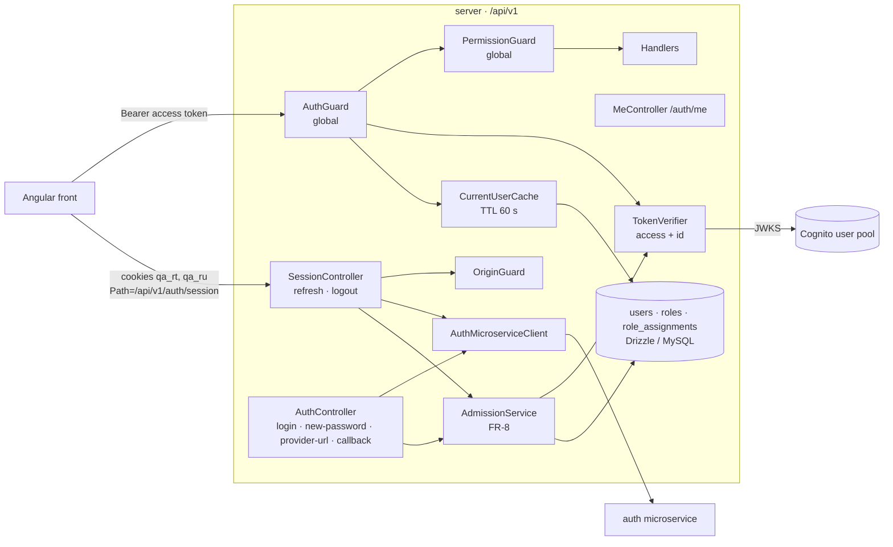

# Cognito-native authentication and session — Design

## 1. Document Control

| | |
|---|---|
| Spec path | `docs/specs/auth/cognito-native-session` |
| Requirements | `requirements.md` (FR-1…FR-18, NFR-1…NFR-7) |
| Depth | Full |
| Status | Draft |
| Base commit | `607dc0b` (this repo), `bf29541f` (auth microservice), `8c2081d1` (old QA) |
| Last updated | 2026-10-13 |

## 2. Executive Summary

Two NestJS modules under `server/src/`: **`users`** (schema, repositories, permission catalog and `can()`) and **`auth`** (microservice client, token verifiers, admission service, controllers, global guards, cookies). Three Drizzle tables with database-level guarantees for scope and uniqueness. A global guard chain — authenticate → authorize — protects every route under `/api/v1` and fails closed. Refresh uses two httpOnly cookies (refresh token + Cognito username) scoped to `/api/v1/auth/session`, and depends on a small change in the auth microservice (DD-2).

**Budget (tripwire for `/akili-execute`):** 11 tasks · ~1,600 LOC (≈ 900 production, ≈ 700 tests) · 1.5 review rounds per task on average (≈ 17 Reviewer passes).

## 3. Architecture Overview



Legend: boxes inside `API` are NestJS providers/controllers; cylinders are stores or external systems; arrows are calls. Guards run in the order shown for every route; `@Public()` routes skip both.

## 4. Extended Directory Structure

```
server/
├── drizzle/                         # generated migrations (new)
├── drizzle.config.ts                # unchanged
├── .env.example                     # + auth variables
└── src/
    ├── main.ts                      # prefix, CORS, cookie parser, helmet, trust proxy
    ├── app.module.ts                # + UsersModule, AuthModule, throttler, global guards/filter
    ├── app.controller.ts            # GET /api/v1/health (@Public) replaces GET /
    ├── common/
    │   └── http-exception.filter.ts # error envelope (TRD § 6)
    ├── config/
    │   ├── env.validation.ts        # + auth vars, ALLOWED_ORIGINS format
    │   └── auth.config.ts           # registerAs('auth')
    ├── database/
    │   ├── drizzle/schema/
    │   │   ├── users.ts
    │   │   ├── roles.ts
    │   │   ├── role-assignments.ts
    │   │   └── index.ts             # re-exports
    │   └── seeds/seed.ts            # roles + first ADMIN
    ├── users/
    │   ├── users.module.ts
    │   ├── users.repository.ts
    │   ├── role-assignments.repository.ts
    │   ├── permissions.ts           # Permission enum + role → permission map
    │   ├── authorization.service.ts # can(), canAny()
    │   └── current-user.cache.ts
    └── auth/
        ├── auth.module.ts
        ├── auth.controller.ts       # login, complete-new-password, provider-url, callback
        ├── session.controller.ts    # session/refresh, session/logout
        ├── me.controller.ts
        ├── admission.service.ts     # FR-8
        ├── token-verifier.service.ts
        ├── auth-microservice.client.ts
        ├── session-cookies.ts       # set/clear both cookies
        ├── guards/{auth,permission,origin}.guard.ts
        ├── decorators/{public,read-access,require-permission,current-user}.decorator.ts
        └── dto/*.ts
```

## 5. Data Model

MySQL 8.0 via Drizzle (`server/src/database/drizzle/schema/`), one migration generated by drizzle-kit.

### `users`

| Column | Type | Rules |
|---|---|---|
| `id` | int unsigned PK auto | |
| `cognito_sub` | varchar(64) null | unique |
| `cognito_username` | varchar(128) null | set at login; needed for refresh (DD-2) |
| `email` | varchar(255) not null | unique; stored lowercase (CHECK `CAST(email AS BINARY) = CAST(LOWER(email) AS BINARY)` — a plain `email = LOWER(email)` is always true under the default case-insensitive collation; amended 2026-10-13 during T-2) |
| `first_name`, `last_name` | varchar(100) null | |
| `auth_source` | enum('sso','custom') not null | default `sso`; corrected at first login (FR-8 step 1) |
| `is_active` | boolean not null default true | |
| `last_login_at` | datetime null | |
| `created_at`, `updated_at` | datetime not null | |
| `created_by` | int unsigned null FK users.id | null = created by the system |

### `roles`

| Column | Type | Rules |
|---|---|---|
| `id` | smallint unsigned PK auto | |
| `code` | varchar(32) not null | unique; ADMIN, LEAD_ASSESSOR, ASSESSOR, TPB, PPU, PROGRAM |
| `name` | varchar(100) not null | |
| `scope_type` | enum('global','result_type','program') not null | |
| `is_active` | boolean not null default true | |

### `role_assignments`

| Column | Type | Rules |
|---|---|---|
| `id` | int unsigned PK auto | |
| `user_id` | int unsigned not null FK | index (`user_id`, `is_active`) |
| `role_id` | smallint unsigned not null FK | |
| `result_type_key` | varchar(64) null | |
| `program_id` | int unsigned null | |
| `is_active` | boolean not null default true | |
| `created_at`, `created_by` | | |
| `revoked_at`, `revoked_by` | null | CHECK: both null when active, both set when inactive |
| `active_key` | varchar generated (stored) | `CONCAT_WS(':', user_id, role_id, COALESCE(result_type_key,''), COALESCE(program_id,''))` when active, else NULL; **unique** → no duplicate active assignment (FR-1), revoked rows don't collide |

**Scope integrity (FR-1):** MySQL CHECK constraints cannot read `roles.scope_type`, so the rule "scope matches the role" is enforced in two places: (1) a CHECK that at most one of `result_type_key` / `program_id` is set; (2) `RoleAssignmentsRepository.create` validates against the role's `scope_type` and rejects mismatches. The admin module (later spec) is the only writer besides the seed.

**Seeds (`seed.ts`, FR-2):** upsert the six roles by `code`; when `SEED_ADMIN_EMAIL` is set, upsert the user by email and an active ADMIN assignment (no-op when present). Run with `pnpm db:seed` (compiled script). Applying migrations or seeds to the shared `qadb` is a **HITL step** (infrastructure § 6).

## 6. API Design

All under `/api/v1`. Error envelope `{ statusCode, error, message, details?, requestId }`.

| Method | Path | Auth | Request | Success | Errors |
|---|---|---|---|---|---|
| POST | `/auth/login` | Public · throttled | `{ email, password }` | 200 `{ accessToken, expiresIn, user }` + cookies · or 200 `{ challenge: 'NEW_PASSWORD_REQUIRED', session }` (no cookies) | 400, 401, 403, 409, 429, 503 |
| POST | `/auth/complete-new-password` | Public · throttled | `{ email, newPassword, session }` | 200 session shape + cookies | 400, 401, 403, 409, 429, 503 |
| GET | `/auth/provider-url?redirectUri=` | Public | query | 200 `{ url }` | 400, 503 |
| POST | `/auth/callback` | Public · throttled | `{ code, redirectUri }` | 200 session shape + cookies | 400, 401, 403, 409, 429, 503 |
| POST | `/auth/session/refresh` | Public · Origin-checked | cookies only | 200 session shape (cookies rotated if new) | 401 (cookies cleared), 403 (origin, or not admitted → cookies cleared), 503 |
| POST | `/auth/session/logout` | Public · Origin-checked | — | 204, cookies cleared | 403 |
| GET | `/auth/me` | Authenticated (GUEST ok) | — | 200 `user` | 401 |
| GET | `/health` | Public | — | 200 `{ status: 'ok' }` | — |

`user` = `{ id, email, firstName, lastName, authSource, assignments: [{ role, resultTypeKey?, programId? }] }`.

Cookies (FR-9): `qa_rt` (refresh token) and `qa_ru` (Cognito username), both `HttpOnly; Secure; SameSite=Lax; Path=/api/v1/auth/session`, no `Domain`; `Max-Age` = refresh-token lifetime (env-free constant of 30 days, re-checked against the app client — P-14). In local development over `http://localhost`, `Secure` is still set (browsers accept `Secure` cookies on localhost).

## 7. Backend Module Design

### 7.1 `users` module
- **Permission catalog** (`permissions.ts`): a closed enum of permissions grouped by role (admin, tpb, ppu, assessor, lead, program) plus `READ`. Only the auth-related seeds of each group are needed now; later specs add permissions to the map, never ad-hoc checks.
- **`AuthorizationService`**: `can(user, permission, ctx)` — pure function over the user's active assignments; result-type/program permissions require the matching context and fail closed without it; LEAD_ASSESSOR expands to assessor permissions for the same key. `canAny(user, permission)` — true if any assignment grants the permission in some scope (used by the route guard).
- **`CurrentUserCache`**: per-process map `sub → { user, assignments, expiresAt }`, TTL 60 s, `invalidate(userId)` exported for writers.

### 7.2 `auth` module
- **`TokenVerifier`**: two `aws-jwt-verify` Cognito verifiers (access: `tokenUse=access`, `clientId`; id: `tokenUse=id`, `clientId`). JWKS fetched and cached by the library; warmed at startup (failure logged, retried on first use). Exposes `verifyAccess(token)` and `verifyId(token)`.
- **`AuthMicroserviceClient`**: Node `fetch`, base `MS_AUTH_URL`, header `auth: {"username":MS_AUTH_USER,"password":MS_AUTH_PASSWORD}` (P-5), timeout 10 s. Maps: 4xx → `InvalidCredentials` (401), challenge → challenge result, timeout/5xx/network → `UpstreamUnavailable` (503), empty or malformed body → 401 (P-7). Sends `username` = email for custom login (P-2), `provider: 'CGIAR-AzureAD'` for SSO (P-3). Never logs bodies.
- **`AdmissionService.resolve(idToken, { mode })`**: implements FR-8 steps 1–7 in one MySQL transaction (lookup by sub → by email with null sub → collision → create/refuse → active → custom-has-roles → update login data and `cognito_username`). `mode = 'refresh'` reads fresh from the DB and never creates users. SSO classification: `identities` must be a non-empty array, else custom. Step 7 updates the email only for SSO or custom with `email_verified` true. Email linking (step 2): a custom token requires `email_verified` true (boolean or `"true"`), else 403; an SSO token does not. The `sub` is linked with `UPDATE users SET cognito_sub = ? WHERE id = ? AND cognito_sub IS NULL`; 0 affected rows → re-read: same `sub` → continue, another `sub` → 409 (amended 2026-10-13 at the T-7 gate).
- **Controllers**: thin; DTOs validated by the global `ValidationPipe` (`whitelist`, `forbidNonWhitelisted`, `transform`) — added in `main.ts`.
- **Guards (global, in order):**
  1. `AuthGuard` — skips `@Public()`; verifies the Bearer token (FR-10); loads the current user through the cache; 401 when missing/inactive/custom-without-roles (FR-11); attaches `request.user`.
  2. `PermissionGuard` — skips `@Public()`; `@ReadAccess()` passes any authenticated user; `@RequirePermission(p)` requires `canAny(user, p)`; **no decorator → 403** (FR-12 fail closed). Resource-scoped checks run in services via `can(user, p, { resultType | programId })` once the resource is loaded (DD-4).
- **`OriginGuard`** on `SessionController`: `Origin` must be in `ALLOWED_ORIGINS`, else 403 before any work.
- **Throttling**: `@nestjs/throttler`, 10 req/min per IP on login, complete-new-password and callback (NFR-4). `trust proxy` set to 1 so the client IP behind the TEST/PROD reverse proxy is used (P-16).
- **Error filter**: maps domain errors to the envelope; adds `requestId`; logs one structured line per auth decision without secrets (NFR-7).

### 7.3 Flows
- **Login / callback / new-password:** validate DTO → microservice → (challenge → return) → `verifyId(idToken)` → `AdmissionService.resolve` → on success set cookies (`qa_rt`, `qa_ru` = `cognito:username` claim) and return session shape; on 401/403/409 clear cookies and return the error.
- **Refresh:** OriginGuard → read cookies (absent → 401 + clear) → microservice refresh with `{ refreshToken, username }` (DD-2) → `verifyId` → `resolve(mode=refresh)` → rotate `qa_rt` if a new refresh token came back → session shape. Any refusal clears both cookies.
- **Logout:** OriginGuard → clear both cookies → 204.

## 8. Frontend / UX Component Architecture

Not in scope. Contract for the later front spec: keep the access token in an in-memory service; call `POST /api/v1/auth/session/refresh` with `withCredentials: true` on app start and on the first 401 (single-flight); never read cookies from JS; SSR renders public routes only.

## 9. Shared Contracts or Package Extensions

- **New dependencies (server):** `aws-jwt-verify`, `cookie-parser` (+ types), `@nestjs/throttler`, `helmet`, `class-validator`, `class-transformer`.
- **Env (`.env.example`, `env.validation.ts`):** `COGNITO_REGION`, `COGNITO_USER_POOL_ID`, `COGNITO_CLIENT_ID`, `MS_AUTH_URL`, `MS_AUTH_USER`, `MS_AUTH_PASSWORD`, `ALLOWED_ORIGINS` (comma-separated), optional `SEED_ADMIN_EMAIL`.
- **Auth microservice (external, DD-2):** `POST /auth/refresh` accepts an optional `username`; when present it is used for `SECRET_HASH` and the `getUserInfo(accessToken)` pre-call is skipped. Backward compatible.
- **TRD pending update (applied on `staging`, not on this branch):** § 5.1 `role_grants` → `roles` + `role_assignments` + `users.cognito_username`; § 6 session routes under `/auth/session/*`.

## 10. Design Decisions

| ID | Decision | Alternatives rejected | Consequence | Requirements |
|---|---|---|---|---|
| DD-1 | Two modules: `users` (data + authorization) and `auth` (identity + session) | One `auth` module — mixes the authorization API every module needs with login concerns | Later modules import only `UsersModule` for `can()` | FR-3, FR-12 |
| DD-2 | Refresh with `{ refreshToken, username }`; username from the id token's `cognito:username`, kept in `qa_ru` and in `users.cognito_username`; **requires the microservice change in § 9** | Expired access token in a cookie (fails at Cognito userInfo — P-1); token in `sessionStorage` (violates decision, fails after expiry) | FR-13 blocked until the microservice ships the change; task T-9 waits on it | FR-9, FR-13 |
| DD-3 | Cookie Path `/api/v1/auth/session`; routes `session/refresh`, `session/logout` | Two Paths (impossible with one cookie); Path `/api/v1/auth` (cookie sent to login routes needlessly) | Login routes never receive the refresh cookie | FR-9, FR-13, FR-14 |
| DD-4 | Route guard checks `canAny`; resource scope checked in services with `can()` after loading the resource | Guard resolves the resource itself (couples guard to every module's data) | Every scoped endpoint MUST call `can()` with context — reviewers check it | FR-3, FR-12 |
| DD-5 | No decorator on a non-public route → 403 | Default allow for authenticated users (GUEST could act on forgotten routes) | Every new route must declare `@ReadAccess()` or `@RequirePermission()` | FR-12 |
| DD-6 | Per-process cache, TTL 60 s, invalidated on QA writes; refresh bypasses cache | Redis (no scenario justifies it, LITE tier); no cache | Staleness ≤ 60 s across processes | FR-11, FR-13, NFR-5 |
| DD-7 | Duplicate-active guard via a stored generated `active_key` with a unique index | Partial unique index (MySQL lacks it); app-only check (races) | Revoked rows never block a re-grant | FR-1 |
| DD-8 | Scope-vs-role rule enforced in the repository plus a CHECK for "at most one scope column" | Trigger reading `roles` (hidden logic, harder to test) | Writers must go through the repository | FR-1 |
| DD-9 | `GET /` (Hello World) replaced by public `GET /api/v1/health` | Keep `/` public outside the prefix | The starter tests change (consumers P-8) | FR-10 |
| DD-10 | Admission in one DB transaction | Separate statements (two concurrent first logins could create duplicates; unique keys would surface as 500) | Unique violations inside the transaction are re-read and resolved, not surfaced. The email link is a conditional UPDATE (`cognito_sub IS NULL`), so a concurrent link by another `sub` is a 409, never an overwrite (amended 2026-10-13). Locking-read rule (amended 2026-10-13, supersedes the earlier accepted risk for a deactivation/revoke during login): the link decision, the 409, and the active/assignments re-check come only from the conditional `UPDATE … WHERE cognito_sub IS NULL` (affected rows) or from `SELECT … FOR UPDATE` — never from a plain `SELECT`. Both read the latest committed version in InnoDB at any isolation level, so the isolation level is not pinned | FR-8 |

**Reversion challenge (Step 2.3):** DD-9 removes the shipped `GET /` → *"what does removing this break?"* — the starter unit test and e2e test (P-8) and any health check pointing at `/`. No deployment uses the new server yet (`docs/infrastructure.md` § 1 lists the API only for the old QA hosts), so the only breakage is the two tests, which T-1 replaces. No other reversion.

## 11. Premise Ledger

Count: 10 verified · 7 UNVERIFIED (High: 3 · Low: 4)
Blast-radius triggers: `live-path` (the design names user actions — login, refresh — and an API version), `shared-state` (the global guards apply to every route), `consumer` (the response of `GET /` changes) — all three fired.

| # | Claim | Class | Citation (as run) | Verified at | If false | Settled by |
|---|---|---|---|---|---|---|
| P-1 | Microservice refresh needs a valid access token: it calls `getUserInfo(data?.accessToken)` before refreshing and uses `userInfo.username` for `SECRET_HASH` | existence | `auth-microservice/src/api/auth/auth.service.ts:597`, `:242-262`; `src/api/auth/services/cognito/cognito.service.ts:362-376` | `bf29541f` | DD-2 unnecessary; T-9 drops its dependency — **High** | — |
| P-2 | Custom login body uses `username` (the email) and `password` | data-env | `auth-microservice/src/api/auth/dto/custom-auth.dto.ts:12,20` | `bf29541f` | Client mapping in T-6 — Low | — |
| P-3 | Provider login is `POST /auth/login/provider` with `{ provider, redirectUri? }` | location | `auth-microservice/src/api/auth/auth.controller.ts:41`; `dto/provider-auth.dto.ts:16,24` | `bf29541f` | Client mapping in T-6 — Low | — |
| P-4 | Custom login, code validation and new-password completion all return an id token | existence | `auth-microservice/src/api/auth/auth.service.ts:192`, `:142`, `:226` | `bf29541f` | FR-8 step 1 cannot run; would need userinfo instead — **High** | — |
| P-5 | Callers authenticate with a JSON `auth` header `{ username, password }` checked against CLARISA | data-env | `auth-microservice/src/middleware/jwt-clarisa.middleware.ts:23-46` | `bf29541f` | Client header in T-6 — Low | — |
| P-6 | Refresh errors without `.response` make the method return `undefined` | existence | `auth-microservice/src/api/auth/auth.service.ts:616-625` | `bf29541f` | Empty-body handling in T-6 unnecessary — Low | — |
| P-7 | The only route today is `GET /` in `AppController` | live-path / shared-state | `grep -rn "@Controller\|@Get\|@Post" server/src` (excluding spec) → `server/src/app.controller.ts:4,8` only | `607dc0b` | More routes would need decorators in T-5 — Low | — |
| P-8 | Readers of `GET /` and `getHello`: `server/src/app.controller.spec.ts:18-19`, `server/test/app.e2e-spec.ts:23`; no front consumer | consumer | `grep -rn "Hello World\|getHello\|AppController" server/src server/test client/src`; `git grep -nE "api/v1\|/auth/(login\|refresh\|me\|callback)\|withCredentials\|HttpClient" origin/{feat/auth-login,staging-center,jp-design/mockup-completo} -- client/src` → 0 | `607dc0b` | T-1 must update more files — Low | — |
| P-9 | `@nestjs/throttler` 6.7.1 supports Nest 12 | data-env | `npm view @nestjs/throttler peerDependencies` → `@nestjs/core ^12.0.0` | 2026-10-13 | Use a custom limiter in T-7 — Low | — |
| P-10 | Federated users' id tokens carry `identities`, provider `CGIAR-AzureAD` | data-env | UNVERIFIED — confirm at source before relying on it | — | SSO/custom classification (FR-8 step 1) wrong — **High** | HITL login in TEST, decode one SSO id token; user-stated (back lead, 2026-10-13); owner T-11 |
| P-11 | `COGNITO_CLIENT_ID` in `server/.env` is QA's `mis_auth` client in CLARISA | data-env | UNVERIFIED — confirm at source before relying on it | — | Every token fails the `client_id` check — **High** | First real login in T-11; user-stated (back lead, 2026-10-13) |
| P-12 | Id tokens carry `cognito:username`; access tokens carry `client_id` and `token_use` | data-env | UNVERIFIED — confirm at source before relying on it | — | DD-2 username source changes — **High** | T-11 (decode real tokens) |
| P-13 | `aws-jwt-verify` lets tests inject a JWKS (no network) | existence | UNVERIFIED — confirm at source before relying on it | — | e2e tests need a local JWKS server — Low | T-4 first step (read the package's typings after install) |
| P-14 | QA's app client: access-token lifetime set to the maximum (1 day), refresh token 30 days | data-env | UNVERIFIED — confirm at source before relying on it | — | Cookie `Max-Age` and cache assumptions adjust — Low | Infrastructure; owner T-11 |
| P-15 | MySQL 8.0.45 enforces CHECK constraints and unique indexes on stored generated columns | data-env | Version: `SELECT VERSION()` → `8.0.45-0ubuntu0.22.04.1` (2026-10-13, shared `qadb`). Enforcement: UNVERIFIED — confirm at source before relying on it | — | DD-7/DD-8 fall back to service checks — Low | T-2 (migration applied at the HITL step) |
| P-16 | TEST and PROD put one reverse proxy in front of the API (so `trust proxy = 1` yields the client IP) | data-env | UNVERIFIED — confirm at source before relying on it | — | Throttling keys on the proxy IP; adjust the setting — Low | Infrastructure; owner T-8 |
| P-17 | The shared dev DB `qadb` must not be reset by agents | other | `docs/infrastructure.md` § 6 (standing rule) | `607dc0b` | — (rule) migrations/seeds stay HITL — Low | — |

