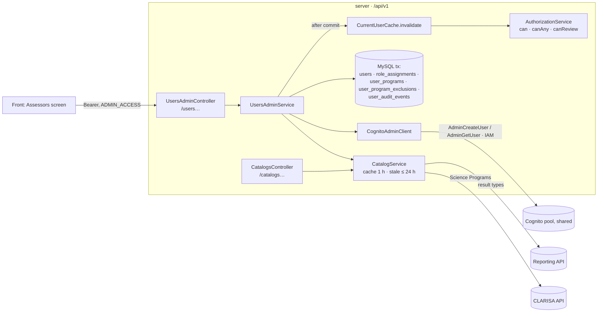

# User management (core) — Design

## 1. Document Control

| | |
|---|---|
| Spec path | `docs/specs/auth/user-management/core` |
| Requirements | `requirements.md` (FR-1…FR-14, NFR-1…NFR-5) |
| Depth | Full |
| Status | Draft |
| Base commit | `8ecef79` (branch `feat/auth-user-management`, from `origin/staging-center` @ `8866e69`) |
| Last updated | 2026-10-19 (DD-12, DD-13 amendments; DD-14, § 7 lock order) |

## 2. Executive Summary

The `users` module gains an admin API (`/api/v1/users…`, `/api/v1/catalogs/…`) behind `ADMIN_ACCESS`. The data model adds a nickname, a per-user program scope, conflict-of-interest exclusions with origin and history, an "all result types" grant, and an audit table. Writes run in one MySQL transaction that locks the target user row (and the ADMIN role row when the last-admin rule is at stake), write one audit event per change, and invalidate the user's cached authorization after commit. Custom-account users get their Cognito account through a new admin client that uses AWS credentials (IAM) on the shared pool. Catalogs come from Reporting (result types) and CLARISA (Science Programs), cached in process. Authorization gains one composable rule, `canReview`, used by later result stories.

**Budget (tripwire for `/akili-execute`):** 10 tasks (9 build + 1 HITL) · **~12,500 LOC** · **~20 Reviewer passes** — re-baselined 2026-10-19 after T-4, approved by the back lead (option A: no requirement cut). Original: ~3,200 LOC (≈ 1,400 production, ≈ 1,800 tests) · ~16 passes. Actual at T-4: ~6,200 LOC · 7 passes. Remaining estimate: T-5 ~700 · T-6 ~2,500 · T-7 ~1,000 · T-8 ~1,800 · T-9 ~500 · T-10 docs only. Causes: amendments DD-12/DD-13/DD-14, lock-emulating concurrency tests, real-response fixtures. A second overrun of this baseline escalates again.

## 3. Architecture Overview



Legend: boxes in `API` are NestJS providers/controllers; cylinders are stores or external systems; arrows are calls.

## 4. Extended Directory Structure

```
server/src/
├── users/
│   ├── users-admin.controller.ts      # /users… (ADMIN_ACCESS)
│   ├── users-admin.service.ts         # create, edit, roles, programs, exclusions, (de)activate, invitation
│   ├── users-admin.unit-of-work.ts    # one tx: locks + writes + audit
│   ├── users-query.repository.ts      # list (search, filters, cursor) and detail read model
│   ├── user-programs.repository.ts    # program scope + exclusions (port + Drizzle adapter)
│   ├── user-audit.repository.ts       # audit events (port + Drizzle adapter)
│   ├── effective-scope.ts             # pure: role → result type → program scope − exclusions
│   ├── dto/*.ts                       # request/response models (OpenAPI)
│   ├── permissions.ts                 # ADMIN grants all
│   ├── authorization.service.ts       # + canReview
│   ├── current-user.cache.ts          # carries program scope + exclusions
│   └── catalogs/{catalogs.controller,catalog.service,reporting-catalog.client,clarisa.client}.ts
├── auth/
│   ├── cognito-admin.client.ts        # AdminCreateUser / AdminGetUser (AWS SDK, SigV4)
│   └── me.controller.ts               # + nickname
├── common/error-codes.ts              # + USERS_* codes
├── config/{cognito-admin,catalogs}.config.ts, env.validation.ts
└── database/drizzle/schema/{users,role-assignments,user-programs,user-program-exclusions,user-audit-events}.ts
server/drizzle/0001_<name>.sql          # generated migration
```

## 5. Data Model

| Table / change | Columns and rules | Requirement |
|---|---|---|
| `users` + | `nickname varchar(50)` NULL, unique (collation-insensitive, P-7); `invitation` enum(`none`,`sent`,`existing_account`) default `none`; `invited_at` datetime NULL | FR-2, FR-8, FR-12 |
| `role_assignments` (rule) | `result_type_key = '*'` means **all result types** (current and future). Allowed only for result-type-scoped roles. Existing CHECK (at most one scope) and `active_key` unchanged | FR-3 |
| `user_programs` (new) | `user_id`, `program_id` (CLARISA id); PK (`user_id`,`program_id`). **No rows = all programs** (current and future) | FR-4 |
| `user_program_exclusions` (new) | `id`, `user_id`, `program_id`, `origin` enum(`manual`,`reporting`), `status` enum(`active`,`removed`,`dismissed`), `reason` varchar(500), `reporting_role` varchar(100) NULL, `created_at`, `created_by` NULL (= system), `ended_at`, `ended_by` NULL (= system), `end_reason`. Stored generated `active_key` = user:program when `status='active'`, unique. CHECKs: `manual` ⇒ reason not empty; `dismissed` ⇒ origin `reporting` and `end_reason` not empty; `ended_at` set iff status ≠ `active`; `ended_by` and `end_reason` NULL while `active`; `ended_by` NULL (system end) allowed only for origin `reporting` with status `removed` — a `manual` removal and every `dismissed` row require `ended_by` (amended 2026-10-19, see DD-12) | FR-4 |
| `user_audit_events` (new) | `id`, `user_id` (target), `actor_id`, `action` enum, `changes` JSON (`{ field: { before, after } }`), `request_id`, `created_at`. Append-only; index (`user_id`,`created_at`) | FR-13 |

Migration `0001`: additive only (new nullable columns, new tables); no data rewrite. Applied by a human on `qadb` (P-17 of the auth spec).

## 6. API Design

All under `/api/v1`, response standard (TRD § 6), **`ADMIN_ACCESS`** (Bearer) unless noted. Error codes below are additions to the catalog unless they already exist.

| Method | Path | Request | Success | Errors |
|---|---|---|---|---|
| GET | `/users` | query `q`, `role`, `resultType`, `programId`, `status` (`active`/`inactive`/`all`, default `active`), `population` (`team`/`guests`/`all`, default `team`), `hasExclusions`, `cursor`, `limit` (1–200, default 50) | `data: UserSummary[]`, `meta.page: { nextCursor }` | 400, 401, 403 |
| GET | `/users/:id` | — | `data: UserDetail` | 404 `USERS_NOT_FOUND` |
| POST | `/users` | `{ email, firstName, lastName, nickname, accountType, roles?, programs?, exclusions? }` | 201 `data: UserDetail` (`invitation`) | 400, 409 `USERS_EMAIL_TAKEN` / `USERS_NICKNAME_TAKEN` / `USERS_ROLE_CONFLICT`, 503 |
| PATCH | `/users/:id` | `{ nickname?, firstName?, lastName? }` | `data: UserDetail` | 404, 409 `USERS_NICKNAME_TAKEN` / `USERS_NAME_LOCKED` |
| PUT | `/users/:id/roles` | `{ roles: [{ role, resultTypes: 'all' \| string[] }] }` (global roles: no `resultTypes`) | `data: UserDetail` | 400 (incl. non-grantable role), 404, 409 `USERS_ROLE_CONFLICT` / `USERS_LAST_ADMIN` |
| PUT | `/users/:id/programs` | `{ programs: 'all' \| number[] }` | `data: UserDetail` | 400, 404 |
| POST | `/users/:id/exclusions` | `{ programId, reason }` | 201 `data: UserDetail` | 400, 404, 409 `USERS_EXCLUSION_EXISTS` |
| DELETE | `/users/:id/exclusions/:exclusionId` | — (manual only) | `data: UserDetail` | 404 `USERS_EXCLUSION_NOT_FOUND`, 409 `USERS_EXCLUSION_NOT_MANUAL` |
| POST | `/users/:id/exclusions/:exclusionId/dismiss` | `{ reason }` (reporting only) | `data: UserDetail` | 400, 404, 409 `USERS_EXCLUSION_NOT_REPORTING` |
| POST | `/users/:id/deactivate` · `/activate` | — | `data: UserDetail` | 404, 409 `USERS_LAST_ADMIN` |
| POST | `/users/:id/invitation` | — | `data: UserDetail` | 404, 409 `USERS_INVITATION_NOT_APPLICABLE`, 503 |
| GET | `/catalogs/roles` | — | grantable roles `{ code, name, scopeType }` | — |
| GET | `/catalogs/result-types` | — | `{ key, name }[]` | 503 `SERVICE_UNAVAILABLE` |
| GET | `/catalogs/science-programs` | — | `{ id, code, name }[]` | 503 |
| GET | `/auth/me` (any authenticated) | — | profile + `nickname` | (unchanged) |

`UserSummary` = `{ id, email, firstName, lastName, nickname, accountType, status, lastSignInAt, invitation, roles: [{ role, resultTypes: 'all' | string[] }], programs: 'all' | number[], exclusions: [{ id, programId, origin, reason, since }] }`. `UserDetail` = summary + `exclusionHistory` (removed and dismissed, with who/when/why). Roles are grouped per role with their result types — the front's single role + `lead` switch maps to them (D2).

## 7. Backend Module Design

- **UsersAdminService** — every mutation: validate DTO (global pipe) → validate catalog references (result type keys, program ids) through `CatalogService` (stale cache allowed; none → 503) → one transaction through `UsersAdminUnitOfWork` → invalidate the target in `CurrentUserCache` **after commit** (FR-6). Inside the transaction:
  1. lock the target `users` row `FOR UPDATE` (404 if absent);
  2. when the change can reduce active admins (revoke ADMIN, deactivate an ADMIN), lock the ADMIN row of `roles` `FOR UPDATE`, then count — with a plain (non-locking) read, under READ COMMITTED (DD-14) — active ADMIN grants of active users and refuse with `USERS_LAST_ADMIN` if it would reach 0 (FR-7);
  3. apply the change (roles by **diff**: revoke removed grants, insert new ones, leave unchanged ones — FR-3);
  4. the repository refuses an Assessor/Lead overlap for the user's resulting active grants, `*` included (FR-3, DD-2);
  5. write one `user_audit_events` row per change, with before/after (FR-13).
  Lock order for an admin mutation: target `users` row `FOR UPDATE` (step 1) → ADMIN `roles` row `FOR UPDATE` (step 2, only when admins can decrease) → `role_assignments` writes (step 3). The ADMIN guard runs **before** any grant insert, because an insert takes a shared lock on `roles` through its foreign key and a later exclusive request on the same row could deadlock. Logins keep the auth order (DD-10) and take only shared locks. Amended 2026-10-19 (T-4 review; the earlier line "users → role_assignments → roles" contradicted steps 2–3).
- **Create (FR-2)** — uniqueness pre-check (email, nickname) → for `custom`: `CognitoAdminClient.getUser(email)`; absent → `createUser` (email verified, given/family name, Cognito sends the temporary password) → `invitation: sent`; present → `invitation: existing_account`, no write to Cognito → transaction inserts user + grants + programs + exclusions + audit. A unique violation at insert (race) → 409 and no QA row; the Cognito account may remain and is reported as `existing_account` on retry (accepted). For `sso`: no Cognito call; admission's email link (auth FR-8 step 2) attaches the first SSO login to this row.
- **Name rule (FR-5)** — first/last name editable only while `last_login_at` is null (`USERS_NAME_LOCKED` otherwise); admission keeps overwriting names from the token on each login (C4). Nickname is never touched by admission.
- **Invitation (FR-8)** — allowed for `custom` + `invitation = sent` + never signed in; `CognitoAdminClient.resendInvitation(email)`; Cognito refusing (user already confirmed) → `USERS_INVITATION_NOT_APPLICABLE`.
- **CognitoAdminClient** — AWS SDK `@aws-sdk/client-cognito-identity-provider` (SigV4); credentials from `COGNITO_ADMIN_ACCESS_KEY_ID` + `COGNITO_ADMIN_SECRET_ACCESS_KEY` (local only, both or neither) else the default chain (IAM role); 10 s timeout; errors → `UpstreamUnavailableError` (503) or typed refusals; logs operation and AWS error name only (NFR-2). Required IAM actions: `cognito-idp:AdminGetUser`, `cognito-idp:AdminCreateUser` on the pool ARN.
- **CatalogService** — result types from Reporting `GET /api/qa/catalog` (P-5), Science Programs from CLARISA (P-6); in-process cache 1 h, served stale up to 24 h when the source fails; no copy → 503 (FR-11). Clients behind ports with fixture tests.
- **Effective scope & `canReview` (D5, D9)** — **an active ADMIN is exempt from the program-scope and exclusion conjuncts (DD-13) — the permission check and the later timeline predicate still apply**; for every other user: pure function over the cached user: a permission for the result type (exact key or `*`) **and** program in scope (no rows = all) **and** no active exclusion. `CurrentUserCache` loads program scope and active exclusions with the user; the visibility rule takes a later timeline predicate as one more conjunct.
- **ADMIN grants all (FR-14)** — `ROLE_DEFINITIONS` ADMIN grants every `Permission` value, derived from the catalog so future permissions follow.
- **List (FR-9)** — one query with `LIKE` on email, nickname, first/last name; filters by joins/EXISTS; `population=team` = has an active grant or `created_by` not null; sort `nickname`, then `id`; opaque cursor of (sort key, id).
- **Nickname exposure (FR-12)** — a shared "public user" mapper (id + nickname) is the only way later non-admin endpoints may render another user; `/auth/me` adds the caller's nickname.
- **Errors** — new catalog codes: `USERS_NOT_FOUND` 404, `USERS_EMAIL_TAKEN` 409, `USERS_NICKNAME_TAKEN` 409, `USERS_ROLE_CONFLICT` 409, `USERS_LAST_ADMIN` 409, `USERS_NAME_LOCKED` 409, `USERS_INVITATION_NOT_APPLICABLE` 409, `USERS_EXCLUSION_EXISTS` 409, `USERS_EXCLUSION_NOT_FOUND` 404, `USERS_EXCLUSION_NOT_MANUAL` 409, `USERS_EXCLUSION_NOT_REPORTING` 409. Unknown role/result type/program and PROGRAM → `VALIDATION_FAILED` with field errors.
- **Logging** — one decision line per mutation (`event: users_admin`, action, target id, actor id, outcome, request id); never email, names or credentials (NFR-2).

## 8. Frontend / UX Component Architecture

Not in scope (server only). Contract notes for the front team: roles come grouped per role with `resultTypes: 'all' | keys`; the `lead` switch = LEAD_ASSESSOR for the chosen types; result types use catalog keys and Science Programs CLARISA ids (display names from `/catalogs`); "Remove from team" = `POST /users/:id/deactivate`; "Send invitation" = `POST /users` (custom) / `POST /users/:id/invitation`; the full name is two fields (`firstName`, `lastName`).

## 9. Shared Contracts or Package Extensions

- **New dependency:** `@aws-sdk/client-cognito-identity-provider`.
- **Env:** `COGNITO_ADMIN_ACCESS_KEY_ID` / `COGNITO_ADMIN_SECRET_ACCESS_KEY` (local only, both or neither), `REPORTING_API_URL` (auth: the shared `CLARISA_API_KEY` in header `x-api-key` — P-5), `CLARISA_API_URL`, `CLARISA_API_KEY` (required; sent to Reporting only — CLARISA `by-portfolio` needs no key, P-6). All validated; secrets read only in `src/config/` (FR-17 of the auth spec).
- **IAM (Cris):** `AdminGetUser`, `AdminCreateUser` on the shared pool for local (user) and TEST/PROD (role).
- **TRD (pending for `staging`):** § 5.1 new tables/columns; § 6 users and catalogs routes.

## 10. Design Decisions

| ID | Decision | Alternatives rejected | Consequence | Req |
|---|---|---|---|---|
| DD-1 | "All result types" = sentinel `*` in `result_type_key` | New boolean column (touches the CHECK and `active_key`); expanding to every current type (misses future ones) | Repository allows `*` only for result-type roles; `can()`/`canReview` treat `*` as any key | FR-3 |
| DD-2 | Assessor/Lead exclusivity enforced in `RoleAssignmentsRepository` (every writer: service, seed), under the user row lock taken by the unit of work | DB unique index (cannot see roles' codes nor `*` overlaps); service-only check (the seed and future writers would bypass it) | The repository reads the user's active grants before inserting; concurrent writers for one user serialize on the user row | FR-3, NFR-5 |
| DD-3 | Last-admin rule serialized by locking the ADMIN `roles` row | Count without lock (two admins demote each other → 0 admins) | Admin-affecting changes serialize; logins only take a shared lock on roles (auth DD-10) and wait at most one short transaction | FR-7, NFR-5 |
| DD-4 | Program scope as a separate table, no rows = all | Program in `role_assignments` (C2: single scope); a JSON column (no FK/index) | Scope is per user, applies to every role (D5) | FR-4 |
| DD-5 | Exclusions keep origin + status, never deleted | Hard delete on removal (loses history); one table per origin | Child 2 writes `reporting` rows without schema change; dismissals survive syncs | FR-4, FR-13 |
| DD-6 | Cognito account via AWS SDK with IAM credentials | Signing admin calls by hand; asking users to self-register | New IAM dependency on the shared pool (Cris); SDK adds a package | FR-2, FR-8 |
| DD-7 | Create order: check → Cognito → DB tx | DB first (an orphan QA row if Cognito fails, violating FR-2) | A Cognito account may outlive a failed insert; harmless and reported as `existing_account` | FR-2 |
| DD-8 | Name editable by admin only before first sign-in | Admin always owns the name (admission would overwrite it each login, C4) | IdP is the source after first login; matches the front (name not editable in edit) | FR-5 |
| DD-9 | Catalogs cached in process (1 h, stale ≤ 24 h) | DB copy of catalogs (sync job); no cache (every form load hits two APIs) | Validation works through short upstream outages | FR-11, NFR-3 |
| DD-10 | ADMIN grants every permission, derived from the catalog | List them by hand | New permissions follow automatically; the `can()` matrix test changes | FR-14 |
| DD-11 | **Reversion:** ASSESSOR + LEAD_ASSESSOR on the same result type becomes forbidden (C6) | Keep allowing it | **Challenge — what does removing it break?** (1) existing data with both active grants → the migration task reports any such pair on `qadb` (read-only query at the HITL step, P-13); (2) seeds create only ADMIN (`seed.ts`); (3) **one test pins the old behavior**: `server/src/users/role-assignments.repository.spec.ts:225` creates ASSESSOR and LEAD_ASSESSOR for the same user and type (`grep -rn "LEAD_ASSESSOR" server/src server/test` → 27 hits, the others grant Lead alone or on another type, e.g. `authorization.service.spec.ts:232` KP vs INNOVATION_DEV) → T-3 changes it to expect the refusal | FR-3 |
| DD-12 | **Amendment (2026-10-19, back lead):** `ended_by` NULL means "ended by the system", symmetric with `created_by`; allowed only for a `reporting` exclusion with status `removed` | Keep `ended_by` mandatory (child 2 could never end a `reporting` exclusion on its own; a later change would need another migration on the shared `qadb`) | Child 2 decides whether its sync ends exclusions automatically, with no schema change. The DB still forces an actor on every `manual` removal and every dismissal; human ends always carry the admin id (service + audit) | FR-4, FR-13 |
| DD-13 | **Amendment (2026-10-19, back lead):** an active ADMIN is never blocked by a conflict of interest — `canReview` ignores program scope and exclusions while the user holds an active ADMIN grant. Exclusions stay stored and apply again if the ADMIN grant is revoked | Exclusions beat ADMIN too (FR-4 read literally); forbid exclusions on an admin (extra validation, a new error code, and an open case for the child-2 Reporting sync) | D3 wins over FR-4 for admins; child 2 stores `reporting` exclusions for admins without special handling; the front may show an admin's exclusions as having no effect | FR-4, FR-14, D3 |
| DD-14 | **Recorded 2026-10-19 (T-4 review, Leader; reported to the back lead):** the admin unit of work runs `READ COMMITTED`; the last-admin count is a plain read taken after the ADMIN `roles` row lock | `REPEATABLE READ` (the snapshot can predate the competing commit — both demotions pass); a locking count (`FOR SHARE`/`FOR UPDATE`) — deadlocks two admins demoting each other at any isolation level | DD-3 holds with no lock cycle; checks that read nothing and then insert rely on the user-row lock or a unique key (DD-2); `qadb` must not use `binlog_format=STATEMENT` (RC + statement binlog fails writes, error 1665) — checked at T-10 | FR-7, NFR-5 |

## 11. Premise Ledger

Count: 10 verified · 4 UNVERIFIED (High: 1 · Low: 3) — P-5, P-6 settled in T-2 (2026-10-19)
Blast-radius triggers: `live-path` (admin actions and the SSO first-login link), `shared-state` (`AuthenticatedUser`/`CurrentUserCache`, `ROLE_DEFINITIONS`), `consumer` (`/auth/me` shape, error catalog, `can()` matrix) — all three fired.

| # | Claim | Class | Citation (as run) | Verified at | If false | Settled by |
|---|---|---|---|---|---|---|
| P-1 | Admission links a pre-registered user by email with no `cognito_sub` (SSO without `email_verified`, custom with it) | live-path | `server/src/auth/admission.service.ts:218` (find by email), `:236` (custom needs verified), `:253` (`linkCognitoSub`); entry: `POST /auth/login` / `/auth/callback` → `issueSession` → `AdmissionService.resolve` | `8ecef79` | FR-2 SSO pre-registration does not attach — **High** | — |
| P-2 | `CurrentUserCache.invalidate(userId)` exists and admission calls it after commit | location | `server/src/users/current-user.cache.ts:128`; `server/src/auth/admission.service.ts:155` | `8ecef79` | FR-6 needs a new mechanism — Low | — |
| P-3 | `active_key` includes `role_id`, so the DB cannot forbid ASSESSOR+LEAD on one type | existence | `server/src/database/drizzle/schema/role-assignments.ts:47-54` | `8ecef79` | DD-2 could be a DB constraint — Low | — |
| P-4 | Custom login sends the email as Cognito `USERNAME` (email is the username or an alias) | data-env | `server/src/auth/cognito-auth.client.ts:127` | `8ecef79` | `AdminCreateUser` username choice changes — Low | — |
| P-5 | Reporting exposes result types (key + name) on `GET /api/qa/catalog?phase_year=` | data-env | Read on TEST 2026-10-19 (T-2): `result_types[]` = `{ key, label, level }` (9 entries); auth = the shared CLARISA API key in header `x-api-key` (back lead decision; `Authorization: Bearer` and `auth` → 401) | `f0d02bd`+T-2 | — | Settled (T-2) |
| P-6 | CLARISA exposes Science Programs (id, code, name) | data-env | Read on TEST 2026-10-19 (T-2): source decided by the back lead = `GET cgiar-entities/by-portfolio?portfolioId=2,3&version=2` (not `initiatives`); rows `{ id, code, name, is_active, entity_type, portfolio, … }` = SP01–SP13 + inactive SGP-02; no key required | `f0d02bd`+T-2 | — | Settled (T-2); Accelerators SP12/SP13 included — to confirm with business (Santi) |
| P-7 | `qadb` default collation is case-insensitive, so a unique index makes the nickname unique case-insensitively | data-env | UNVERIFIED — confirm at source before relying on it | — | Need a generated lower-case column — Low | T-1 (read-only `SHOW CREATE TABLE users` at HITL) |
| P-8 | QA can obtain IAM credentials with `AdminGetUser`/`AdminCreateUser` on the shared pool | data-env | UNVERIFIED — confirm at source before relying on it | — | DD-6 impossible; D7 must be revisited — **High** | Cris (pool owner) before T-5 |
| P-9 | `@aws-sdk/client-cognito-identity-provider` is not installed | existence | `grep -c "client-cognito-identity-provider" server/package.json` → 0 | `8ecef79` | — (T-5 adds it) — Low | — |
| P-10 | The shared pool's invitation email (temporary password) is acceptable for QA users (template names PRMS?) | data-env | UNVERIFIED — confirm at source before relying on it | — | Users receive a confusing email — Low | HITL smoke with the pool owner |
| P-11 | Readers of `AuthenticatedUser` / `ROLE_DEFINITIONS` that change with this design | shared-state | `grep -rln "AuthenticatedUser\b" server/src server/test` → `auth/me.controller.ts`, `auth/admission.service.ts`, `auth/authenticated-request.ts`, `auth/decorators/current-user.decorator.ts`, `users/current-user.cache.spec.ts`; `grep -rln "ROLE_DEFINITIONS" server/src server/test` → `database/seeds/seed.ts`, `database/seeds/seed.spec.ts`, `users/role-assignments.repository.spec.ts`, `users/authorization.matrix.spec.ts`, `users/current-user.cache.spec.ts`, `test/auth-{session,login,guards,hardening}.e2e-spec.ts` | `8ecef79` | Missed readers break silently — **High** | — |
| P-12 | Consumers of the `/auth/me` profile shape | consumer | `server/test/auth-guards.e2e-spec.ts:625` (exact `toEqual` on the profile); `client/src/app/core/auth/auth.models.ts:17-25` (`UserProfile`, additive field) | `8ecef79` | The exact-shape test fails; the front ignores the new field — Low | — |
| P-13 | `qadb` has no user with ASSESSOR and LEAD_ASSESSOR active on the same result type | data-env | UNVERIFIED — confirm at source before relying on it | — | DD-11 needs a data fix first — Low | T-1 (read-only query at HITL) |
| P-14 | Exactly one existing test grants ASSESSOR and LEAD_ASSESSOR on the same user and type | consumer | `grep -rn "LEAD_ASSESSOR" server/src server/test` → 27 hits; same user + type only at `server/src/users/role-assignments.repository.spec.ts:225` | `8ecef79` | More tests break under DD-2 — Low | — |
