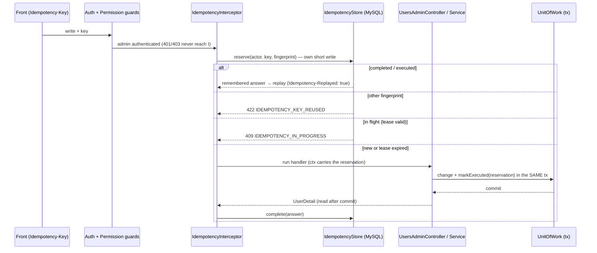

# Users admin write safety — Design

## 1. Document Control

| | |
|---|---|
| Spec path | `docs/specs/changes/users-admin-write-safety` |
| Requirements | `requirements.md` (FR-1…FR-10, NFR-1…NFR-5) |
| Depth | Full |
| Status | Approved (back lead, 2026-10-20) |
| Base commit | `d858030` (branch `feat/users-admin-write-safety`, from `origin/staging-center` @ `21ca0ca`) |
| Exploration | Delegated to a read-only scout (citations as run, below) |
| Last updated | 2026-10-20 |

## 2. Executive Summary

A route-level **idempotency interceptor** reserves `(admin, key)` in a new MySQL table before the handler runs, replays a remembered answer without running the handler, and stores the answer after it. The guarantee that matters — *a change never runs twice* — is closed **inside the unit of work**: the same transaction that applies the change flips the reservation to `executed`, fenced by an owner token so a taken-over lease cannot double-apply. The answer itself is stored right after the commit, because the controller reads `UserDetail` after the commit today. A new `PUT /users/:id` composes the existing per-part logic (extracted into helpers that take the transaction's repositories) inside **one** unit of work.

**Budget (tripwire for `/akili-execute`), derived from the defect-class gates (KZ-auth--user-management--core-2):** 8 tasks (7 build + 1 HITL) · ~3,600 LOC (≈ 950 production; ≈ 2,650 tests — keyed-replay e2e for 11 routes ≈ 700, concurrency/takeover fakes ≈ 450, fingerprint table ≈ 150, aggregate parity table ≈ 600, unit-of-work fencing ≈ 300, log spy ≈ 150, OpenAPI ≈ 100, schema ≈ 200) · ~14 Reviewer passes (≈ 1.5 per build task + re-reviews; T-4 and T-6 on parallel lenses).

## 3. Architecture Overview



Legend: guards and the global envelope/filter are existing pieces (§ 11 P-1…P-4); the interceptor, store and `markExecuted` are new.

## 4. Extended Directory Structure

```
server/src/
├── common/idempotency/
│   ├── idempotent.decorator.ts        # @Idempotent() — opt-in per route; applies the interceptor
│   ├── idempotency.interceptor.ts     # reserve → replay | refuse | run → complete | release
│   ├── idempotency.store.ts           # port + Drizzle adapter (reserve, takeOver, markExecuted(tx), complete, release, purgeExpired)
│   ├── fingerprint.ts                 # pure: method + path + canonical JSON body → sha256
│   ├── idempotency.errors.ts          # IDEMPOTENCY_KEY_REUSED (422), IDEMPOTENCY_IN_PROGRESS (409)
│   └── idempotency.context.ts         # the reservation handle passed to the service
├── common/error-codes.ts              # + 2 codes
├── users/users-admin.controller.ts    # @Idempotent() on 11 write routes; + PUT /users/:id
├── users/users-admin.service.ts       # ctx carries the reservation; per-part helpers extracted; + replaceUser
├── users/users-admin.unit-of-work.ts  # + idempotency store bound to the tx in UsersAdminRepositories
├── users/dto/replace-user.dto.ts      # PUT body
└── database/drizzle/schema/idempotency-keys.ts
server/drizzle/0002_<name>.sql          # generated, additive
```

## 5. Data Model

| Table / change | Columns and rules | Requirement |
|---|---|---|
| `idempotency_keys` (new) | PK (`actor_id`, `idem_key`); `actor_id` FK users; `idem_key` varchar(128) `CHARACTER SET ascii COLLATE ascii_bin` (keys are opaque and case-sensitive, FR-6; amended 2026-10-20 at the T-1 gate); `fingerprint` char(64) (sha256 hex); `state` enum(`in_progress`,`executed`,`completed`); `owner_token` char(36); `lease_until` datetime; `route_status` smallint (success status of the route, for a post-crash replay); `target_user_id` int NULL; `response_status` smallint NULL; `response_body` JSON NULL (`data`, or `{ code, fields }` for a refusal); `created_at`; `expires_at` datetime; index (`expires_at`) | FR-2…FR-7, FR-9, NFR-5 |

Migration `0002`: additive only (one new table). Applied by a human on `qadb` (as `0001`).

## 6. API Design

| Method | Path | Change |
|---|---|---|
| all 10 existing users-admin writes (core § 6) | unchanged paths | + optional request header `Idempotency-Key`; + response header `Idempotency-Replayed: true` on a replay; + errors 400 (bad key), 409 `IDEMPOTENCY_IN_PROGRESS`, 422 `IDEMPOTENCY_KEY_REUSED`, 503 (store unavailable) |
| PUT | `/users/:id` (new, `ADMIN_ACCESS`) | Request `{ nickname?, firstName?, lastName?, roles, programs, exclusions: [{ programId, reason }] }`. 200 `data: UserDetail`. Errors: 400 (field errors, incl. duplicate `exclusions[i].programId`, `programs: []`, unknown fields), 404 `USERS_NOT_FOUND`, 409 `USERS_NICKNAME_TAKEN` / `USERS_NAME_LOCKED` / `USERS_ROLE_CONFLICT` / `USERS_LAST_ADMIN` / `USERS_EXCLUSION_EXISTS` (a `reporting` exclusion is active on that program), 503, + the idempotency codes |

## 7. Backend Module Design

- **Interceptor order.** Guards run before interceptors (P-1), so 401/403 never reserve a key (FR-6). The interceptor is route-scoped via `@Idempotent()`, inside the global envelope interceptor (P-2): it sees the handler's raw return value (`UserDetail`) and thrown errors, never the envelope.
- **Reserve (own short write, outside any business transaction).**
  - No header → pass through untouched (FR-1).
  - Malformed key → 400 `VALIDATION_FAILED` field `Idempotency-Key`, nothing stored (FR-6).
  - Purge up to a small batch of expired rows (NFR-5), then insert `in_progress` with a fresh `owner_token`, `lease_until = now + lease`, `expires_at = now + 24 h` (D2).
  - Duplicate key → read the row:
    - different fingerprint → 422 `IDEMPOTENCY_KEY_REUSED` (FR-4);
    - `completed` → replay the stored answer (FR-3);
    - `executed` without an answer (process died after commit) → replay `route_status` with a fresh `UserDetail` of `target_user_id` (FR-2 crash clause);
    - `in_progress` with a valid lease → 409 `IDEMPOTENCY_IN_PROGRESS` (FR-5);
    - `in_progress` with an expired lease → **take over** with a compare-and-set on the old `owner_token`; the loser of a take-over race gets 409.
  - Store unavailable → 503; the handler does not run (NFR-4).
- **Lease** = 120 s: longer than the slowest write (~30 s cold create, P-9) with margin; shorter than the front's 60 s replay cadence ×2, so a dead request is retried within ~2 replays.
- **Exactly-once fence (inside the unit of work).** The reservation handle travels in `AdminContext` (P-5). `UsersAdminRepositories` gains a tx-bound idempotency store (P-6). Every service mutation, when the context carries a reservation, calls `markExecuted(owner_token, target_user_id)` **in its own transaction**, conditioned on `state = in_progress AND owner_token = mine`. Zero rows affected (lease taken over) → throw → rollback, so a stalled first request can never apply its change after a take-over (FR-5, NFR-1). No-op mutations mark too (the answer is still deterministic).
- **Complete / release (after the handler).**
  - 2xx → `complete` with `response_status` + the returned `data` (FR-2).
  - Domain 4xx thrown → store `{ code, fields }` + status as `completed` (D3); the change was rolled back by the unit of work, so no `executed` mark exists.
  - Pipe 400 (validation) → same as a domain 4xx.
  - 5xx / 503 / unknown error → `release` (delete the row if still mine), so a retry runs again (D3).
  - A failure to complete after a successful commit is logged (ids only) and leaves the row `executed` — the crash path above serves the replay.
- **Replay rendering.** A stored success returns its `data` through the normal envelope (new `meta`) with header `Idempotency-Replayed: true`. A stored refusal is re-thrown as an HTTP error built from `{ code, fields }` and the status — the exception filter renders the body from those three only (P-3, P-4).
- **Fingerprint.** sha256 of method + request path (ids included, query excluded) + the parsed JSON body in canonical form (keys sorted recursively). Header `Idempotency-Key` is not part of it.
- **Scope per admin.** Every read and write of the store is keyed by `actor_id`; another admin's key is a different row (FR-6). No route returns another actor's row.
- **Decision log.** The existing one-line decision log (core § 7 Logging) gains `idempotency=replayed|in_progress|reused|taken_over|none`; a replay writes its own line (`outcome=replayed`) and no service line. Never the key's stored body, never the request body (NFR-2, FR-9).
- **Aggregate edit (`replaceUser`).** Validate everything first, outside the transaction: patch rules, roles, programs, exclusions, and one catalog check. Then **one** `mutate`: lock the target, then apply in this order:
  - **edit** — nickname/names; name rule, core DD-8;
  - **roles** — `applyRoles`, already reusable; it runs the last-admin guard before any insert (core DD-14 order);
  - **programs** — extracted from `replacePrograms`;
  - **exclusions** — reconcile the desired manual set: insert missing ones via `insertExclusion`, remove active manual ones that are not listed via an extracted remove helper, keep existing ones unchanged.

  Each part writes its own audit rows exactly as its separate route does (core DD-15); unchanged parts write none. A single `invalidate` runs after commit when anything changed. The separate routes call the same extracted helpers, so both paths share one implementation (FR-8 parity).
- **Exclusion reconciliation details.** The desired list holds manual exclusions only. A program listed twice → 400 on `exclusions[i].programId`. An existing manual exclusion keeps its original reason even if the list sends another one (a reason is recorded at creation, core FR-4); this is documented in OpenAPI. A program with an active `reporting` exclusion → 409 `USERS_EXCLUSION_EXISTS`. `reporting` exclusions are never removed here (D4).

## 8. Frontend / UX Component Architecture

Not in scope (server only). Contract addendum for the front (appended to the archived core `front-contract.md`'s successor note in this spec folder):
- the header is honored; a replay is marked `Idempotency-Replayed: true`;
- `PUT /users/:id` replaces the 5-call edit;
- **409 `IDEMPOTENCY_IN_PROGRESS` is transient** — today the unsent queue marks every 409 as permanently rejected (P-10), so the front should treat this code like a 503 (retry later with the same key);
- 422 `IDEMPOTENCY_KEY_REUSED` means a client bug (same key, different body).

## 9. Shared Contracts or Package Extensions

- New error codes in the catalog: `IDEMPOTENCY_IN_PROGRESS` 409, `IDEMPOTENCY_KEY_REUSED` 422.
- `AdminContext` gains an optional reservation handle; `UsersAdminRepositories` gains the tx-bound idempotency store.
- No new dependency (sha256 from `node:crypto`; P-7). No new env var (lease and retention are constants).
- TRD (pending for `staging`): § 5.1 new table; § 6 idempotency convention for writes.

## 10. Design Decisions

| ID | Decision | Alternatives rejected | Consequence | Req |
|---|---|---|---|---|
| DD-1 | Keys in MySQL, fenced inside the unit of work | DynamoDB with TTL (not atomic with the MySQL change; first entity in the table; TTL/IAM via infrastructure); in-process memory (wrong across instances/restarts) | Exactly-once with the change; migration `0002`; lazy purge | FR-2, FR-5, NFR-1 |
| DD-2 | Mark `executed` in the business tx; store the answer after commit | Answer inside the tx (would require reading `UserDetail` through the tx before commit — a second read path); answer only after commit, no mark (a crash between commit and store re-executes) | A crash window replays status + fresh detail instead of the exact first body (FR-2 crash clause) | FR-2, FR-3 |
| DD-3 | Lease 120 s with owner-token fencing and compare-and-set take-over | No lease (a dead request blocks the key 24 h); lease without fencing (a stalled first request could commit after a take-over) | Abandoned keys free after 2 min; at most one commit per key | FR-5 |
| DD-4 | 409 for in-flight, 422 for reuse (IETF idempotency-key draft convention) | 503 for in-flight (the front would retry it today, but it misstates the cause) | Front must treat 409 `IDEMPOTENCY_IN_PROGRESS` as transient (front note) | FR-4, FR-5 |
| DD-5 | Remember 4xx, release on 5xx (D3) | Remember everything (a transient outage would be replayed forever); remember only 2xx (a replayed refusal could later succeed with different data — a double decision) | Deterministic answers replay; outages retry | FR-2, FR-3 |
| DD-6 | Route-scoped `@Idempotent()` interceptor in `common/` | Global interceptor (would touch auth routes, out of scope); per-handler code (11 copies) | Reusable by later modules with one decorator | FR-1, FR-10 |
| DD-7 | `PUT /users/:id` composes extracted per-part helpers in one `mutate`; the separate routes call the same helpers | A second implementation for the aggregate (drift); the front orchestrating 5 calls (no atomicity) | One code path per rule; parity proven by a table test | FR-8 |
| DD-8 | Aggregate exclusions = desired **manual** set; existing reasons kept | Free-form patch of exclusions; updating reasons (reasons are creation-time facts, core FR-4) | Predictable reconcile; reason edits need remove + add | FR-8 |

Step 2.3 reversion challenge: **no DD removes, disables or inverts delivered behavior.** Requests without the header behave as before (FR-1), and the separate routes keep their contracts while sharing extracted helpers. The extraction is a refactor guarded by the existing 1,016 unit / 414 e2e tests. A replay of `POST /users` with a key now answers 201 instead of 409, but that is new behavior behind a header the server ignored until now. Challenge outcome: nothing to remove; the "what breaks" risk is covered by the parity table test (T-5).

## 11. Premise Ledger

Count: 11 verified · 3 UNVERIFIED (High: 1 · Low: 2)
Blast-radius triggers: `live-path` (11 users-admin write routes), `shared-state` (`AdminContext`, `UsersAdminRepositories`, the service's mutation path), `consumer` (error catalog, OpenAPI tests, the front's error and queue handling) — all three fired.

| # | Claim | Class | Citation (as run) | Verified at | If false | Settled by |
|---|---|---|---|---|---|---|
| P-1 | Global guards (AuthGuard, PermissionGuard) run before any interceptor, so 401/403 never reach the idempotency interceptor | live-path | `server/src/app.module.ts:32-33` (`APP_GUARD` Auth then Permission); Nest order guards → interceptors → pipes → handler | `d858030` | Keys could be reserved for refused requests (FR-6) — Low | — |
| P-2 | The only global interceptor is the response envelope; it wraps the handler's raw value as `{success, data, meta}` with a per-request `meta` | live-path | `server/src/common/configure-app.ts:42`; `server/src/common/response-envelope.interceptor.ts:23-34` | `d858030` | Replay could not reuse `data` through the envelope (DD-2) — Low | — |
| P-3 | The exception filter renders an error body from status, `code` and (for `VALIDATION_FAILED`) `fields` only; message from the catalog | location | `server/src/common/http-exception.filter.ts:125-157`, `toErrorBody` `:161-197` (fields only at `:185-191`) | `d858030` | Stored refusals would need the full body (DD-5) — Low | — |
| P-4 | Validation errors are 400 `VALIDATION_FAILED` with field errors from the global pipe, raised after interceptors start | live-path | `server/src/common/configure-app.ts:32-40`; `server/src/common/validation.ts:66-70` | `d858030` | A pipe refusal would not pass through the interceptor (DD-5) — Low | — |
| P-5 | Handlers build `AdminContext {actorId, requestId}` and pass it to every service mutation | shared-state | `server/src/users/users-admin.controller.ts:89-94`; service methods take `ctx` (`users-admin.service.ts:175,229,283,300,324,339,371,417,441,459`) | `d858030` | The reservation needs another carrier (DD-2) — **High** | — |
| P-6 | `UsersAdminUnitOfWork.run` executes the callback in one READ COMMITTED transaction exposing only `users`, `assignments`, `programs`, `audit`, `admins`; the raw tx is not exposed | shared-state | `server/src/users/users-admin.unit-of-work.ts:64-77,143-161` | `d858030` | The fence needs a different seam (DD-2) — **High** | — |
| P-7 | No body-hash helper exists; `node:crypto` is the only sha256 source | existence | `git grep -n -i "sha256\|createHash" -- server/src` → only `cognito-auth.client.ts:264` (`createHmac`) and test strings | `d858030` | Reuse instead of new `fingerprint.ts` — Low | — |
| P-8 | Every write route re-reads `UserDetail` via `UsersQueryRepository.get` after the service returns (after commit) | live-path | `server/src/users/users-admin.controller.ts:96-100` and each write handler (`:140-151, :165-174, :189-198, :212-225, :238-247, :261-273, :287-302, :316-325, :334-343, :358-367`) | `d858030` | The answer could be stored in the tx (DD-2 alternative) — Low | — |
| P-9 | A cold-cache create can take ~30 s | data-env | archived core `requirements.md` NFR-3 (two sequential catalog reads at `users-admin.service.ts:1021,1039`, then one 10 s Cognito budget) | `d858030` | Lease length (DD-3) — Low | — |
| P-10 | The front sends `Idempotency-Key` on every write, reuses it on replays, retries only 0/502/503/504/429/401-signed-in, and marks any other status (409, 422) as permanently rejected during replay | consumer | `client/src/app/core/http/request-safety.interceptor.ts:55-57,64-73,86-90`; `client/src/app/core/http/unsent-queue.ts:10,35-36,208-217` | `d858030` | DD-4 front note changes — Low | — |
| P-11 | Per-part logic: `applyRoles` and `insertExclusion` already take `(repos, …)`; edit, programs replace and exclusion removal are inline closures inside their public methods; each public method opens its own unit of work via `mutate`; `invalidate` only in `mutate` after commit | shared-state | `server/src/users/users-admin.service.ts:513-523` (`mutate`), `:542` (`applyRoles`), `:604` (`insertExclusion`), inline `:236-273`, `:307-320`, `:345-367` | `d858030` | T-5 extraction scope changes — Low | — |
| P-12 | MySQL raises a duplicate-key error on a concurrent insert of the same PK and serializes the compare-and-set update, under READ COMMITTED, on `qadb` | data-env | UNVERIFIED — confirm at source before relying on it | — | Reservation race design (DD-3) — **High** | T-8 (HITL on `qadb`) |
| P-13 | qatest uses the same database as `qadb` (so `0002` applied once covers both) | data-env | UNVERIFIED — confirm at source before relying on it | — | Migration must also run on the qatest DB — Low | T-8 (back lead / pool-infra owner) |
| P-14 | The front lead accepts treating 409 `IDEMPOTENCY_IN_PROGRESS` as transient | consumer | UNVERIFIED — confirm at source before relying on it (user-stated: none) | — | Switch DD-4 to 503 — Low | T-7 (contract addendum review with the front lead) |
