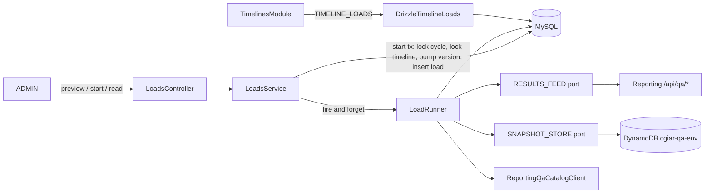

# Step-1 loads — Design

## 1. Document Control

| | |
|---|---|
| Spec path | `docs/specs/ingestion/step-1-loads` |
| Requirements | `requirements.md` (FR-1…FR-15, NFR-1…NFR-7), approved by the back lead on 2026-11-04 ("Continue") |
| Status | Draft |
| Depth | Full |
| Verified at | `feat/step-1-loads` @ `7163227` (QA); Reporting contract `qa-catalog.en.md` v1.29 @ `654cbab4d`; live probes against Reporting TEST (`prtest-back`) and DynamoDB `cgiar-qa-test`, 2026-11-04 |
| Last updated | 2026-11-04 |

## 2. Executive Summary

A new `ingestion` module owns the load. It has:
- three HTTP routes under `/timelines/:id/loads`, plus a preview;
- a `RESULTS_FEED` port with an HTTP adapter to Reporting;
- a `SNAPSHOT_STORE` port with the repo's first ElectroDB entity;
- two MySQL tables (`timeline_loads`, `timeline_results`, migration `0007`);
- an in-process run engine with a lease.

The database carries the invariants, through generated keys with unique indexes:
- one running load per cycle;
- one active membership per `(cycle, result_code)`;
- one membership per `(timeline, result_code)`.

The timeline edit needs **no new lock**. A load start bumps `timelines.version` under the timeline lock, so an edit judged on an old "has a load" fails its locked version check (DD-7).

## 3. Architecture Overview



Legend:
- Boxes are Nest providers. Cylinders are stores.
- `TimelinesModule` reads the load tables directly, through `DrizzleTimelineLoads`. It never imports `IngestionModule`, so there is no module cycle (DD-9).

## 4. Extended Directory Structure

```text
server/
  drizzle/0007_timeline_loads.sql                       new (generated)
  src/database/drizzle/schema/timeline-loads.ts         new
  src/database/drizzle/schema/timeline-results.ts       new
  src/database/drizzle/schema/timeline-audit-events.ts  changed: actions + 'load_start', 'load_end'
  src/database/dynamodb/entities/result-snapshot.entity.ts  new (first ElectroDB entity)
  src/users/catalogs/catalog-http.ts                    changed: postJson
  src/admin-config/field-config/reporting-qa-catalog.client.ts  changed: refresh(year) public, forced
  src/admin-config/timelines/timeline-loads.ts          changed: DrizzleTimelineLoads replaces NoTimelineLoads
  src/admin-config/timelines/timelines.module.ts        changed: binding
  src/ingestion/
    AGENTS.md
    ingestion.module.ts
    loads.controller.ts  dto/  models/
    loads.service.ts            preview, start, reads
    load-runner.ts              the background run (lots, retries, lease)
    load-rules.ts               pure: window, skips, lease, summary
    kp-classifier.ts            pure: 2025 rule (port KP_RULES)
    results-feed.port.ts  reporting-results-feed.client.ts
    snapshot-store.port.ts  dynamo-snapshot-store.ts
    loads.store.ts  loads.unit-of-work.ts
    loads.errors.ts
  test/ingestion-loads.e2e-spec.ts  test/ingestion-loads-privacy.e2e-spec.ts
docs/specs/ingestion/step-1-loads/front-contract.md
```

## 5. Data Model

### 5.1 `timeline_loads` (MySQL, migration `0007`)

| Column | Type | Rule |
|---|---|---|
| `id` | int unsigned PK | |
| `cycle_id` | int unsigned FK cycles | |
| `timeline_id` | int unsigned FK timelines | |
| `timeline_step_id` | int unsigned FK timeline_steps | Step 1 (room for step 3, P2-3906) |
| `phase_year` | smallint unsigned | `cycles.year` at start |
| `scope` | json | `{allPrograms, programIds, allResultTypes, resultTypeKeys}` read at start (FR-3) |
| `status` | enum `running`, `completed`, `failed` | |
| `running_key` | int unsigned, generated `IF(status='running', cycle_id, NULL)` STORED, **unique** | One running load per cycle (FR-2, NFR-6; the `0003` pattern) |
| `total`, `processed` | int unsigned | `total` is null until the run has listed every page |
| `summary` | json | Loaded by program and type, KP groups, skips by reason, other timelines `{id, name, count}` |
| `failure_reason` | varchar(64) null | Closed list: `REPORTING_UNAUTHORIZED`, `REPORTING_REJECTED`, `REPORTING_UNAVAILABLE`, `CATALOG_VERSION_MISMATCH`, `STORE_UNAVAILABLE`, `ABANDONED`, `INTERNAL` |
| `started_by` | int unsigned FK users | |
| `started_at`, `heartbeat_at`, `finished_at` | datetime | Lease on `heartbeat_at` (DD-6) |
| `request_id` | varchar(64) null | |

Index: `(timeline_id, id)` for the list.

### 5.2 `timeline_results` (MySQL)

| Column | Type | Rule |
|---|---|---|
| `id` | bigint unsigned PK | |
| `cycle_id`, `timeline_id`, `load_id` | int unsigned FKs | |
| `result_code` | int unsigned | Identity (S-2) |
| `result_id` | int unsigned | The phase's id |
| `phase_year` | smallint unsigned | |
| `program_clarisa_id` | int unsigned | Lead program |
| `result_type_key` | varchar(64) | |
| `status` | enum `pending`, `auto_validated`, `not_in_qa` | FR-7 |
| `kp_group` | enum `not_in_qa`, `auto_checked`, `review`, null | null for non-KP |
| `awaits_step` | tinyint unsigned null | 3 for KP review (S-9) |
| `snapshot_sk` | varchar(160) | The DynamoDB sort key (pk is derived from `result_code`) |
| `snapshot_hash` | char(64) | sha-256 of the canonical values JSON |
| `catalog_version` | varchar(32) | |
| `created_at` | datetime | |
| `ended_at` | datetime null | |
| `end_reason` | enum `timeline_closed`, `released_qaed`, `released_not_qaed`, null | |
| `active_key` | varchar(32), generated `IF(ended_at IS NULL, CONCAT(cycle_id,'#',result_code), NULL)` STORED, **unique** | FR-4 |

Unique `(timeline_id, result_code)`: a membership per timeline, active or ended. This is S-5 in the database. Index `(result_code)` for history.

Rows are never deleted. The only update is ending a membership (`ended_at`, `end_reason`).

### 5.3 `timeline_audit_events`

The `action` enum gains `load_start` and `load_end`. This is additive: `ALTER … MODIFY` keeps `update`. `changes` follows the existing `{field: {before, after}}` shape:
- `load_start`: `{load: {before: null, after: {id, phaseYear, scope}}}`;
- `load_end`: `{load: {before: 'running', after: {id, status, total, processed, loaded, skipped, failureReason}}}`. The `id` ties the end row to its load (FR-12; amended 2026-11-04 at the T-5 gate). The step is the load row's `timeline_step_id`.

`actor_id` is the user who started the load. No PII.

### 5.4 DynamoDB `ResultSnapshot` (ElectroDB, table from `DYNAMODB_TABLE_NAME`)

| Part | Value |
|---|---|
| pk | `RESULT#{result_code}` |
| sk | `SNAP#{phase_year}#{cycle_id:06}#{timeline_id:08}#{load_id:010}`. Zero-padded, so the history Query sorts by year, cycle, timeline, load (FR-6) |
| Attributes | `resultCode`, `resultId`, `phaseYear`, `cycleId`, `timelineId`, `loadId`, `resultTypeKey`, `programClarisaId`, `catalogVersion`, `hash`, `loadedAt` (the load's `started_at`, so a retry writes identical content), `values` (a JSON string), `valuesGz` (binary, only when the JSON is above 256 KB; then `values` is absent) |
| Write | `put` with condition `attribute_not_exists(pk)`. A condition failure is read back: same hash → success; different hash → the lot fails (`INTERNAL`) |
| No GSI | The table has none (P-3); none is needed |

Orphans: a snapshot whose `(load_id, result_code)` has no `timeline_results` row is never read by QA (FR-6). No cleanup in this spec.

## 6. API Design

All routes use `@RequirePermission(Permission.ADMIN_ACCESS)` (FR-13) and the standard envelope.

| Method | Path | Request | Response | Errors |
|---|---|---|---|---|
| GET | `/timelines/:id/loads/preview` | — | 200 `{phaseYear, window: 'open'\|'closed', toLoad: {total, byProgram[], byResultType[]}, kpGroups: {notInQa, autoChecked, review}, skipped: [{reason, count, timelines?: [{id, name, count}]}]}` | 404 `TIMELINES_NOT_FOUND`; 503 `SERVICE_UNAVAILABLE` (Reporting) |
| POST | `/timelines/:id/loads` (`@Idempotent()`) | `{}` | **202** `{id, status: 'running'}` | 404; 409 `CYCLES_CLOSED`, `LOADS_WINDOW_CLOSED`, `LOADS_ALREADY_RUNNING`; 503 |
| GET | `/timelines/:id/loads` | — | 200 `[{id, status, total, processed, startedAt, finishedAt, startedBy: {id, nickname}, failureReason}]`, newest first | 404 |
| GET | `/timelines/:id/loads/:loadId` | — | 200: the list item plus `summary` | 404 `TIMELINES_NOT_FOUND`, `LOADS_NOT_FOUND` |

Notes:
- **The preview reads the timeline, then Reporting.** It writes nothing. `window` lets the front disable the start.
- **The start checks Reporting is reachable** with one list call (`page_size=1`) before the transaction. A 5xx, a timeout or a 401 is a 503 `SERVICE_UNAVAILABLE`. Nothing is written in that case (FR-2).
- **Stale loads read as `failed`.** A `running` load with an expired lease reads `failed` / `ABANDONED` on every read (FR-9). The next start persists that state.

## 7. Backend Module Design

### 7.1 Preview (`LoadsService.preview`)

1. Read the timeline bundle and cycle (404).
2. List every feed page (`page_size=200`) with `phase_year`, `program_ids` and `result_type_keys` from the scope. For an "all" flag, the filter is omitted.
3. Read QA's memberships for those `result_code`s in the cycle, in one query, `IN` chunked by 500. Classify each result:
   - an active membership in another timeline whose last step has **not** closed → `ACTIVE_IN_OTHER_TIMELINE`;
   - any membership in this timeline → `ALREADY_IN_THIS_TIMELINE`;
   - a `result_code` listed twice → `DUPLICATE_RESULT_CODE` (P-1 guard, DD-11);
   - otherwise → to load.
4. For KPs to load, call details in lots of 50, with `field_keys` = the 10 KP rule keys listed in proposal § 12.1 (R-9; amended 2026-11-04, was "9"). Then classify them (§ 7.5).

### 7.2 Start (`LoadsService.start`)

1. Load the bundle (404). Reporting reachability probe (503).
2. `LoadsUnitOfWork` transaction, `READ COMMITTED`, with this lock order: the cycle row `FOR SHARE`, the timeline row `FOR UPDATE`. That is the timeline edit's order (`timelines.unit-of-work.ts:64-74`), so the two serialize without deadlocks. Then:
   1. If the cycle is `closed` → `CYCLES_CLOSED`.
   2. If now (Rome minute) is after step 1's `closesAt` → `LOADS_WINDOW_CLOSED` (*times* S-2: the closing minute is open).
   3. Mark `failed`/`ABANDONED` any `running` load of the cycle whose lease expired (DD-6).
   4. Insert the load. A duplicate on `running_key` → `LOADS_ALREADY_RUNNING`.
   5. Bump `timelines.version` (DD-7).
   6. Write the `load_start` audit row.
   7. Write the idempotency mark.
3. After commit, start `LoadRunner.run(loadId)`. It is not awaited; it catches and records its own failure. Answer 202.

### 7.3 Run (`LoadRunner`)

1. List every feed page with the load's stored scope. Set `total`. Read the catalog version for `phase_year`.
2. For each lot of 50, in feed order:
   1. **Skips.** Read the memberships of the lot's codes in the cycle. In a short transaction, end (`timeline_closed`) the active memberships of **other** timelines whose last step's `closesAt` is before now (Rome minute) (DD-5). The remaining active ones in other timelines → `ACTIVE_IN_OTHER_TIMELINE`. Any in this timeline → `ALREADY_IN_THIS_TIMELINE`. Duplicate codes → `DUPLICATE_RESULT_CODE`.
   2. **Intake** the rest. `taken` continues; each `not_taken` is a skip with its reason as given.
   3. **Details** for `taken`, with `field_keys` per S-10 (DD-10). Each `not_eligible` is a skip. If `catalog_version` differs from QA's copy, force one catalog refresh for the load. If it still differs, the load fails (`CATALOG_VERSION_MISMATCH`).
   4. **Classify** KPs (§ 7.5).
   5. **Snapshots**: one `put` per result, at most 10 in parallel.
   6. **Memberships**: one transaction, insert row by row. A duplicate on `active_key` or `(timeline_id, result_code)` is a race. It becomes a skip (`ACTIVE_IN_OTHER_TIMELINE` or `ALREADY_IN_THIS_TIMELINE`, judged by which key) and does not fail the lot (FR-4).
   7. **Progress**: `processed += lot size`, `heartbeat_at = now`, summary counts merged. All in the same transaction as step 6.
3. End: `completed`. If the KP release setting is on (FR-14, off by default), release the lot's `not_in_qa` and `auto_validated` KPs as `qaed`. Then `finished_at`, the final summary, and the `load_end` audit row.
4. **Retries** (DD-8). Every Reporting call and every store write retries on 5xx, timeout, network error or a store error: **3 attempts**, backoff 1 s then 4 s, ± 20 % jitter. A 4xx is never retried: 401 → `REPORTING_UNAUTHORIZED`, any other 4xx → `REPORTING_REJECTED`. Exhausted retries → `REPORTING_UNAVAILABLE` or `STORE_UNAVAILABLE`. A failure sets `failed`, the reason, `finished_at` and the `load_end` audit. What earlier lots recorded stays (FR-8).
5. A separate timer renews `heartbeat_at` every 60 s while the run is alive (FR-9).

### 7.4 Pure rules (`load-rules.ts`)

| Rule | Input → output |
|---|---|
| Window | `(cycle status, step 1 closesAt, now Rome minute)` → `open` \| `CYCLES_CLOSED` \| `LOADS_WINDOW_CLOSED` |
| Lease | `(status, heartbeat_at, now)` → effective status. Lease = **5 min**. Heartbeat ≤ 60 s, and one lot's worst case is 3 calls × (3 × 10 s + 5 s backoff) ≈ 105 s, so a live run never looks stale |
| Membership end | `(active membership, its timeline's last step closesAt, now)` → ends? |
| Skip reason | `(code, memberships of the cycle, timeline, duplicates)` → reason \| load |
| Summary merge | Associative merge of lot counts |

### 7.5 KP rule (`kp-classifier.ts`, port `KP_RULES`)

This is the 2025 rule of proposal § 12.1, as a pure function over the 10 keys listed there (`is_melia`, `type` and 4 CG/WoS pairs; amended 2026-11-04, was "9").

Comparisons:
- Years: compare the year part of `issue_date_cg` and `issue_date_wos`.
- ISI and peer reviewed: equal to `true` or `1`.
- Accessibility: trimmed and lower-cased.
- `null`, or a missing key on either side → the check fails, and the KP goes to **review**.
- Type: `knowledge_product.type` equal to `Journal Article`, trimmed and case-insensitive.

Output: `{status, kpGroup, awaitsStep}`. Non-KP results → `{pending, null, null}`.

### 7.6 "Has a load" (`DrizzleTimelineLoads`)

`withLoad(ids)` is one statement. A timeline is in the answer when any of these holds:
- it has a `timeline_results` row;
- it has a `completed` load;
- it has a `running` load whose lease is alive.

The first two are S-6. The third counts a running load for the scope lock (FR-11); it also ends the hold while the first lot is in flight. If that load then fails with no members, the hold returns. The list's query count goes from 6 to 7 (TRD loads-port note 2).

### 7.7 HTTP adapter (`ReportingResultsFeedClient`)

| Part | Design |
|---|---|
| `postJson` | Added to `catalog-http.ts` beside `getJson`: same 10 s abort, `redirect: 'error'`, JSON parse and log discipline. Headers are passed by the caller, as with `getJson` (P-11); the helper never logs or echoes them, and no log line or error message includes headers (NFR-1). A non-2xx keeps its status (`UpstreamStatusError extends UpstreamUnavailableError`), so the adapter can map the FR-8 kinds while existing `getJson` callers see no change (amended 2026-11-04, T-1) |
| Operations | `list(query)` → page; `details({phaseYear, resultIds, fieldKeys?})`; `intake({phaseYear, resultIds})`; `release({phaseYear, items})` |
| Errors | One `FeedError` with `kind`: `unauthorized` (401), `rejected` (other 4xx, plus the status), `unavailable` (5xx, timeout, network, bad JSON). The runner maps them (§ 7.3.4) |
| Parsing | Response bodies are checked field by field. A shape mismatch is `unavailable`, never trusted |

### 7.8 Logs

One `ingestion` line per request: route, timeline id, outcome, request id. The runner logs one line per lot and one per end, with ids and counts only. No result titles or person fields; NFR-2 is checked by a log spy.

## 8. Frontend / UX Component Architecture

None in this spec. `front-contract.md` gives Yeck the four routes, the states (`running`, `completed`, `failed` plus reasons), polling guidance (every 2 s while `running`), the skip reasons, and the codes. The design of the screens is Juanpa's (proposal § 8).

## 9. Shared Contracts or Package Extensions

- **Reporting contract** `qa-catalog.en.md` v1.29. Fixtures for the adapter tests are copied from its examples (§ *Results feed*, § *Intake and release*).
- **Env vars**: none new. `REPORTING_API_URL`, `CLARISA_API_KEY`, `AWS_REGION`, `DYNAMODB_TABLE_NAME`, and `DYNAMODB_ENDPOINT` for DynamoDB Local all exist. The KP release setting is a code constant, `false` (FR-14). A flag can come with Q9.
- **TRD pending items** (shared-file discipline; not edited on this branch):
  - ADR-005 deviation: the run record is `timeline_loads` in MySQL.
  - The reserved tables are real.
  - The first ElectroDB entity.
  - D-2 made concrete.
  - The loads-port query count is 7.
- **`docs/infrastructure.md:29`**: the table is `cgiar-qa-test`, pk/sk, on demand, active. The local credentials cannot reach `cgiar-qa-dev` or `cgiar-qa-prod` (P-3).

## 10. Design Decisions

| ID | Decision | Alternatives rejected | Consequence | Requirements |
|---|---|---|---|---|
| DD-1 | Snapshot in DynamoDB behind `SNAPSHOT_STORE`; loads and memberships in MySQL | MySQL JSON table (option A); run record in DynamoDB (ADR-005, option C) | Two stores, no shared transaction. Handled by a deterministic key and orphan tolerance (DD-4). **Supersedes ADR-005 for this flow** (run record) | FR-6, S-1 |
| DD-2 | Invariants as generated `*_key` columns with unique indexes | Check in code before writing | Correct under concurrency (NFR-6). A race becomes a duplicate-key error mapped to a skip or a 409 | FR-2, FR-4 |
| DD-3 | `(timeline_id, result_code)` unique over **all** memberships | Allow re-entry into the same timeline | S-5 enforced by the database. If Angel overrules S-5, the index becomes active-only (a migration) | FR-4, S-5 |
| DD-4 | Snapshot written before the membership, with a conditional put and a hash read-back | Membership first | A failure leaves an orphan snapshot, never a membership without its snapshot | FR-6 |
| DD-5 | The time-based end of a membership is applied **lazily**: a later load ends an expired membership under its own transaction before judging the skip | A scheduled job; a generated column on the clock (MySQL forbids `NOW()` there) | No job (TRD: nothing scheduled). The rows of a closed timeline stay `ended_at = NULL` until another timeline meets the result; every reader must apply the same rule (`load-rules.ts` is the single source) | FR-4, S-4 |
| DD-6 | Lease of 5 min on `heartbeat_at`; stale = `failed`/`ABANDONED` on read; persisted at the next start | Recovery on boot; no lease | A restart never blocks a cycle for more than 5 min, with no job | FR-9 |
| DD-7 | The start bumps `timelines.version` under the timeline lock; the edit's existing locked version check catches the race. No change to the edit's flow beyond the port binding | A second "has a load" read inside the edit transaction | Zero new code in `timelines.service.ts`. An ADMIN editing while a load starts gets `TIMELINES_VERSION_STALE` and reloads | FR-11 |
| DD-8 | 3 attempts, backoff 1 s / 4 s ± 20 %; 4xx never retried | Unlimited retry; a retry queue | Bounded run time; the lease bound holds (§ 7.4) | FR-8 |
| DD-9 | `DrizzleTimelineLoads` lives in `admin-config/timelines` and reads the ingestion tables directly | Bind the port from `IngestionModule` | No module cycle (ingestion imports timelines for the bundle and the lock) | FR-11 |
| DD-10 | Details sends `field_keys` only when S-10 excludes keys; the list comes from the catalog's top-level keys minus the excluded ones | Always all keys | **Waits on Q3**. With the default "keep all", the call omits `field_keys` | FR-6, S-10 |
| DD-11 | A `result_code` listed twice in one feed listing is skipped `DUPLICATE_RESULT_CODE` and logged | Take the first | P-1 held on TEST, but PROD is unverified. A silent skip would lose a result, while the reason makes it visible | FR-5 |
| DD-12 | `values` stored as a JSON string, gzip above 256 KB | Native DynamoDB map | Exact round-trip of the feed (null, nested lists); the largest measured item is 9.5 KB (P-2) | FR-6, NFR-7 |
| DD-13 | The start probes Reporting (one list call) before writing | Let the runner fail | An unreachable or unauthorized Reporting is a 503 at once, with no failed load row | FR-2 |

**Reversion challenge (Step 2.3):** DD-7 replaces `NoTimelineLoads`. That is the only removal of delivered behavior. *What does removing it break?* A timeline gets a load, so the edit suites that assume "has a load" is always false must keep a fake binding. Those suites override `TIMELINE_LOADS` or use the no-load default. **T-8 keeps `NoTimelineLoads` as a test double** instead of deleting it, so those suites do not change (*edit* NFR-6).

### Budget (Step 2.4)

| Measure | Estimate |
|---|---|
| Tasks | 11 (+ 1 T-HITL) |
| Production LOC | ≈ 4,500 — re-estimated again 2026-11-04 at the T-5 tripwire, approved by the back lead ("Re-estimar y seguir"); T-5 alone ran ≈ 1,027. Before that: ≈ 3,200 — re-estimated 2026-11-04 at the T-4 gate, approved by the back lead ("Re-estimar y seguir"). Was ≈ 1,450 (adapter 200, migration and schema 160, entity and store 150, runner 320, service 250, controller and DTOs 200, rules and classifier 120, port binding 50; the loads store and unit of work had no line). T-1…T-4 ran ≈ 1,208 against 630 estimated (× 1.9); the rest re-scaled at × 1.9 plus ≈ 400 for T-5 |
| Test LOC | ≈ 9,000 — re-estimated a third time 2026-11-04 at the T-8 tripwire, approved by the back lead ("Re-estimate and continue"); T-1…T-8 ran ≈ 7,037. Before that ≈ 7,000 — re-estimated 2026-11-04 at the T-5 tripwire (T-1…T-5 ran ≈ 4,417). Before that ≈ 3,800 (was ≈ 1,800) |
| Review rounds | ≈ 20 — re-estimated 2026-11-04 at the T-8 tripwire (T-1…T-8 used 13; T-5 and T-8 ran parallel lenses and a rework). Was 14 (1 per task, plus 3 margin for the runner, the migration and the e2e) |

It is above the proposal's 900-LOC split line. Recommendation: **keep one spec and ship 3 PRs**:
1. persistence and ports;
2. service, runner and routes;
3. edit binding and documents.

The preview is only ≈ 150 LOC, so splitting it out would not help.

### Known gaps (recorded 2026-11-04 at the T-8 gate, back lead: "record as known gaps")

DD-6 and DD-8 are silent on these. The runner ships without them; each is a candidate for a follow-up proposal, not a task of this spec.

| # | Gap | Effect | Candidate fix |
|---|---|---|---|
| G-1 | Lease revival: `recordLot` and `renewHeartbeat` check `status = 'running'`, not the lease | A lot that commits after a > 5 min stall makes a load that readers showed as `failed`/`ABANDONED` read `running` again | Add `heartbeat_at >= now − lease` to both conditions |
| G-2 | Lost commit acknowledgement on `recordLot` | The retry turns the lot's own inserts into `ALREADY_IN_THIS_TIMELINE` skips and adds the lot to `processed` again (`processed > total`; `loaded`/`skipped` skewed in `load_end`). Memberships and snapshots stay correct | Conditional progress (`WHERE processed = :expectedBefore`), or count a race skip whose row has this `load_id` as loaded |
| G-3 | Heartbeat without progress | A hung store call (no query timeout) keeps renewing the lease, so the load stays `running` and the cycle stays blocked | A timeout per attempt, or stop beating after no progress for longer than the lease |

## 11. Premise Ledger

Count: 15 verified, 2 `UNVERIFIED` (High 1: P-5; Low 1: P-6). Both are settled before T-12, which depends on them.

Blast-radius triggers: `live-path` (the ADMIN action reaches the new routes; P-12), `shared-state` (`TIMELINE_LOADS` and `timelines.version`; P-13), `consumer` (the `timeline_audit_events.action` enum and the `TIMELINE_LOADS` binding; P-14, P-15).

| # | Claim | Class | Citation (as run) | Verified at | If false | Settled by |
|---|---|---|---|---|---|---|
| P-1 | Within `phase_year` 2026, each eligible `result_code` has one `result_id` | data-env | Probe script, mode `codes`: paged `GET /api/qa/results?phase_year=2026&page_size=200` on Reporting TEST → `total 33, distinct result_id 33, distinct result_code 33, codes with >1 result_id 0`. Feed SQL filters by `v.phase_year = ?` over both versions (`qa-results.repository.ts:288-295`) | 654cbab4d (Reporting) | Uniqueness by `result_id` (FR-5); DD-11 already guards. Impact Low | — (PROD sample: T-HITL) |
| P-2 | The largest `values` of a real result is far below 400 KB | data-env | Probe, mode `sizes`: `details` per type on TEST → overall max **9,534 bytes** (KP), median ≤ 6,277 | 654cbab4d | DD-12 gzip threshold, NFR-7. Low | — |
| P-3 | The table exists as `cgiar-qa-test` with key `pk` HASH / `sk` RANGE, on demand, no GSI | data-env | Probe, mode `dynamo`: `DescribeTable cgiar-qa-test` → `ACTIVE`, `PAY_PER_REQUEST`, no GSI, 0 items. `cgiar-qa-dev`, `cgiar-qa-prod` → `AccessDeniedException` with the local credentials | — (AWS) | Entity keys (§ 5.4). Low | — |
| P-4 | The QA key passes auth on all five `/api/qa/*` routes of Reporting TEST | data-env | Probe, mode `grants`: catalog 200, results 200, details 400, intake 400, release 400 (empty body → validation, so past auth). Control: a fake key → 401; an unknown route → 401 | — (Reporting TEST, 2026-11-04) | R-2; T-HITL blocked. Low | — |
| P-5 | The deployed TEST already enforces the per-route grant (v1.29), so P-4's 400s prove the grants and not just a valid key | data-env | `UNVERIFIED — confirm at source before relying on it`. The probe cannot tell "granted" from "not enforced yet" | — | A 401 appears once v1.29 is deployed, and loads fail with `REPORTING_UNAUTHORIZED`. **High** (blocks the T-HITL) | Back lead with Reporting / CLARISA admin, before the T-HITL |
| P-6 | IAM in TEST/PROD hosts can reach `cgiar-qa-{env}` | data-env | `UNVERIFIED — confirm at source before relying on it` | — | Snapshots fail with `STORE_UNAVAILABLE`. Low (build unaffected) | Infrastructure (Cris), before the T-HITL |
| P-7 | Timeline scope stores CLARISA ids and catalog keys, the feed's filter vocabulary | data-env | `database/drizzle/schema/timeline-programs.ts:6` ("`program_id` is the CLARISA"); contract § `GET /api/qa/results` (`program_ids` = CLARISA ids, `result_type_keys` = catalog keys) | 7163227 | A mapping step in § 7.1. Low | — |
| P-8 | The timeline edit locks the cycle `FOR SHARE`, then the timeline `FOR UPDATE`, and re-checks `version` under that lock | location | `timelines.unit-of-work.ts:64-74`; `timelines.service.ts:560-564` (`locked.version !== version` → stale) | 7163227 | DD-7 fails; the edit would need its own locked `hasLoad` read. High → verified | — |
| P-9 | `TIMELINE_LOADS` is bound in `TimelinesModule` to `NoTimelineLoads`; the view and the edit read only that port | location | `timelines.module.ts:37`; `timeline-loads.ts:11-27`; `timelines.service.ts:472` | 7163227 | DD-9 placement. Low | — |
| P-10 | `timeline_audit_events.action` is an enum with only `update`; `actor_id` is not null | existence | `schema/timeline-audit-events.ts:15,38,41` | 7163227 | § 5.3 migration shape. Low | — |
| P-11 | `catalog-http.ts` has only `getJson`; the key header is built by callers | existence | `users/catalogs/catalog-http.ts:25` (`export async function getJson`); `grep -n "export" catalog-http.ts` → `getJson`, `isObject`, constants only | 7163227 | § 7.7. Low | — |
| P-12 | `live-path`: an ADMIN reaches the routes through the global guard → `@RequirePermission(ADMIN_ACCESS)` on the controller → `LoadsController` | live-path | Timelines controller pattern `timelines.controller.ts:81-82` (`@RequirePermission(Permission.ADMIN_ACCESS)` / `@Controller()`); the new controller copies it; the route inventory test `test/auth-hardening.e2e-spec.ts` lists every route | 7163227 | FR-13 | — |
| P-13 | `shared-state`: readers of `TIMELINE_LOADS` and of `timelines.version` | shared-state | `git grep -n "TIMELINE_LOADS\|loads.withLoad\|this.loads" -- server/src` (excluding `*.spec.ts`) gives the readers of `TIMELINE_LOADS`: `timelines.service.ts:311` (list and detail, for the hold via `timeline-view.ts:24`) and `:472` (edit, passed to `timeline-rules.ts:461`). The binding is `timelines.module.ts:37`. `git grep -n "version !== " -- server/src/admin-config/timelines/timelines.service.ts` gives the readers of `version`: `:478` (unlocked stale), `:553` (no-op answer), `:562` (locked stale), `:773` (`confirmVersion`). All four compare for equality, so a bump by the load start reads as stale, which is the intended effect | 7163227 | DD-7, § 7.6 | — |
| P-14 | `consumer`: the readers of `timeline_audit_events` and its `action` enum | consumer | `git grep -n "timelineAuditActions\|timeline_audit_events\|timelineAuditEvents" -- server/src server/test client/src`. Writers: `timelines.store.ts:601`. Tests that pin it: `schema/schema.spec.ts:952` (`action` enumValues equal `['update']`, **must change**), `:1172`, `:1185-1230` (the `0004` migration's SQL), `:1765` (scoped to `0006_timeline_step_times`, per `:1741`, so `0007` is unaffected), `timelines.unit-of-work.spec.ts:747,795`, `test/support/in-memory-admin-config.ts:101,185`. No `client/src` hit. No reader filters by action | 7163227 | § 5.3; T-2 updates `schema.spec.ts:952` | — |
| P-15 | `consumer`: the code and tests that name the loads port | consumer | `git grep -ln "NoTimelineLoads\|TIMELINE_LOADS" -- server/src server/test` → `admin-config/AGENTS.md`, `timeline-loads.ts`, `timeline-rules.ts`, `timeline-view.ts`, `timelines.module.ts`, `timelines.service.spec.ts`, `timelines.service.ts`, `timelines.unit-of-work.spec.ts`, `test/support/admin-config-app.ts`, `test/support/in-memory-admin-config.ts` | 7163227 | Reversion challenge; T-8 keeps `NoTimelineLoads` as the double these use | — (re-run in T-8) |
| P-16 | `ReportingQaCatalogClient.forYear` returns `catalogVersion`; the refresh is private | location | `reporting-qa-catalog.client.ts:49,80`; `field-config-catalog.ts:36` | 7163227 | § 7.3.3 needs a public forced refresh. Low | — |
| P-17 | No scheduler exists; "open" is computed on read (TRD, *timelines* DD-2) | other | `archive/…cycle-timelines/design.md:264` (DD-2) | 7163227 | DD-5, DD-6. Low | — |

Notes:
- **P-13 and P-14 were searched with `git grep`**, so they cover every tracked file in the named scopes.
- **The probe script ran outside the repo**, so P-1 to P-4 cite it by mode and output only.
- **The QA key was never printed.**
