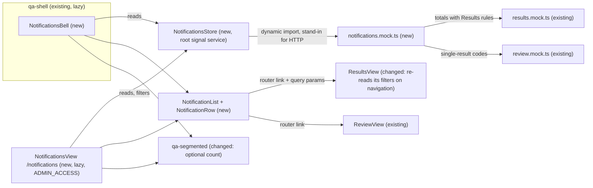

# Review updates for the QA Admin (notifications) — Design

## 1. Document Control

| Spec path | Requirements | Status | Last updated |
|---|---|---|---|
| docs/specs/notifications/review-updates | `requirements.md` (FR-1…FR-9, NFR-1…NFR-4) | Draft (rev. 2, after Judgment Day round 1) | 2026-10-22 |

| | |
|---|---|
| Depth | Standard |
| Phase | Mock phase — `client/` only; no server, API or data model changes |
| Visual reference | Claude Design "QA Platform" → `notifications/Notifications.dc.html` (frames 1a, 1c, 1d, 1e) |
| Verified at | `93dfe10` (`jp-design/mockup-completo`) |
| Review | `judgment.md` — round 1 fixes S-1…S-6 and I-1…I-7 applied here |
| Skills | `angular-developer`, `tailwind-design-system` (project `## Skill Map`); `frontend-design` for the UI |

## 2. Executive Summary

A new `notifications` feature folder adds a **store** that loads mock notifications and keeps read state, a **row/list** pair shared by the panel and the page, a **bell** that the shell renders in its top bar, and a lazy **Notifications page**. The shell gains one import and one tag; the routes gain one entry. Two of Juanpa's own files change behavior so the targets work: **Results** re-reads its filters on every navigation to it, and **`qa-segmented`** can show a grey count next to an option. Every number a notification compares with its target is computed from the same Results mock and the same rules Results uses.

## 3. Architecture Overview



Legend: *new* = added by this spec; *changed* = Juanpa's own file, changed by this spec; *existing* = read only. Arrows mean "uses".

No server impact. A later spec swaps the dynamic import in the store for HTTP with the same shape (DD-1).

## 4. Extended Directory Structure

```
client/src/app/
├── app.routes.ts                                  # + one view('notifications', …) entry (ADMIN_ACCESS, no nav)
├── app.routes.spec.ts                             # new: route entry has ADMIN_ACCESS and no nav (FR-6, I-7)
├── shell/
│   ├── qa-shell.ts                                # + NotificationsBell in imports
│   └── qa-shell.html                              # + <qa-notifications-bell /> before <qa-unsent-center />
├── ui/segmented/qa-segmented.ts                   # changed: optional `count` per option (S-6)
├── pages/workspace/results/results-view.ts        # changed: re-seeds filters on every NavigationEnd to /results (S-1, F-1)
├── pages/workspace/results/results-view.spec.ts   # new: new or same-URL navigation on an open view updates the count
└── pages/workspace/notifications/                 # new
    ├── notifications.model.ts                     # Notification, NotificationType, NotificationTarget, DayGroup
    ├── notifications.mock.ts                      # mock events; totals from results.mock.ts; codes from review.mock.ts
    ├── notifications.mock.spec.ts                 # totals = ResultsView count; codes exist; sentence rule (NFR-4, S-2, I-6)
    ├── notifications-store.ts                     # @Service root store
    ├── notifications-store.spec.ts
    ├── notification-row.ts                        # one notification (variant: panel | page)
    ├── notification-list.ts                       # day groups + rows + empty / loading / error
    ├── notification-list.spec.ts                  # vocabulary, red only for At risk, day groups
    ├── notifications-bell.ts                      # bell, dot, popover panel; phone link
    ├── notifications-bell.spec.ts                 # admin gating, no gap, accessible name, closes on open
    ├── notifications-view.ts
    ├── notifications-view.html
    └── notifications-view.spec.ts                 # timeline / type / unread / search filters, states
```

## 5. Data Model

No persistence. The mock's in-memory shape (`notifications.model.ts`):

| Field | Meaning | Rule |
|---|---|---|
| `id` | Stable id | Unique in the mock |
| `type` | One of the 9 types of FR-3 | Closed union |
| `subject` | Bold start of the sentence | — |
| `text` | Rest of the sentence | Stage words by the rule in § 8 *Sentences* (DD-6) |
| `timelineId` | a `TIMELINES` id (`annual`, `jul`, `kp`, `sp03`, `sep` at HEAD `2904c55`) or `all` | `all` is not a `TIMELINES` id: it means "every timeline"; such items show only under "All timelines" |
| `day`, `time` | Day group (`today` · `yesterday` · `earlier`) and display time | Mock date 17 Jul 2026, same as the mockup |
| `unread` | Initial read state | Copied into the store's signals |
| `target` | `{ path, queryParams? }` | Per-type table below |
| `total` | The number compared with the target | **Computed** from `RESULTS` with Results' rules (DD-3); `null` when the target shows no list |
| `delta` | Change since yesterday ("18 since yesterday") | **Authored** in the mock; never compared with a target (`RESULTS` has no dates, P-18) |
| `action` | `View result` · `View results` | Per-type table below |

### Per-type table (FR-3, FR-4, FR-5)

| Type | One per | `timelineId` | Action | Target | Sentence (the compared number is always `total`) |
|---|---|---|---|---|---|
| Stage | assessed stage (`r1-one`, `r1-two`, `r2-assessed`), timeline, day | that timeline | View results | `/results?timeline=<id>&stage=<stage>` | "`<total>` results reached `<Stage>` in `<Round>`." + "`<delta>` since yesterday." |
| Quality assessed | timeline, day | that timeline | View results | `/results?timeline=<id>&stage=quality-assessed` | "`<total>` results are Quality assessed." + "`<delta>` since yesterday." |
| Program response | program, day | `all` | View results | `/results?program=<code>&status=Answered` | "`<code>` has answered `<total>` returned results." — results, not comments |
| Waiting | condition | `all` | View results | `/results?status=Awaiting%20response` | "`<total>` returned results are waiting on a program." |
| At risk | step, timeline | that timeline | View results | `/results?timeline=<id>&stage=<stage>` — the stage is named in the mock entry (`r2-pending` for "Step 4", the broker step closing on 23 Jul in the timeline data at `2904c55`) | "Step `<n>` of `<timeline>` closes in `<days>` with `<total>` results still `<Stage>` in `<Round>`." |
| Load | first load of a timeline (later loads: OQ-7) | that timeline | View results | `/results?timeline=<id>` | "`<timeline>` now has `<total>` results in QA." + "`<delta>` loaded today." |
| Escalation | result | the result's timeline | View result | `/results/<code>` | "`<code>` was escalated to the third-party broker." — no number |
| Third-party broker | result | the result's timeline | View result | `/results/<code>` | "`<code>` moves to PPU." — no number |
| PPU | result | the result's timeline | View result | `/results/<code>` | "`<code>` was marked Done by PPU." — no number |

Rules the mock spec asserts: for every entry with a list target (`/results` with query parameters), the target's `timeline` parameter equals `timelineId` and is absent exactly when `timelineId` is `all`, and the sentence contains `total`; for a Load entry, `delta` equals `total` (a first load); for the Waiting entry, `total` also equals the Overview's waiting figure (212, `overview.mock.ts:186`, `STATUS_COUNTS`); `delta` and qualifiers (days left, "since yesterday", "loaded today") are never compared; single-result codes exist in `review.mock.ts` and are not `Automatic` (`QA-2026-0806` and `QA-2026-0803` are excluded, P-25).

"Show progress" → Cycle is dropped: Cycle's figures come from its own mock and Cycle reads no query parameters, so its numbers could not match the sentence (P-19). At risk opens the Results list it talks about instead. FR-5 is amended accordingly.

## 6. API Design

None in this phase. The later API returns the same `Notification` shape; `total`, `delta` and `target` are computed server-side.

## 7. Backend Module Design

None in this phase.

## 8. Frontend / UX Component Architecture

### Route

`notifications` added through the existing `view()` helper with `permission: Permission.ADMIN_ACCESS` and no `nav`, so it is guarded at match and activation, never appears in the sidebar, and `nav-items.spec.ts` keeps its admin menu list (P-3, P-20, DD-7). `app.routes.spec.ts` pins both facts.

### Components

| Piece | Kind | Inputs / outputs | Requirements |
|---|---|---|---|
| `NotificationsStore` | `@Service()` root | `state` (`loading` · `ready` · `error`), `items`, `unreadCount`, `load()`, `retry()`, `markRead(id)`, `markAllRead()`, `simulate(state)` | FR-1, FR-7, FR-8, NFR-3 |
| `NotificationRow` | presentational | `notification`, `variant` (`panel` · `page`); output `opened` | FR-3, FR-5 |
| `NotificationList` | presentational | `items`, `variant`, `state`; outputs `opened`, `retry`; empty text and its action | FR-2, FR-6, FR-8 |
| `NotificationsBell` | smart | reads `AccessControl` and the store | FR-1, FR-2, FR-9 |
| `NotificationsView` | smart (page) | reads the store and its query params | FR-6, FR-7, FR-8 |

### Bell and panel

- Host is `display: contents` (`host: { class: 'contents' }`, as `qa-unsent-center` does, P-21), so a non-admin gets no element and no flex gap. It renders nothing unless `AccessControl.canAny(ADMIN_ACCESS)` (P-2, DD-4).
- **≥ 640 px:** a `<button>` (required by the popover trigger, P-13) opens a spartan `BrnPopover`, aligned to the bell's end edge. Provider options as `qa-select` and `role-cell`: `provideBrnPopoverDefaultOptions({ role: null })`, so the pane has no unnamed dialog role; the **content root** carries `role="dialog"`, `aria-label="Notifications"` and `class="qa-tokens"` (S-5, I-4).
- Panel: 400 px wide, max height `min(560px, 80dvh)` with its own scroll, `--surface-raised` background, `--border-raised` border, `--shadow-pop` (I-5). Content: title, "Mark all as read" (`link` tone, hidden when nothing is unread), All / Unread (`qa-segmented` with the unread `count`), the list (`variant="panel"`, at most 8), "View all notifications".
- Every way out of the panel — a row, its action, "View all notifications" — **closes the popover first**, then navigates (I-3).
- **< 640 px:** the same icon is a router link to `/notifications` (DD-5). The two elements swap by CSS breakpoint, so only one is in the accessibility tree.
- Dot: 7 px `--primary` circle with a 2 px `--surface` ring. Accessible name: "Notifications" or "Notifications, N unread".
- The store's `load()` runs once, the first time the bell renders.

### Page

- Standard header: title "Notifications" (fs-26), subtitle "Updates on the review of results in Annual report 2026." (fs-14), "Mark all as read" as `secondary` button on the right.
- Context line "Viewing All timelines ⌄" — `qa-select appearance="inline"` with All timelines + `TIMELINES`.
- Filter row: search (same input styling as Results), Type (`qa-multi-select`, the 9 types), spacer, All / Unread (`qa-segmented` with `count`; `layout="fill"` below 640 px so segments reach 40 px with the track). Applied filters show as removable chips with "Clear filters", as in Results.
- One card, day groups with eyebrow labels (11 px, uppercase, 0.08em, **`--text-4`**), lines only between rows.
- States: loading → 4 placeholder rows of row height; error → "Couldn't load notifications." + "Try again" (`secondary`); empty Unread → "No unread notifications" + "Show all"; no match → "No notifications match these filters" + "Clear filters"; nothing at all → "No notifications yet" (no action). The list takes the kind as an input; the parent picks it.
- Mock switch: `?mock=loading` or `?mock=error` on the page calls `store.simulate()` (DD-9).

### Row

- Grid: 8 px dot column · text column · action (page only). Panel rows are fully clickable (hover `--surface-3`); page rows keep the action as a `link` tone `qaBtn`, and the sentence is the row's link too.
- Sentence 13 px (panel) / 14 px (page), subject `font-weight 600`; meta 12 px **`--text-4`**: type · timeline (page) · time; tabular figures.
- Type label `--text-4`; **At risk only** in `--danger` semibold (FR-3).
- Opening calls `store.markRead(id)`, then navigates to `target` (FR-5, FR-7).

### Sentences (DD-6)

`QA_STAGE_LABELS` values have the shape `"<Round> · <Stage>"` (e.g. "Round 1 · Assessed by 2 assessors"), except `quality-assessed` = "Quality assessed" (P-7). Rule: split the label on `" · "` into `<Round>` and `<Stage>`, and fill the per-type sentence in § 5; a one-part label is used whole. Stage notifications use only the assessed stages, so no sentence reads "reached Pending"; At risk uses the stage word as the label writes it ("still Pending in Round 2"). `notifications.mock.spec.ts` asserts every Stage, Quality assessed and At risk sentence contains its label's words exactly.

### Results re-reads its filters on navigation (S-1, F-1)

`ResultsView` today seeds its filter signals once from `ActivatedRoute.snapshot` (P-16), its filter controls only set signals and never touch the URL (P-24), and the router ignores a navigation to the URL it is already on (P-23). So a notification opened while Results is on screen does nothing, or does nothing after she changed a filter by hand.

Results must **not** write its filters to the URL: every URL write is a router navigation, and the shell's sidebar state is derived from the URL, so it would re-expand a sidebar she collapsed on each filter change (P-27, re-judgment F-1). Change, two parts:

1. **Results re-seeds on navigation** (Juanpa's own file, P-12): on every `NavigationEnd` whose path is `/results`, the filter signals (timeline, stage, search, program, type, assessor, status) are re-seeded from that event's URL, with the same allowed-value rules as today. On first load the behavior is unchanged. Manual filter changes still only set signals, as today.
2. **Notifications navigate with a same-URL reload** (new code): the row and its action call the router with `onSameUrlNavigation: 'reload'` for that one navigation (P-28), so opening the same target twice still produces a `NavigationEnd`. The URL string does not change, so the shell's URL signal keeps its value and the sidebar keeps its state (P-27).

`qa-shell.ts` is not touched. `results-view.spec.ts` covers: an open view navigated from one `?stage=` to another updates the paginator total; after a manual filter change, a same-URL reload navigation to the original target restores its count. `notifications-bell.spec.ts` covers: the sidebar's collapsed state survives opening a notification whose target is the current URL. Results' route has no unsaved-changes form, so these navigations raise no guard prompt (P-26).

### `qa-segmented` count (S-6)

`QaSegmentedOption` gains an optional `count` (number). When set, the label renders "`label` `count`" with the count in `--text-4`, regular weight, tabular figures — active or not. Options without `count` render exactly as today (P-22). Only Juanpa's own file changes.

### Tokens used

`--surface`, `--surface-3`, `--surface-raised`, `--border-raised`, `--border-soft`, `--text`, `--text-2`, `--text-4`, `--primary`, `--danger`, `--shadow-pop`, `--focus-ring`, `--fs-*`. **Not** `--text-muted` for any text in this feature: it is about 3.0:1 on `--surface`, under FR-9's 4.5:1 (S-4). No new token. This departs from the eyebrow rule in the team design notes, which uses `--text-muted`; the contrast requirement wins and the deviation is reported to Juanpa.

## 9. Shared Contracts or Package Extensions

- Reads `results.mock.ts` (`RESULTS`, `TIMELINES`, `qaStage`, `QA_STAGES`, `QA_STAGE_LABELS`, `STATUS_ORDER`, `PROGRAM_CODES`) and `review.mock.ts` (result codes). Both are named imports with aliases, since both files export `RESULTS`.
- Extends `QaSegmentedOption` with an optional `count` — backward compatible.
- No new dependency, no env var.

## 10. Design Decisions

| ID | Decision | Alternatives rejected | Consequence | Requirements |
|---|---|---|---|---|
| DD-1 | All notification data flows through one root store; components never import the mock | Components reading the mock directly | A developer replaces one import with HTTP later | NFR-3 |
| DD-2 | The store loads the mock with a dynamic import | Static import | Real `loading` state; the Results mock stays out of the shell chunk | FR-8, NFR-2 |
| DD-3 | Every `total` is computed from `RESULTS` with Results' own rules (only results with a QA stage; timeline by `batch === name`; stage, status and program filters); `delta` is authored and never compared | Typed numbers from the mockup | The sentence and its target cannot drift; numbers may differ from the mockup's | FR-5, NFR-4 |
| DD-4 | The bell checks `ADMIN_ACCESS` itself and its host is `display: contents` | An `@if` in the shell template | One-line, additive change to a file with Yeck's commits; no gap for non-admins | FR-1 |
| DD-5 | On phones the bell is a link to the page; the panel exists from 640 px | A full-width panel on phones | No cramped popover; one list to test on phones | FR-2, FR-9 |
| DD-6 | Stage sentences are built from `QA_STAGE_LABELS` by the split rule in § 8 | Free copy per notification | Vocabulary cannot drift from Results; copy differs slightly from the mockup's "have now been assessed by 2 assessors" | FR-3 |
| DD-7 | `/notifications` uses `view()` with `ADMIN_ACCESS` and no sidebar entry | A sidebar item | Same guard as other admin views; sidebar unchanged until OQ-6 | FR-6 |
| DD-8 | Read state lives in the store's signals only | `localStorage` | Resets on reload (allowed by FR-7) | FR-7 |
| DD-9 | Loading and error are reachable through `?mock=loading|error` on the page | A dev-only toggle in the UI | States testable in the browser; removed with the mock | FR-8 |
| DD-10 | Panel uses spartan `BrnPopover` with `role: null` on the pane and a named dialog on the content root, which carries `qa-tokens` | `qa-menu` (CDK menu role cannot hold a segmented control and rich rows) | Escape / outside-click handled by the popover; tokens and dark mode work in the overlay | FR-2, FR-9 |
| DD-11 | `ResultsView` re-seeds its filters on every `NavigationEnd` to `/results`; notification navigations use `onSameUrlNavigation: 'reload'` | Re-seed from `queryParamMap` only (fails when the URL does not change, RA-1/RB-1); writing filters to the URL with `replaceUrl` (re-expands a collapsed sidebar on each change, F-1, and would need a logic change in `qa-shell.ts`) | Targets work from anywhere, including from Results after manual filtering; the shell is untouched; Results' URL still does not reflect manual filters | FR-5 |
| DD-12 | Single-result notifications use only codes that exist in `review.mock.ts` and are not `Automatic` | Making Review accept any code | No silent fallback to another result; no escalation on a result outside the flow | FR-5 |
| DD-13 | "Show progress" → Cycle is replaced by "View results" on the list at risk | Teaching Cycle query parameters and syncing its numbers | Every action's number is checkable; FR-5's action table loses one row | FR-5 |
| DD-14 | `qa-segmented` gets an optional grey `count` | A second text element next to the control | One control for All / Unread in the panel and the page | FR-2 |

**Reversion challenge (Step 2.3):** DD-11 changes when Results reads its URL — a behavior change, not a removal: first-load behavior is unchanged. DD-13 removes an action that exists only in the mockup, not in shipped code. Question asked: "what does this break?" — answers: (a) a test that relies on Results ignoring later navigations — the search found no `ResultsView` spec (P-16); (b) the Back button — no extra history entries are written; (c) Overview deep links — they open a new `ResultsView` whose first read equals today's snapshot (re-judgment A and B); (d) the shell sidebar — untouched, because Results writes no URL and a same-URL reload leaves the URL string unchanged (P-27); (e) **accepted change:** clicking the sidebar "Results" link while on a filtered Results list now shows the unfiltered list (the URL it navigates to), where today the old filters stay on screen under a URL that no longer has them (re-judgment FB-4).

### Budget (Step 2.4)

| Expected tasks | Expected LOC | Expected review rounds |
|---|---|---|
| 7 | ~1,100 (≈ 650 app code, 450 tests) | 9 (one per task + 2 margin) |

Still Standard depth. `/akili-execute` stops and asks if actuals exceed it.

## 11. Premise Ledger

Count: 28 rows — 28 verified, 0 `UNVERIFIED`. P-13 was `UNVERIFIED` and is now verified at the source; P-14 was contradicted in review and is recorded with its corrected claim. Every citation the judges supplied was re-run by the architect before it was written here.
Blast-radius triggers: `live-path` (activate the bell; open `/notifications`; open a target), `shared-state` (the shell is shared by every workspace page; `qa-segmented` is shared by every screen that uses it), `consumer` (shell template, route list, `QaSegmentedOption`, `ResultsView` behavior) — all three fired.

| # | Claim | Class | Citation (as run) | Verified at | If false | Settled by |
|---|---|---|---|---|---|---|
| P-1 | The top bar lives in `qa-shell.html` and the Unsent button is rendered there by `<qa-unsent-center />` | location | `client/src/app/shell/qa-shell.html:96` (`<header`), `:122` | 93dfe10 | Bell placement changes — Low | — |
| P-2 | The shell checks permissions with `AccessControl.canAny(Permission)` | location | `client/src/app/shell/qa-shell.ts:82`, `:89-90`; `client/src/app/core/access/access-control.ts:75` | 93dfe10 | DD-4 gating changes — High | — |
| P-3 | `view()` routes are guarded by `data.permission` at match and activation; unauthorized users are redirected to `/forbidden` | other | `client/src/app/app.routes.ts:12-27`; `client/src/app/core/access/permission-guard.ts:8`, `:26-27` | 93dfe10 | FR-6 "No access" needs a new guard — High | — |
| P-4 | Results reads `timeline`, `stage`, `q`, `program`, `type`, `assessor`, `status` from the URL and drops values not in its allowed lists (`q` is free text; an unknown timeline falls back to all) | data-env | `client/src/app/pages/workspace/results/results-view.ts:42-46`, `:79`, `:89`, `:93-97` | 93dfe10 | Per-type targets change — High | — |
| P-5 | Allowed values: stages `r1-pending … quality-assessed`; statuses `Pending … Automatic` (incl. `Answered`, `Awaiting response`); timelines `annual`, `jul`, `sep` | data-env | `client/src/app/pages/workspace/results/results.mock.ts:400`, `:79-86`, `:124-128` | 93dfe10 | Target query values change — Low | — |
| P-6 | Results counts only results with a QA stage, and filters a timeline by `batch === timeline.name` | location | `client/src/app/pages/workspace/results/results-view.ts:82-85` | 93dfe10 | DD-3 count rule changes — High | — |
| P-7 | `RESULTS`, `TIMELINES`, `qaStage`, `QA_STAGE_LABELS` are exported; stage labels are `"<Round> · <Stage>"` except `quality-assessed` | existence | `client/src/app/pages/workspace/results/results.mock.ts:393`, `:124`, `:453`, `:403-411` | 93dfe10 | Mock duplicates data; DD-6 rule changes — High | — |
| P-8 | Spartan `BrnPopover` is already in use, with `role: null` on the pane | existence | `client/src/app/ui/select/qa-select.ts:20`, `:86`; `client/src/app/pages/workspace/assessors/role-cell.ts:3-20` | 93dfe10 | DD-10 needs another primitive — Low | — |
| P-9 | `QaShell` is lazy loaded, so the bell is not in the initial bundle | existence | `client/src/app/app.routes.ts:55`, `:58-60`; `client/src/app/pages/home/home.ts:2`, `:8` | 93dfe10 | NFR-2 measure changes — Low | — |
| P-10 | Unit tests run with `@angular/build:unit-test`; a store spec exemplar exists | data-env | `client/angular.json:90`; `client/src/app/pages/workspace/assessors/assessors-store.spec.ts` | 93dfe10 | Test runner changes — Low | — |
| P-11 | Results shows its match count as the `qa-pagination` total (`[total]="matchCount()"`; amended at execute time, the "Showing X of Y" line was replaced by a paginator) | location | `client/src/app/pages/workspace/results/results-view.html:69`; `client/src/app/ui/pagination/qa-pagination.ts:38` | 2904c55 | NFR-4 test reads another element — Low | — |
| P-12 | `qa-shell.*` and `app.routes.ts` carry commits by Yeck; `results-view.ts`, `qa-segmented.ts`, `review-view.ts`, `review.mock.ts` only by Juanpa | other | `git log --format='%an' -- <file> \| sort \| uniq -c` run on each file (judges could not re-run: no shell) | 93dfe10 | Changes to the Yeck files are additions only (allowed by team `CLAUDE.md` § 3.4); a logic change there would need Juanpa's written confirmation — Low | — |
| P-13 | `BrnPopover` sets `autoFocus` and closes on Escape and outside click; focus returns to the trigger only when focus fell to the body; the trigger must be a `<button>` | data-env | `client/node_modules/@spartan-ng/brain/fesm2022/spartan-ng-brain-popover.mjs:18-25`, `:144`; `spartan-ng-brain-overlay.mjs:309-310`, `:464-475` | 93dfe10 | DD-10 adds focus handling — Low | — |
| P-14 | Overlay content gets the QA tokens (light and `.dark`) only when its root carries `class="qa-tokens"` | data-env | `client/src/app/ui/tokens/qa-tokens.css:7`; `client/src/app/ui/tokens/qa-tokens.ts:24-29`; `qa-select.ts:146`; `role-cell.ts:36` (contradicted the first version in review, corrected) | 93dfe10 | Panel unstyled — High | — |
| P-15 | No test pins the shell DOM; no E2E suite exists in `client/` | consumer | `grep -rn "qa-shell\|QaShell\|qa-unsent-center\|user-email" client/src --include=*.spec.ts` → 0 hits; `ls client` → no `e2e/` | 93dfe10 | T4 must update pinning tests — Low | — |
| P-16 | `ResultsView` seeds its filters once from `ActivatedRoute.snapshot.queryParamMap`; no spec covers `ResultsView` | location | `client/src/app/pages/workspace/results/results-view.ts:60`, `:79`, `:89`, `:93-97`; `find client/src/app -name "*.spec.ts"` → no `results-view.spec.ts` | 93dfe10 | DD-11 not needed — Low | — |
| P-17 | `ReviewView` looks the code up in `review.mock.ts` and falls back to its first result; that mock has 14 codes, `QA-2026-0803` … `QA-2026-0841` | location | `client/src/app/pages/workspace/review/review-view.ts:116`; `grep -o "code: 'QA-2026-[0-9]*'" client/src/app/pages/workspace/review/review.mock.ts` → 14 codes (0841, 0839, 0836, 0833, 0830, 0827, 0824, 0821, 0818, 0815, 0812, 0809, 0806, 0803) | 93dfe10 | DD-12 not needed — High | — |
| P-18 | `QaResult` has no date or event field | data-env | `client/src/app/pages/workspace/results/results.mock.ts:32-46` | 93dfe10 | `delta` could be computed — Low | — |
| P-19 | Cycle's progress figures come from `cycle.mock.ts`, and Cycle reads no query parameters | location | `client/src/app/pages/workspace/cycle/cycle.mock.ts:93`, `:156`, `:174`; `grep -rn "queryParam" client/src/app/pages/workspace/cycle` → 0 hits (judge A) | 93dfe10 | DD-13 not needed — Low | — |
| P-20 | `nav-items.spec.ts` pins the admin menu list; a route without `nav` keeps it green | consumer | `client/src/app/core/access/nav-items.spec.ts:14-22` | 93dfe10 | Spec must be updated — Low | — |
| P-21 | `qa-unsent-center` uses `host: { class: 'contents' }` next to the bell's slot in a `gap-1` flex row | location | `client/src/app/ui/unsent/qa-unsent-center.ts:18`; `client/src/app/shell/qa-shell.html:121` | 93dfe10 | DD-4 host rule changes — Low | — |
| P-22 | `QaSegmentedOption` is `{ value, label, disabled? }` and renders `{{ option.label }}` in one color; `layout="fill"` makes 34 px segments | consumer | `client/src/app/ui/segmented/qa-segmented.ts:5-9`, `:65`, `:97` | 93dfe10 | DD-14 shape changes — Low | — |
| P-23 | The router uses default options (no `onSameUrlNavigation`), so navigating to the current URL does nothing | data-env | `client/src/app/app.config.ts:18` (`provideRouter(routes)`); `grep -n "onSameUrlNavigation\|withRouterConfig" client/src/app/app.config.ts` → 0 hits | 93dfe10 | DD-11 part 2 not needed — Low | — |
| P-24 | Results' filter controls only set signals; the view imports no `Router` | location | `client/src/app/pages/workspace/results/results-view.ts:3` (imports `ActivatedRoute, RouterLink` only), `:191-227` (setters) | 93dfe10 | DD-11 part 2 changes shape — Low | — |
| P-25 | Of the 14 review-mock codes, `QA-2026-0806` and `QA-2026-0803` are `Automatic` | data-env | `grep -n "QA-2026-08" client/src/app/pages/workspace/review/review.mock.ts` with status extracted → 0806, 0803 `Automatic` | 93dfe10 | DD-12 exclusion list changes — Low | — |
| P-27 | The shell derives its URL signal from `NavigationEnd.urlAfterRedirects` and its `collapsed` state from that URL with a `linkedSignal`, so a new URL string resets a manual collapse; an identical string does not (signal equality) | shared-state | `client/src/app/shell/qa-shell.ts:93-99`, `:105` | 93dfe10 | DD-11 part 2 would re-expand the sidebar — High | — |
| P-28 | The router accepts `onSameUrlNavigation` per navigation, taking precedence over the router default | existence | `client/node_modules/@angular/router/types/_router_module-chunk.d.ts:3393-3403` (`NavigationBehaviorOptions.onSameUrlNavigation`) | 93dfe10 | DD-11 part 2 needs a router config change in `app.config.ts` (Yeck's file) — High | — |
| P-26 | The unsaved-changes guard prompts only while a registered check is dirty, and Results registers none, so same-URL reload navigations never prompt | other | `client/src/app/core/forms/unsaved-changes.ts:17`, `:32-34`, `:39`, `:45`; `grep -n "unsaved\|isDirty\|register(" client/src/app/pages/workspace/results/results-view.ts` → 0 hits | 93dfe10 | Reload navigations could prompt — Low | — |

Live path (FR-1, FR-2): workspace route → `QaShell` (`app.routes.ts:58-60`, or HomePage → `QaShell`, `home.ts:8-10`) → header (`qa-shell.html:96`) → `<qa-notifications-bell />` (new) → `BrnPopover` content. Page: `/notifications` → `view()` → `permissionMatch` → `NotificationsView`. Target: row → `router.navigate(target, { onSameUrlNavigation: 'reload' })` → `NavigationEnd` → `ResultsView` (re-seeds from the event URL, DD-11) or `ReviewView` (`review-view.ts:116`).

Shared state: the shell header is rendered by every child view of the shell (`results`, `results/:code`, `cycle`, `fields`, `assessors`, `app.routes.ts:62-97`) and by HomePage; the bell adds itself once and changes no shared state. `qa-segmented` is used across Cycle, Fields and other screens — the new `count` is optional, so every existing option list renders as today.

Consumers: shell template — none pinned (P-15); route list — `nav-items.spec.ts` (P-20); `QaSegmentedOption` — every existing caller passes `{ value, label }` only, unaffected (P-22); `ResultsView` query behavior — no spec today (P-16). These go into the owning tasks' `Consumers` fields.
