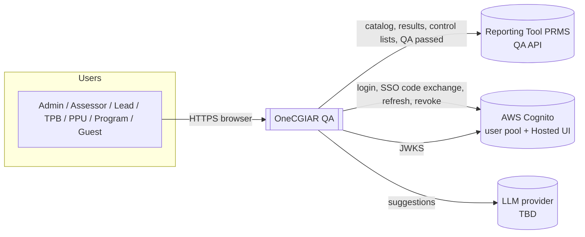
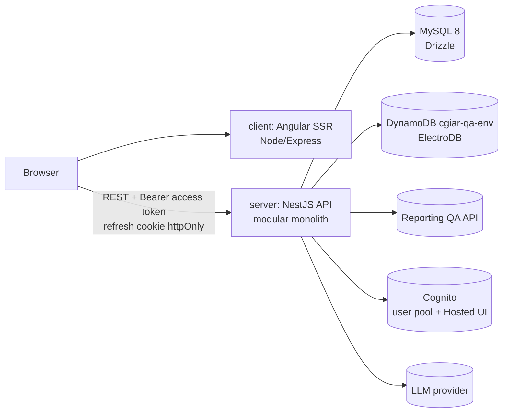

# OneCGIAR QA — Technical Requirements Document

| | |
|---|---|
| Status | Draft v0.1 |
| Last updated | 2026-10-15 |
| Inputs | `docs/prd.md` (business drivers), `docs/ux-ui/design.md`, current repo (`client/`, `server/`) |
| Tier | **LITE** — modular monolith ([ADR-001](#adr-001--modular-monolith-lite-tier)) with one evidenced escalation: polyglot persistence ([ADR-002](#adr-002--mysql-for-workflow-state-dynamodb-for-snapshots)) |

> **In one line:** one NestJS API (modular monolith) and one Angular SSR front; MySQL via Drizzle holds configuration and the assessment workflow, DynamoDB via ElectroDB holds immutable Reporting snapshots, AI predictions and ingestion runs; Cognito tokens are verified locally on every request; Reporting is reached only through its HTTP API.

---

## 1. System Overview

| Part | Path | Stack (as of 2026-10-13) |
|---|---|---|
| Front | `client/` | Angular 22 (standalone, signals, zoneless-ready), SSR (`@angular/ssr` + Express), Tailwind 4, spartan/ui, Vitest — **npm** |
| Back | `server/` | NestJS 12 (ESM), TypeScript 6 strict, `@nestjs/config`, Drizzle ORM + `mysql2`, ElectroDB + `@aws-sdk/client-dynamodb`, Vitest + Supertest, oxlint, Prettier — **pnpm** |
| Relational DB | — | MySQL 8.0 (dev: shared `qadb` on the internal network) |
| NoSQL | — | DynamoDB, single table `cgiar-qa-{env}`, us-east-1 |
| Identity | — | AWS Cognito (user pool + Hosted UI), called directly with QA's own app client |
| Upstream | — | Reporting Tool (PRMS) QA API |

Repository: monorepo, two independent packages (no root workspace). Each package keeps its own package manager.

## 2. Architecture Overview & Decisions

### 2.1 C4 — Context



Legend: `[[ ]]` system in scope · `[( )]` external system · arrows = synchronous HTTPS calls, labeled by purpose.

### 2.2 C4 — Container



Legend: rectangles = deployable containers owned by this repo · cylinders = data stores or external APIs · labels = protocol/payload.

### 2.3 Style and tier

- **Style:** modular monolith with hexagonal edges per module: controllers (in) → application services → ports; adapters for Drizzle repositories, ElectroDB entities, and the Reporting/AI/auth HTTP clients.
- **Tier:** LITE on structure, compute and async; one escalation on data (two stores), justified by QAS-PERF-2 and QAS-MOD-1.

### 2.4 ADR index

| ADR | Decision | Status |
|---|---|---|
| ADR-001 | Modular monolith (LITE tier) | Accepted |
| ADR-002 | MySQL for workflow state, DynamoDB for snapshots | Accepted |
| ADR-003 | Cognito-native auth, local JWKS verification, refresh token in httpOnly cookie | Accepted (pending infra: pool, domains) |
| ADR-004 | Reporting only through its HTTP API, behind an anti-corruption layer | Accepted |
| ADR-005 | Ingestion as in-process background runs, recorded in DynamoDB | Accepted — revisit at threshold |
| ADR-006 | Explicit comment state machine in the domain layer | Accepted |
| ADR-007 | Monorepo with per-package package managers (client npm, server pnpm) | Accepted — revisit |
| ADR-008 | Where SSR runs in PROD | **Open** |
| ADR-009 | LLM provider for AI suggestions | **Open** |

#### ADR-001 — Modular monolith (LITE tier)
- **Issue:** one small team (front lead, back lead, designer, business owner); one product; no module with a divergent availability or scaling target.
- **Decision:** one NestJS deployable with feature modules (§ 4); no microservices.
- **Alternatives:** microservices per domain — rejected, no escalation trigger (team count < deployables, no independent hot path).
- **Implications:** module boundaries are enforced by code review and imports (a module talks to another only through its exported service), so a later split stays possible.

#### ADR-002 — MySQL for workflow state, DynamoDB for snapshots
- **Issue:** the workflow (cycles, roles, comments, decisions) is relational and transactional; Reporting snapshots are large, immutable, schemaless JSON payloads written once and read by key, with field-level AI predictions per snapshot.
- **Decision:** MySQL 8 via Drizzle for configuration, results index, evaluations, comments, decisions, users/roles, AI usage. DynamoDB (single table `cgiar-qa-{env}`) via ElectroDB for `Snapshot`, `Prediction`, `IngestionRun`.
- **Alternatives:** MySQL JSON columns for snapshots — viable, rejected because snapshot volume grows per batch and per sync, and DynamoDB gives cheap immutable append with conditional writes (hash dedupe) without bloating the transactional DB. PostgreSQL — rejected; MySQL is already provisioned and connected.
- **Implications:** no cross-store transactions. MySQL rows reference snapshots by `snapshot_id` (ULID) + hash; a snapshot is written **before** the MySQL row that points to it, so a dangling reference cannot occur (an orphan snapshot is harmless).

#### ADR-003 — Cognito-native auth
- **Decision:** login, new-password, SSO code exchange, refresh and logout revocation go **directly to Cognito** with QA's own app client (user-pool API + Hosted UI). QA holds the app client secret only as the env var `COGNITO_CLIENT_SECRET` (never in code or logs). The API verifies the Cognito **access token** locally against the pool's JWKS on every request (signature, `iss`, `exp`, `token_use=access`, `client_id`). Access token lives in front memory; the refresh token lives in the httpOnly, Secure, `SameSite=Lax` cookie `qa_rt`, plus `qa_ru` (`cognito:username`, needed for `SECRET_HASH` on refresh), both on `Path=/api/v1/auth/session` of the API subdomain (front and API are same-site: `qa.cgiar.org` / `api.qa.cgiar.org`, `qatest.ciat.cgiar.org` / `qatest-serv.ciat.cgiar.org`).
- **Supersedes** the earlier decision "login and refresh through the CGIAR auth microservice" (2026-10-14, spec `auth/cognito-native-session` DD-11). Reason: the microservice used different app clients for custom login and for refresh, so a custom refresh token could never refresh; its SSO tokens also carried a different `aud` than custom tokens.
- **Issuer formats:** two Cognito URLs are in play and must not be mixed. The JWT `iss` is `https://cognito-idp.<region>.amazonaws.com/<poolId>` (what the verifier checks). The Hosted UI domain `https://<domain>.auth.<region>.amazoncognito.com` (`COGNITO_URL`) is used for `/oauth2/authorize` and `/oauth2/token`, never as issuer.
- **Alternatives:** QA-issued tokens (today's model) — rejected (P4). Calling Cognito per request — rejected for latency.
- **Implications:** roles are QA data (MySQL), not Cognito groups; the token gives identity only. CORS allow-list per environment with credentials.

#### ADR-004 — Reporting through HTTP only
- **Decision:** a `reporting` adapter module owns every call to the Reporting QA API and maps payloads to QA's domain types keyed by catalog `field_key`. No module reads Reporting tables.
- **Implications:** contract tests against recorded fixtures; catalog version stored with every field configuration and snapshot.

#### ADR-005 — Ingestion as in-process background runs
- **Decision:** opening a batch creates an `IngestionRun`; a background job in the API process pages the results list, fetches details in lots, validates against the catalog, and writes snapshots (dedupe by hash). Runs are resumable by cursor and idempotent.
- **Revisit when:** a batch cannot finish within the M2 target, or the back moves to Lambda — then move the job to SQS + worker.

#### ADR-006 — Explicit comment state machine
- **Decision:** comment states and transitions (§ 7.3) live in one domain service with a transition table; every transition writes an append-only `comment_events` row (actor, role, from, to, reason).
- **Implications:** the 27 business rules map to transition guards and are tested as a table.

#### ADR-007 — Per-package package managers
- **Decision:** `client/` stays on npm (existing lockfile, CI and deploy scripts), `server/` uses pnpm.
- **Revisit:** a root pnpm workspace if shared packages (e.g. API contract types) appear.

#### ADR-008 — SSR hosting in PROD (open)
- Options: Docker host (as TEST) or Lambda + Lambda Web Adapter + CloudFront (tested on `feature/qa-ssr-lambda`). Today PROD front is static S3 + CloudFront. Owner: infrastructure + front lead.

#### ADR-009 — LLM provider (open)
- Needed by `ai-assist`. Constraint: suggestions are stored per snapshot and field with model id and prompt version.

## 3. Quality Attribute Scenarios (NFRs)

| ID | Attribute | Source → Stimulus | Artifact / Environment | Response | Measure | Tactics |
|---|---|---|---|---|---|---|
| QAS-SEC-1 | Security | Attacker → forged, expired or wrong-client token | API, normal | Request rejected before any handler | 100 % → 401; covered by e2e tests | Local JWKS verification, global guard, deny-by-default |
| QAS-SEC-2 | Security | Authenticated user → action outside their scoped roles | API, normal | Rejected | 100 % → 403; role/scope matrix tested per endpoint | Policy guard per route (role + scope), server-side only |
| QAS-SEC-3 | Security | Any user → malformed input | API | Rejected with field errors | 100 % of DTOs validated; no unvalidated body reaches a service | Validation pipe, whitelist, forbid unknown |
| QAS-PERF-1 | Performance | Assessor → opens a result review page | API + MySQL + DynamoDB, normal load | Page data returned | p95 ≤ 800 ms for a result with ≤ 150 fields | One snapshot `get` by key, indexed MySQL queries, no N+1 |
| QAS-PERF-2 | Performance | Admin → opens a batch | Ingestion, Reporting healthy | Results ready to evaluate | ≤ `[M2 target]` for `[batch size]` (PRD OQ-6) | Batched detail fetch, bounded concurrency, hash dedupe |
| QAS-AVL-1 | Availability | Reporting → down or 5xx mid-ingestion | Ingestion run | Run pauses as `FAILED_RETRYABLE`, no partial result marked ready; resume continues from cursor | 0 results in an inconsistent state; resume needs no manual SQL | Retry with backoff, idempotent writes, run cursor |
| QAS-AVL-2 | Availability | Users → normal working hours | API | Service up | ≥ 99.5 % monthly during an open window (proposed) | Health checks, graceful shutdown, restart policy |
| QAS-MOD-1 | Modifiability | Reporting → adds a field to the catalog | Admin config | Admin can show/configure it | No code change or deploy | Catalog-driven config by `field_key`, schemaless snapshots |
| QAS-MOD-2 | Modifiability | Business → changes a comment rule | Comments module | Change isolated | One transition-table edit + its tests | State machine (ADR-006) |
| QAS-OBS-1 | Observability | Admin/dev → "why is result X not in batch Y?" | Ingestion | Answer from the run record | Every run stores counts, rejected results with reasons, timings | Structured logs with `runId`, `IngestionRun` entity |
| QAS-SCL-1 | Scalability | Cycle volume → 2× results | All | No redesign | Linear cost; DynamoDB on-demand, MySQL indexes | On-demand capacity, pagination everywhere |
| QAS-COST-1 | Cost | Idle periods between cycles | Infra | Low baseline | DynamoDB on-demand; no always-on extra infra beyond API/front hosts | Pay-per-request |

## 4. Domain Modules & Responsibilities

One NestJS module per row under `server/src/<module>/`; spec folders under `docs/specs/` mirror the names.

| Module | Responsibility | Owns (store) | Depends on |
|---|---|---|---|
| `auth` | Token verification guard, current user, Cognito client (login, new-password, SSO code exchange, refresh, revoke), session cookies, Origin check | — | users |
| `users` | Users, roles and role assignments with scope (result type / program) | MySQL | — |
| `admin-config` | Cycles, windows, batches, field configuration per result type and catalog version | MySQL | reporting |
| `reporting` | Anti-corruption client for the Reporting QA API (catalog, results, control lists, QA passed) | — | — |
| `ingestion` | Ingestion runs, validation against catalog, snapshot writing, sync | DynamoDB (`Snapshot`, `IngestionRun`), MySQL (`results`) | reporting, admin-config |
| `evaluation` | Field reviews (approve / comment) per result and batch | MySQL | ingestion, admin-config |
| `comments` | Comment threads and the state machine | MySQL | evaluation |
| `escalation` | Lead escalation, TPB decisions, PPU done | MySQL | comments |
| `ai-assist` | Predictions per snapshot and field; usage tracking | DynamoDB (`Prediction`), MySQL (`ai_suggestion_usage`) | ingestion |
| `history` | Entry/exit snapshots and diffs per result | reads DynamoDB + MySQL | ingestion |
| `dashboards` | Read models for progress | reads MySQL | all (read-only) |

Patterns, each bound to a problem:
- **Repository** (Drizzle/ElectroDB behind ports) — keeps services testable without a DB.
- **Adapter / Anti-corruption layer** (`reporting`) — isolates QA from Reporting's payload shapes (ADR-004).
- **State** (transition table) — comment lifecycle (ADR-006); simpler than scattered `if` checks.
- **Strategy** — field validation per catalog type (text, number, list, hierarchical list, `required_when`/`visible_when`).

## 5. Data Model & Entities

### 5.1 MySQL (Drizzle, `server/src/database/drizzle/schema/`)

| Entity | Key fields |
|---|---|
| `users` | id, cognito_sub (unique, null until first login), cognito_username (set at login; needed for refresh), email (unique, lowercase), first_name, last_name, auth_source (`sso`, `custom`), is_active, last_login_at, created_by |
| `roles` | id, code (ADMIN, ASSESSOR, LEAD_ASSESSOR, TPB, PPU, PROGRAM; unique), name, scope_type (global, result_type, program), is_active |
| `role_assignments` | id, user_id, role_id, result_type_key, program_id (at most one set, matching the role's scope_type), is_active, created_at/by, revoked_at/by (active or revoked, history kept; no duplicate active assignment per user, role and scope) |
| `cycles` | id, phase_year, name, status |
| `windows` | id, cycle_id, name, opens_at, closes_at |
| `batches` | id, window_id, name, status (DRAFT, OPEN, CLOSED), opened_at |
| `field_configs` | cycle_id, result_type, field_key, catalog_version, shown, core, commentable, ai_input |
| `results` | id, reporting_result_id, code, result_type, program_id, batch_id, entry_snapshot_id, latest_snapshot_id, exit_snapshot_id, status, quality_assessed_at |
| `field_reviews` | id, result_id, batch_id, field_key, assessor_id, decision (APPROVED, COMMENTED), snapshot_id |
| `comments` | id, field_review_id, author_id, body, state, is_core |
| `comment_events` | id, comment_id, actor_id, actor_role, from_state, to_state, body, created_at (append-only) |
| `ai_suggestion_usage` | id, prediction_id, user_id, field_review_id, prompt_version, copied_at |

### 5.2 DynamoDB single table `cgiar-qa-{env}` (ElectroDB, service `qa`)

| Entity | pk | sk | Notes |
|---|---|---|---|
| `Snapshot` | `RESULT#<reportingResultId>` | `SNAP#<capturedAt>#<hash>` | Full Reporting payload, catalog version, batch id, source (ENTRY, SYNC, EXIT). Conditional put on hash → no duplicates. Immutable. |
| `Prediction` | `SNAP#<snapshotId>` | `FIELD#<fieldKey>` | Suggestion text, model id, prompt version, created_at |
| `IngestionRun` | `BATCH#<batchId>` | `RUN#<startedAt>` | Status, cursor, counts, rejected results with reasons |

GSI candidates (decided in the ingestion spec): runs by status; snapshots by batch.

## 6. API Surface & Contracts

- REST, JSON, prefix `/api`, URI versioning `/api/v1/...`.
- Every route authenticated by default; public routes opt out explicitly (`GET /api/v1/health`, login, complete-new-password, provider-url, callback, session refresh and logout).
- Errors use one envelope: `{ statusCode, error, message, details?, requestId }`.
- Pagination: cursor-based (`?cursor=&limit=`) for lists that can grow (results, history).
- Contract types are owned by `server/` DTOs; the front mirrors them until a shared package exists (ADR-007).

Auth routes (`/api/v1/auth/*`): `POST login`, `POST complete-new-password`, `GET provider-url`, `POST callback` (public, throttled), `POST session/refresh` and `POST session/logout` (public, **Origin-checked**, cookie-only: no body, no bearer token), `GET me` (authenticated). Every POST under `/auth/*` requires `application/json`. `GET /api/v1/health` is public and returns 200 `{ "status": "ok" }`.

Initial resource map: `/auth/*`, `/users`, `/role-assignments`, `/cycles`, `/windows`, `/batches`, `/batches/:id/ingestion-runs`, `/field-configs`, `/results`, `/results/:id/fields`, `/field-reviews`, `/comments`, `/comments/:id/events`, `/results/:id/history`, `/dashboards/*`.

## 7. Backend Workflows & Business Rules

### 7.1 Batch open → ingestion
1. Admin opens batch → `IngestionRun` (RUNNING).
2. Page Reporting results list (eligible for the cycle/batch) → fetch details in lots.
3. Validate each payload against the catalog version (types, control lists, `required_when`/`visible_when`, `$result_type`).
4. Hash payload → conditional put `Snapshot` (ENTRY) → upsert `results` row.
5. Rejected results recorded on the run with reasons. Run → COMPLETED / FAILED_RETRYABLE.

### 7.2 Sync during evaluation
Scheduled per open batch: re-fetch details; new hash → new `Snapshot` (SYNC) and `latest_snapshot_id` moves; field reviews keep the snapshot they were made on.

### 7.3 Comment state machine (proposed — the 27-rule document is authoritative, PRD OQ-1)

```
OPEN ──program──▶ ACCEPTED | ACCEPTED_WITH_COMMENT        (closed)
OPEN ──program──▶ CLARIFICATION_REQUESTED ──assessor──▶ OPEN
OPEN ──program──▶ DISAGREED
DISAGREED ──lead, core field only──▶ ESCALATED
ESCALATED ──TPB──▶ TPB_SIDED_PROGRAM                       (closed)
ESCALATED ──TPB──▶ TPB_SIDED_ASSESSOR ──PPU──▶ DONE        (closed)
```

### 7.4 Closure
A result is **Quality Assessed** when it has field reviews for all shown fields and no comment in a non-closed state; then `exit_snapshot_id` is set and Reporting is notified (endpoint TBD, PRD OQ-2). Notification is retried until acknowledged.

### 7.5 AI
Predictions are generated per snapshot and AI-input field (async after ingestion). AI output is never written to `field_reviews` or `comments`; only a user's explicit copy creates content, recorded in `ai_suggestion_usage`.

## 8. Frontend Architecture & State Boundaries

- Standalone components, signals for state, `computed`/`linkedSignal` for derived state, lazy routes per workspace section (`client/CLAUDE.md`).
- **Server state** via `httpResource`/services per feature; **UI state** in component signals; no global store unless a spec justifies it.
- Access token kept in memory in an auth service; an HTTP interceptor attaches it and refreshes on 401 once (refresh cookie sent with `withCredentials`).
- SSR: `/login` prerendered; authenticated routes render client-side (current setting on `feature/qa-ssr-lambda`). `NG_ALLOWED_HOSTS` and `NG_TRUST_PROXY_HEADERS` set per environment.
- Mock data in `*.mock.ts` files next to the page until the API exists.

## 9. Integration Points

| Integration | Direction | Status | Notes |
|---|---|---|---|
| Reporting `GET /api/qa/catalog?phase_year=` | QA → Reporting | Available (v2026.30) | Sections, fields, types, control lists, `required_when`/`visible_when`, `$result_type` |
| Reporting results (list + batched detail) | QA → Reporting | TBD | Values keyed by `field_key` |
| Reporting control lists | QA → Reporting | TBD | `level`, `parent_id` for hierarchical lists |
| Reporting "QA passed" | QA → Reporting | TBD | Idempotent, retried |
| Cognito user pool + Hosted UI | API → Cognito | Available (callback `http://localhost:4200/auth/callback` registered 2026-10-14; TEST/PROD https callbacks pending with the pool owner) | Login, new-password, SSO code exchange, refresh, `RevokeToken` (ADR-003) |
| Cognito JWKS | API → Cognito | Pending pool | Cached keys, refresh on unknown `kid` |
| LLM provider | API → provider | TBD (ADR-009) | |

## 10. Security & Authorization Model

- **Authentication:** ADR-003. A global guard verifies the access token; `@Public()` opts out.
- **Authorization:** policy guard resolves the user's active `role_assignments` and checks role + scope against the resource (result type of the result, program of the result). GUEST = authenticated user without grants → read-only routes.
- **Transport & browser:** HTTPS only; CORS allow-list per env with credentials; refresh cookie httpOnly + Secure + SameSite=Lax; Helmet headers; rate limiting on auth routes.
- **Secrets:** env vars in dev (`server/.env`, git-ignored); a secrets manager in TEST/PROD (see `docs/infrastructure.md`). Never in the repo.
- **Audit:** `role_assignments` keeps created/revoked history; `comment_events` is append-only.

## 11. Error Handling & Observability

- Domain errors as typed exceptions mapped by one global exception filter to the error envelope; unknown errors → 500 without internals.
- Async jobs (ingestion, sync, AI, Reporting notify) never swallow errors: status on the run record + structured log.
- Structured JSON logs with `requestId`, `userId`, `runId`; health endpoint for the host's checks.
- Graceful shutdown closes the MySQL pool and DynamoDB client (already wired in `server/`).

## 12. Testing Strategy

| Level | Tool | Scope | Gate |
|---|---|---|---|
| Back unit | Vitest + `@nestjs/testing` | Services, state machine (table tests), validators | Every task |
| Back e2e | Vitest + Supertest | HTTP surface, auth/roles matrix, error envelope | Tasks that change routes |
| Contract | Recorded Reporting fixtures | `reporting` adapter | Ingestion specs |
| Front unit | Vitest (`@angular/build:unit-test`) | Components, services | Every front task |
| E2E | Not chosen (Playwright proposed) | Critical flows | Before first release |
| Accessibility | AXE in front tests | Every screen | Front tasks |

Commands (failure-only output) are listed in `AGENTS.md` § Verification commands.

## 13. Technical Constraints & Assumptions

- `field_key`s are permanent; snapshots are immutable; AI never acts on its own; no manual SQL to operate a cycle (PRD § 8).
- Migrations via drizzle-kit (`pnpm db:generate` / `db:migrate`), committed under `server/drizzle/`; never hand-edited in shared DBs.
- Env vars (server): `DATABASE_URL`, `DATABASE_POOL_SIZE`, `AWS_REGION`, `DYNAMODB_TABLE_NAME`, `DYNAMODB_ENDPOINT` (local only), plus auth and Reporting settings added by their specs.
- **Revisit conditions:** ingestion exceeds the M2 target → queue + worker (ADR-005); shared types between client and server → root workspace (ADR-007); back moves to Lambda → revisit pool sizing and in-process jobs.
